> 원문: <https://www.a16z.news/p/charts-of-the-week-job-fud-fades>

---

## 일자리 공포가 잦아들다

지난주 마이크로소프트가 임직원 6만 명, 전체 인력의 4분의 1에 가까운 규모,에게 자발적 퇴사 제안을 내보냈다는 보도가 나왔다. 전원이 "좋습니다"라고 답하면 100억 달러가량의 비용이 드는 안이다.

회사는 AI를 이유로 들지 않았다. 마이크로소프트의 CFO는 목표가 "임직원에게 선택권을 주는 것"이며, 내부 이동 기회가 여전히 많아 신청률은 높지 않을 것으로 보고 있다고 말했다. 다른 사람들도 크게 "AI가 모든 일자리를 가져간다"는 서사로 만들려 들지 않았다. AI가 조금이라도 개입했다고 보는 쪽의 추측은 비용 절감의 숨은 동인으로 마이크로소프트의 대규모 설비 투자(Capex) 약속을 가리켰다.

사실인지는 모른다. 다만 큰 그림에서는 5월의 절정에 비해 "AI 일자리 종말" 공포(FUD)가 누그러든 것이 맞다.

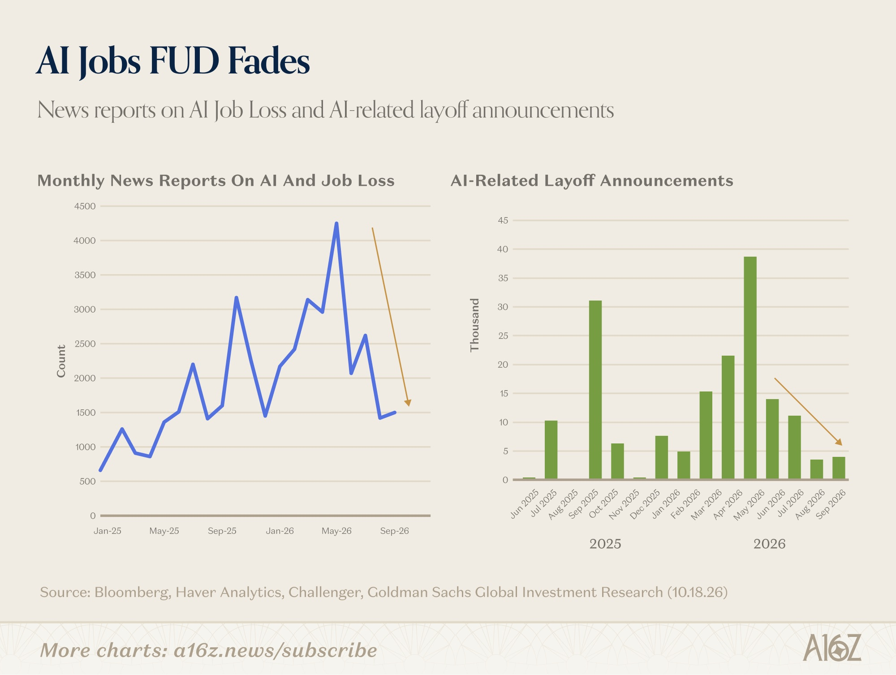

AI와 일자리 상실을 다룬 뉴스 보도는 대략 1년 전 수준으로 돌아갔고, 8월과 9월에 공개된 "AI 관련" 구조조정 발표는 올해 중 가장 적었다.

AI가 노동력을 바꾸고 있지 않다는 뜻도, 그 변화가 여전히 초기 국면에 머물 것이라는 뜻도 아니다. 당시나 지금이나 AI가 일자리를 광범위하게 대체한다는 성급한 선언에는 근거가 없었고, doomers는 다른 주제로 옮겨간 듯하다.

공포가 잦아든 데에는 반대 방향의 증거가 쌓이고 있기 때문이기도 하다. AI(혹은 다른 무언가)가 기술직과 비기술직 모두의 수요를 뚜렷하게 늘리고 있다는 것이다.

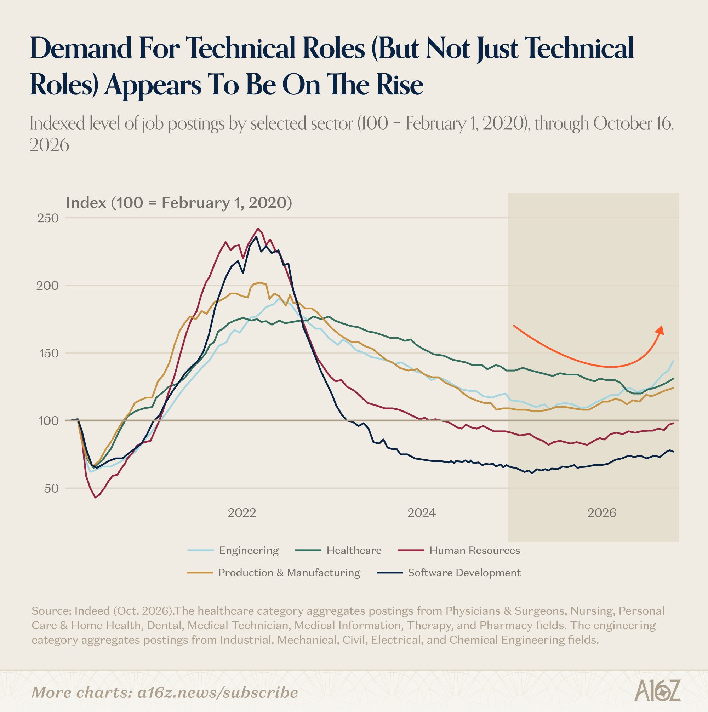

Indeed 데이터를 보면 소프트웨어 엔지니어, 제조, 그리고 특히 엔지니어링 채용 공고가 작년부터 상승 반전을 이어간다. 추가 채용의 선행 신호로 여겨지던 HR 직군도 겨우 팬데믹 이전 수준을 회복했다.

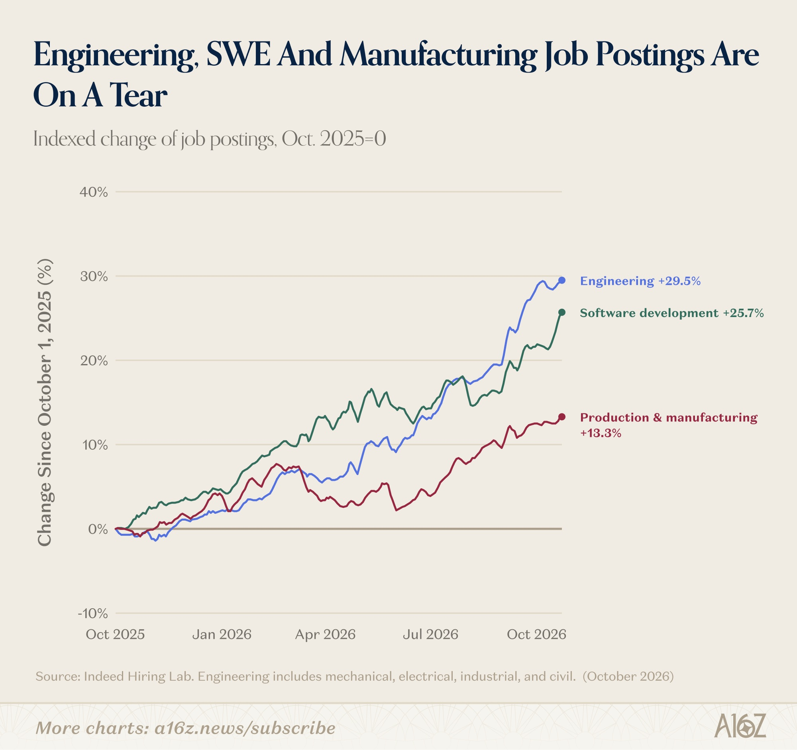

기술직을 좁혀 보면 개선세가 더 뚜렷하다. 작년 10월 이후 엔지니어, 소프트웨어 엔지니어, 제조 채용 공고가 각각 약 30%, 26%, 13%씩 늘었다.

AI가 등장하니 AI 인프라를 짓는 사람과 AI를 써먹는 사람의 수요가 동시에 늘었다는 얘기다. 놀랍지 않은가.

한편 Charts는 설비 투자 붐이 만든 "현장 노동직" 수혜를 자주 다뤄왔는데, Lightcast의 재미있는 관찰이 하나 있다. 폭파 전문직이 대부분의 주에서 꽤 수익성 좋은 직업이라는 것. 특히 노스캐롤라이나와 뉴욕이다.

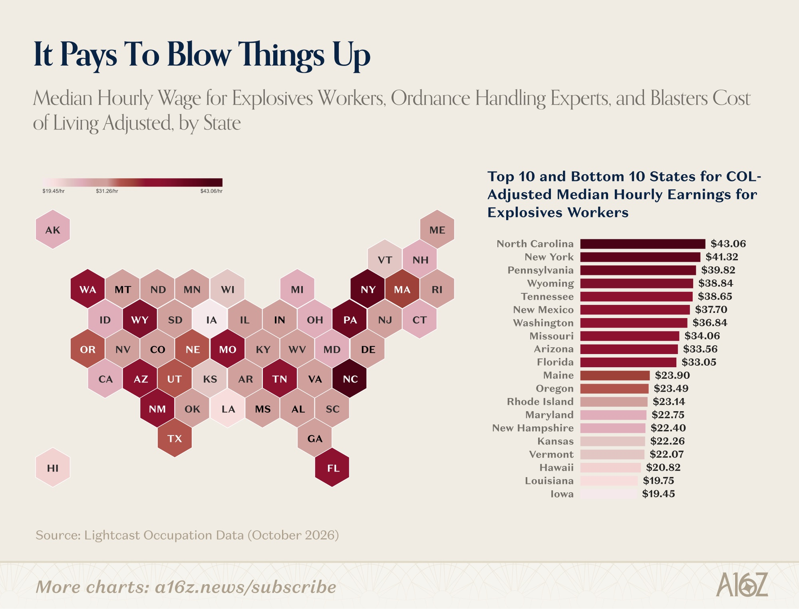

시간당 중간값이 30달러 안팎이니, 폭파 기술자의 중간 임금은 전체 노동자 중간값보다 20~25% 높다.

폭파 전문직에 대한 재미있는 사실이 하나 더 있다. 숙련 기술직 전반이 고령화된 것과 달리 폭파업 종사자는 젊다.

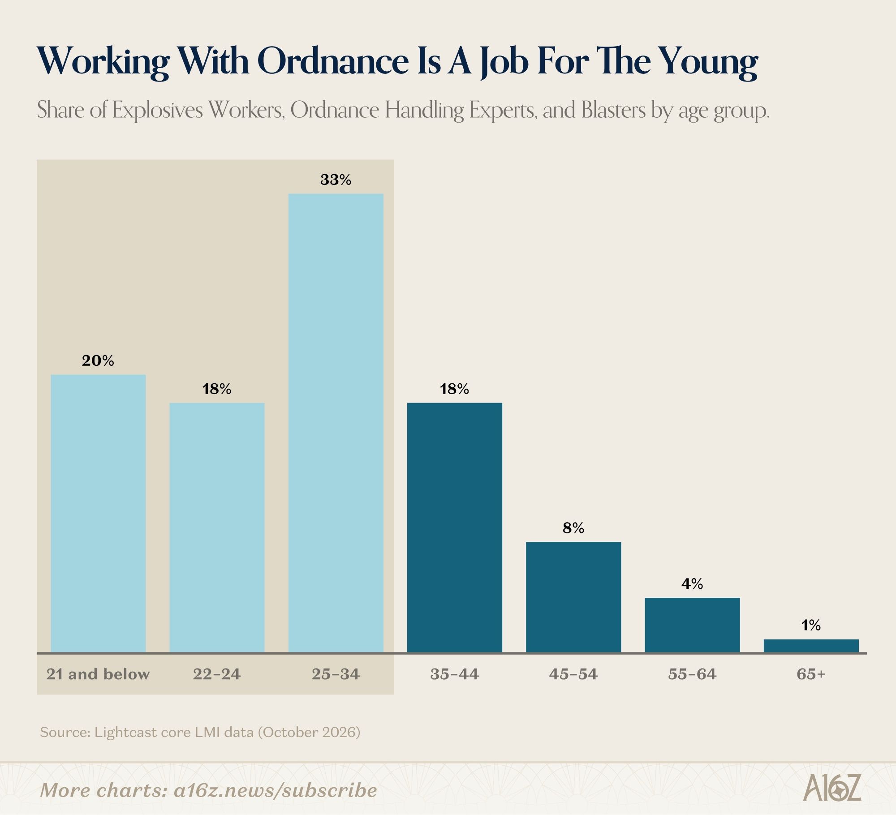

폭파업 종사자의 약 71%가 34세 이하다.

물론 이 데이터에는 유보가 필요하다. 생활비를 보정한 뒤에도 주별 폭파업 중간 임금의 편차가 상당히 크다. 헤드라인 수치는 의심해볼 만하다는 뜻이다. 표본 구성과 표본 크기가 작용하는 부분이 크다. 디플레이터 쪽을 보면, 뉴욕 주 전체 디플레이터로는 뉴욕의 대도시권과 실제로 폭파가 이뤄질 지역 사이의 생활비 격차를 제대로 잡아내지 못한다. "폭파업 종사자"의 정의도 주말로 다르다. 노스캐롤라이나의 군수품 전문가, 캘리포니아의 특수효과 담당자, 아이오와의 탄약 공장 라인 노동자는 같은 직업이 아니다.

그래도 젊고 배움에 굶주렸다면 코딩, 용접, 그리고 폭파를 배울 좋은 시기인 것 같다.

아직은 아니다, AI 일자리 종말. 아직은 아니다.

## AI가 안내하고, 소비자가 승인한다

Charts는 앞서 에이전틱 쇼핑은 아직 초기 단계지만, 사람들이 체크아웃 단계를 AI에게 맡기는 데 꽤 준비돼 있다는 데이터가 있다고 적었다. 이것이 소비자가 쇼핑 과정에서 AI를 점점 덜 쓰고 있다는, 혹은 전자상거래 전반이 둔화되고 있다는 뜻은 아니다. 오히려 온라인으로 물건 사기는 갈수록 인기가 커지는 중이다.

Visa를 보자. 신용카드 결제망의 거인이 전자상거래의 완벽한 대리 지표는 아니지만 근사치로는 충분하다. Visa는 이번 회계연도에 M&A와 팬데믹 회복 연도를 제외하면 15년 만에 가장 큰 연간 매출 증가를 기록했다.

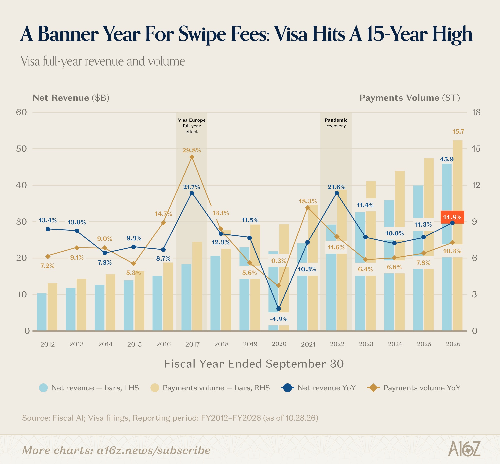

지난 회계연도에 Visa는 15.7조 달러의 거래액에서 약 460억 달러의 매출을 올렸고, 전년 대비 증가율은 15%에 가깝다. 이미 크고 성숙한 사업치고는 스와이프와 스와이프 수수료가 어마어마하다.

이것은 이미 일어난 일이다. 앞으로에 대해서도 데이터는 소비자의 전자상거래 식욕이 커지고 있음을 가리킨다. Bain의 소비자 조사에서 전자상거래 최대 성수기인 연말 쇼핑에 대한 구매 의향이 전반적으로 늘었다.

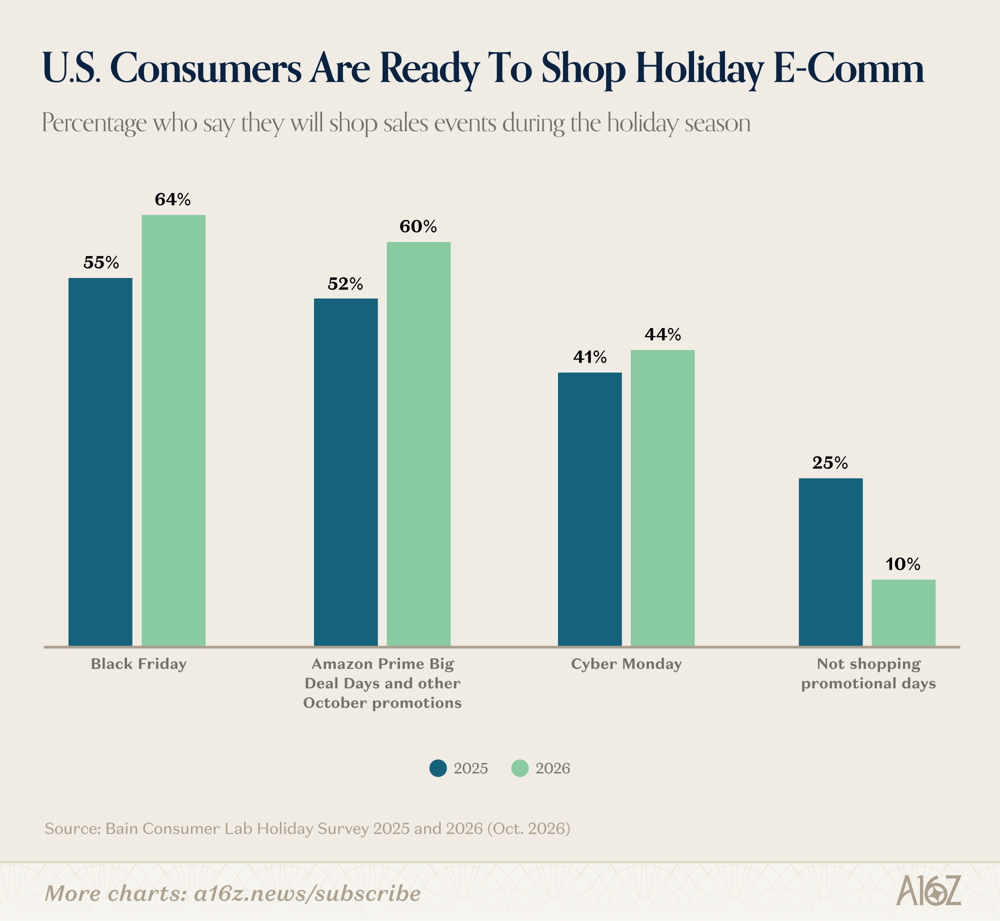

블랙 프라이데이, 프라임 데이, 사이버 먼데이에 쇼핑하겠다는 답변이 늘었고, 이 장사를 아예 피하겠다는 사람은 10%뿐이었다.

요점은 이것이다. 전자상거래는 이미 크고, 정체되기는커녕 전체 소매판매 지출에서 차지하는 비중을 계속 키우고 있으며, 둔화 조짐은 보이지 않는다.

자, 이게 에이전틱 쇼핑이랑 무슨 상관인가? 아마 아무 상관 없을 수도 있고, 그렇지 않을 수도 있다.

소비자가 AI를 가장 즐겨 쓰는 용도 중 하나가 가격 비교라는 점을 상기하자. 그렇다면 전자상거래 프로모션이 절정에 달하는 시즌은 AI가 빛나기에 특히 좋은 시기다. AI는 소비 여정의 탐색과 숙고 단계에서도 인기가 커지는 중이고, "AI가 안내한(AI referred)" 쇼핑객이 상대적으로 구매 의도가 높은, 지갑을 이미 꺼내 든 채 도착하는 집단이라는 증거도 있다.

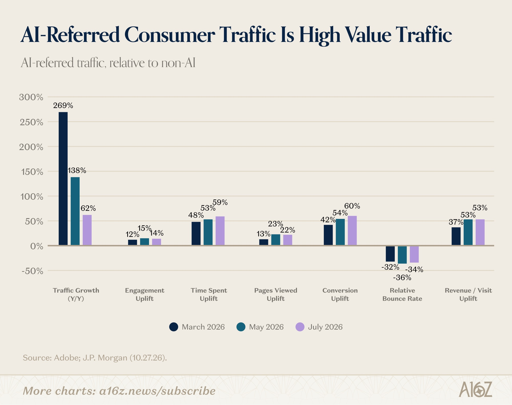

Adobe 데이터로 보면 AI가 안내한 전자상거래 트래픽은 더 많이 상호작용하고, 더 오래 머물고, 더 많은 페이지를 보고, 전환 가능성이 더 높으며(이탈 가능성은 낮고), 가장 중요한 것은 비AI 트래픽 대비 매출이 약 50% 높다는 점이다.

AI 보조 쇼핑의 초기 성적은 나쁘지 않다. 흥미롭게도 구글 스스로가 AI 요약 검색이 기존 검색 수익화에 하방 압력을 넣고 있다고 언급했다. 구글은 혁신가의 딜레마를 목격했고, 올인했다.

다른 곳에서도 AI가 소비 여정에서 수익을 내고 있다는 단서가 보인다. 광고에 대해 뭐라도 아는 메타의 평균 광고 단가(미국과 캐나다 기준)는 2분기 연속 전년 대비 20% 이상 올랐다.

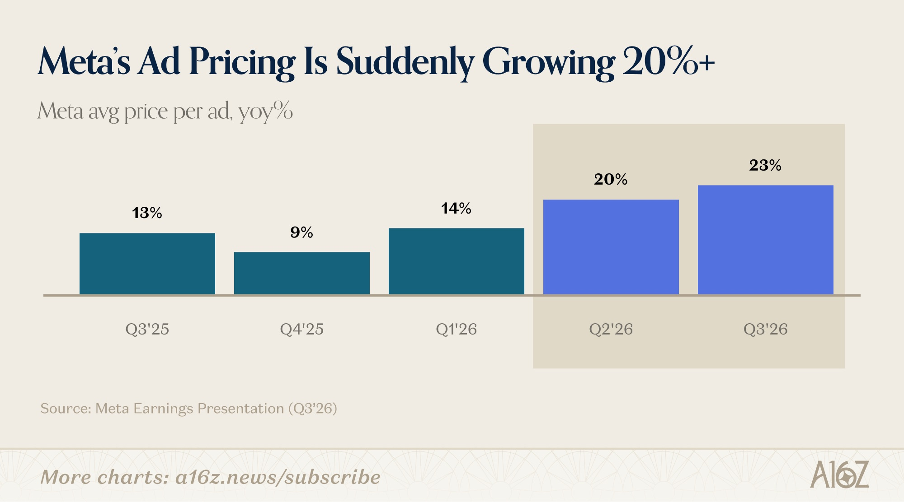

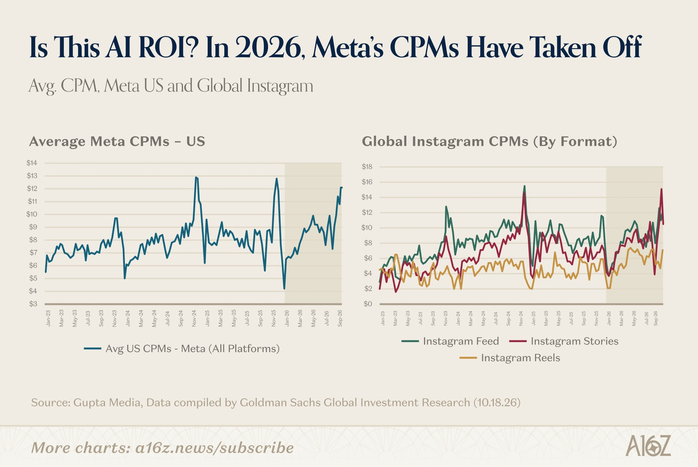

메타의 평균 CPM은 2024년과 2025년 대부분 기간(계절적 스파이크는 별개로) 안정돼 있었다. 그래서 최근의 상승 반전은 오래된 흐름이 아니라 실제 변곡점이다. 주로 피드와 스토리가 주도한다. 메타가 AI로 내부 엔진을 개선하고 있다고 시사해온 만큼 그것이 이야기의 일부일 수 있다. 어느 쪽이든 광고 수익화의 뚜렷한 점프다.

큰 그림에서 보면 AI 쇼핑 에이전트가 오는가 여부와 별개로, AI가 소비자 행동에 영향을 주고 있고, 전자상거래를 가능하게 하는 운영자들(과 그들의 경제학)의 밸류체인 위아래로도 영향을 주고 있다는 것은 분명해 보인다. 결제와 탐색, 물론 전자상거래 사업자 자신에게는 호재다. 동시에 기존 기업과 도전자에게 전혀 다른 영향을 줄 수 있는, 빠르게 바뀌는 지형이기도 하다.

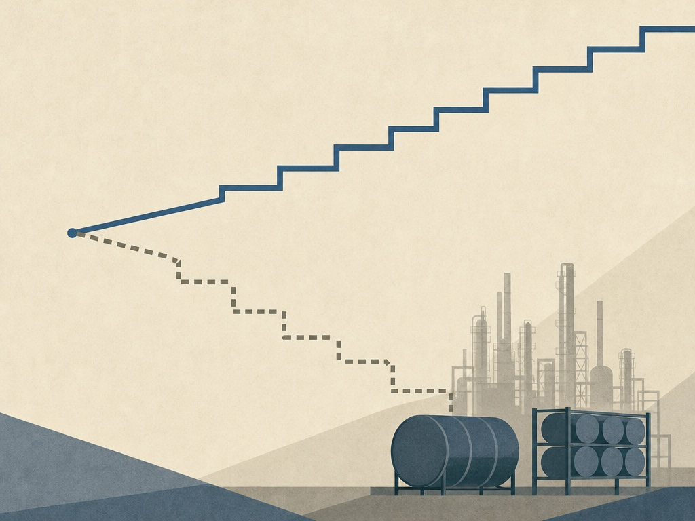

## 랙 스프레드가 온다(그런데 왜)?

AI의 ROI와 이것이 건설 붐의 최대 지출자들에게 주는 의미라는 주제로, Charts는 공포(FUD)의 이면에 있는 데이터는 아니지만 FUD에서 두드러진 역할을 하는 데이터를 잠시 돌아본다.

그렇다, 눈치챘겠지만 지금 FUD가 공기 중에 있다. 봄에는 AI가 너무 좋아서 모든 일자리를 가져갈까 걱정했다면, 지금의 걱정은 AI가 그렇게 좋지 않아서 엄청난 설비 투자를 지출 규모에 상응하는 시간 안에 감당할 만한 수익으로 만들지 못할 것이라는 것이다. AI가 충분한 수익을 내지 못하면 설비 투자는 느려지고, 반도체 기업들은 시들고, "거품은 터진다." 그런 이야기다. Charts는 강세론과 약세론 어느 쪽이 옳은지에 대해 어떤 견해도 내지 않는다. 다만 지금 당장은 약세론이 우세하다는 사실을 관찰할 뿐이다.

예컨대 이 건설 붐(과 반도체 기업들)의 부채를 보험으로 담보하는 비용은 한여름 이후 급등했다.

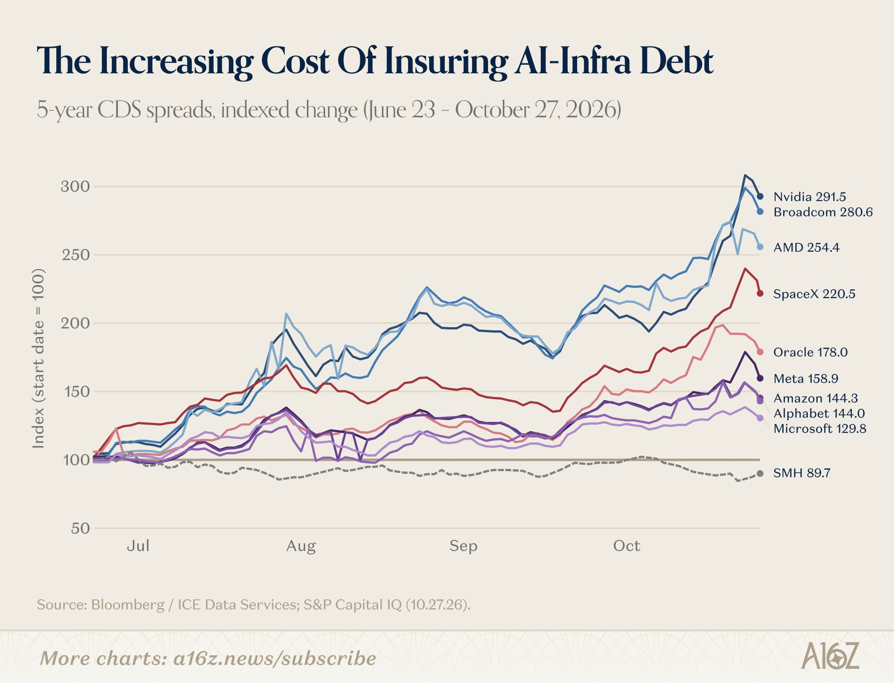

일반적으로 부채 보험 비용이 오르면 시장이 인식하는 디폴트 가능성도 오르고 있다는 뜻이다. 당연히 기초 투자의 회수에 대한 우려가 커지면 디폴트 가능성 인식도 커진다.

공정하게 말하면 이것이 전부 AI 공포는 아니다. 전반적인 부채 비용도 올랐고, 새로 발행되는 채권이 많아지면서 수요와 공급의 역학도 작동한다. 디폴트 리스크만이 오늘의 차입 비용 프리미엄을 만드는 유일한 요인은 아니다. 다만 이번 경우에는 분명 도움이 되지 않는다.

감성 변화의 또 다른 인상적인 사례다.

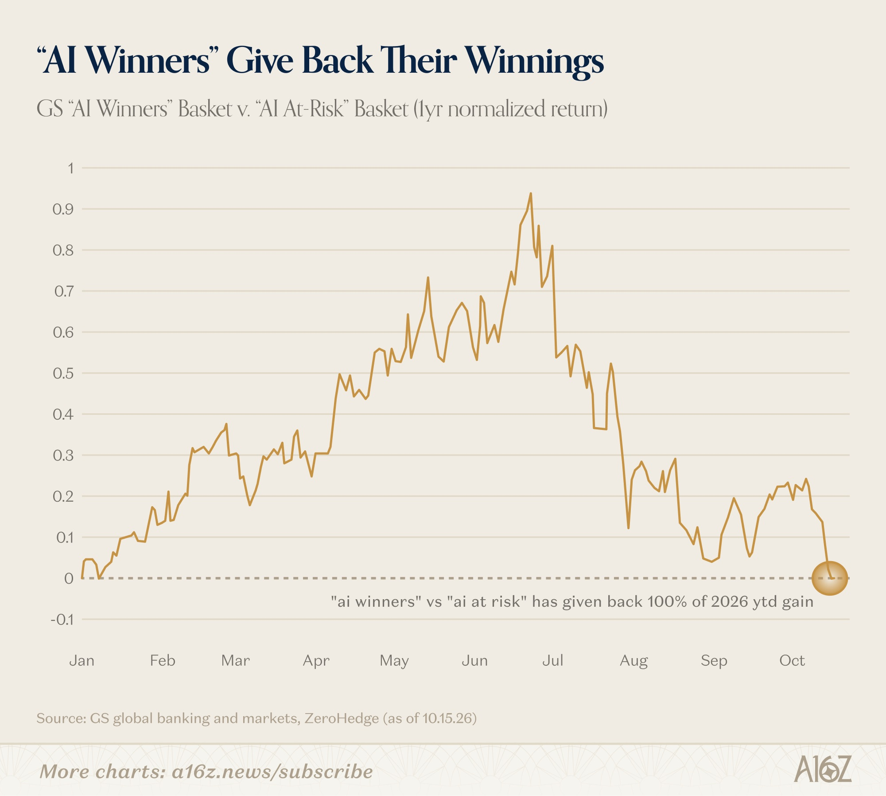

골드만의 "AI 승자" 바스켓은 "AI 위기" 바스켓 대비 상대 수익을 모두 반납했다. 이것도 두 계절의 이야기다. 1월부터 6월까지는 승자가 크게 이겼고, 7월부터 10월까지는 승자들이 성층권 상승보다 더 빠르게 지표면으로 추락했다.

좋다, 그런데 FUD가 있다는 사실 자체가 요점은 아니다.

요점은 FUD 서사에서 두드러진 역할을 하는 차트 하나에 초점을 맞추는 것이다.

그 차트는 최근 "크런치 스프레드"라는 이름이 붙었지만, a16z의 Editor-at-Large Alex Danco가 지적했듯 "랙 스프레드"가 훨씬 나은 이름이다(이유는 곧 보인다). 버전이 몇 가지 있지만 요지는 이렇다.

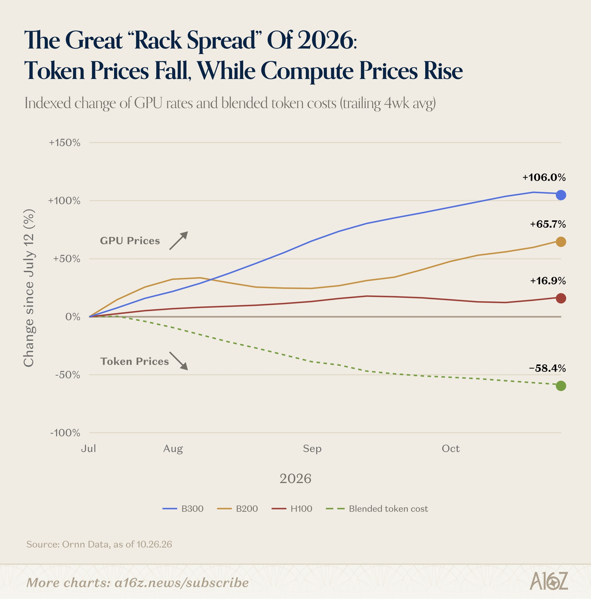

토큰 가격은 떨어지는데 GPU 대여 요금은 오르고 있다.

랙 스프레드는 원유와 정제 제품의 가격 차이를 가리키는 상품 시장의 잘 알려진 지표, 크랙 스프레드(Crack Spread)를 빌린 것이다. 서버 랙을 가리키면서 "크랙"과 발음이 훨씬 비슷한 "랙"이 "크런치"보다 훨씬 뛰어난 이름인 이유가 이제 보일 것이다.

- 원유에서 크랙 스프레드는 수요와 공급의 불균형이 어디에 자리하는지 알려준다. 땅에서 원유를 뽑아 바다 건너 옮기는 쪽인가, 아니면 정제 제품을 최종 수요에까지 전달하는 쪽인가.
- AI에서는 GPU가 원유, 토큰이 정제 제품(그러면 모델은 정유사)이라는 발상이다. 그렇다면 랙 스프레드, 즉 연산 가격과 토큰 가격의 차이는 연산 기반층의 수요가 상대적으로 높고, 파생물인 토큰층에는 상대적 과잉이 있다는 신호가 된다.
- 함의는 모델층에 나쁜 소식이라는 것이다. 토큰이 점점 대체 가능한 상품(commodity)이 된다는 뜻이고, 그렇다면 연산층에도 나쁜 소식이다. 토큰이 상품이라면 다음 최고의 것을 훈련하려고 연산에 큰돈을 쓸 이유가 없어지니까. 대체로 그런 이야기다.

그러나 크랙 스프레드 유추가 맞지 않는 이유가 몇 가지 있다. 우선 원유와 그 파생물은 물량에 묶여 있고, 원유 제품의 최종 수요도 비교적 알려져 있다. 원유에서 나온 것보다 휘발유를 더 만들 수는 없다. 그래서 동일 물량 단위의 가격 차이를 측정하는 크랙 스프레드는 일정량의 원유를 일정량의 다른 것으로 바꾸는 특정 프리미엄을 알려준다. 정유사 마진의 대체로 고정된 상한이고, 물량으로 만회하기 어렵다. 특히 원유 총수요가 크게 움직이지 않을 때는 더욱 그렇다. 다르게 말하면 크랙 스프레드는 에너지 파이가 채굴자와 정유사 사이에서 어떻게 나뉘는지를 알려주는 탄탄한 지표다.

GPU와 토큰에는 그에 상응하는 측정 단위가 없다. GPU 한 통에 상응하는 토큰 한 통 같은 것은 없다. 토큰 가격은 떨어질 수 있지만 토큰 물량은 계속 늘 수 있고, 그렇다면 토큰 지출 총액도 늘 수 있다. 그것은 모델에 좋은 소식이고, 토큰 수요의 상한은 위로 움직이는 목표다. 동시에 고정된 것이 아닌 경제 파이에서 힘의 균형이 어느 쪽으로 기우는지, 하물며 최종 정산에서 누구의 마진이 어떤지 거의 아무것도 말해주지 않는다.

그래도 한 가지는 남는다. 랙 스프레드가 토큰 비용 하락과 함께 주목받기 시작한 7월 언저리와, 공공시장의 AI 공포가 퍼지기 시작한 시점 사이에는 눈으로 보이는 상관관계가 있다. 크랙 스프레드 유추가 타당한 것과 별개로, 시장은 특히 토큰 가격 하락이라는 사실에서 약세의 "AI 수요" 신호를 읽어내고 있는 듯하다.

그런데 여기가 진짜 요점이다.

첫째, 이런 가중평균 가격/토큰 지수를 표면값대로 받아들여도, 전체 토큰 지출은 늘고 있다는 뜻이 나온다. 그러나 더 중요한 것은 표면값으로 받아들여서는 안 된다는 점이다. 방향성으로는 흥미롭고 유용한 지표인 것은 확실하다(Charts도 전에 썼고 앞으로도 쓸 것이다). 그러나 이 지수는 모두 작고 편향된 표본에서 나온 것이고, 토큰 물량과 토큰 지출의 "진실(ground truth)" 수요를 반영하지 못한다. 벤더들 스스로 그렇게 공개한다.

Ramp, OpenRouter, Silicon Data, Ornn 어느 것을 보든, 토큰 물량과 지출은 그것들을 해당 벤더에 노출하는 소수의 사용자 집단에서 나온 값이다. 수요의 사자의 몫을 차지하는 대기업 대부분은 노출하지 않는다. 오히려 지출과 토큰 사용량을 벤더에 노출하는 사용자야말로 토큰 지출 관리와 최저가 모델 라우팅에 가장 신경 쓰는 집단일 가능성이 높다. 다시 말한다. 표본은 작고 편향돼 있다. 그리고 다시 말하지만 이 출처들 어느 것도 그렇지 않다고 주장하지 않는다. 자신들이 측정하는 것에 대해 모두 투명하다.

이것이 $/토큰 데이터를 나쁘거나 쓸모없게 만드는 것은 아니다. 다만 사람들이 생각하는 것보다 실제 토큰 소비와 지출에 대해 훨씬 적은 것을 말해준다는 뜻이다. (여러 이유로 여기서 다루지 않겠지만 GPU 지수 가격은 비교하면 훨씬 강한 신호다. 거기에도 한계는 있지만.)

"토큰 지출"에 대한 냅킨 수학을 보자.

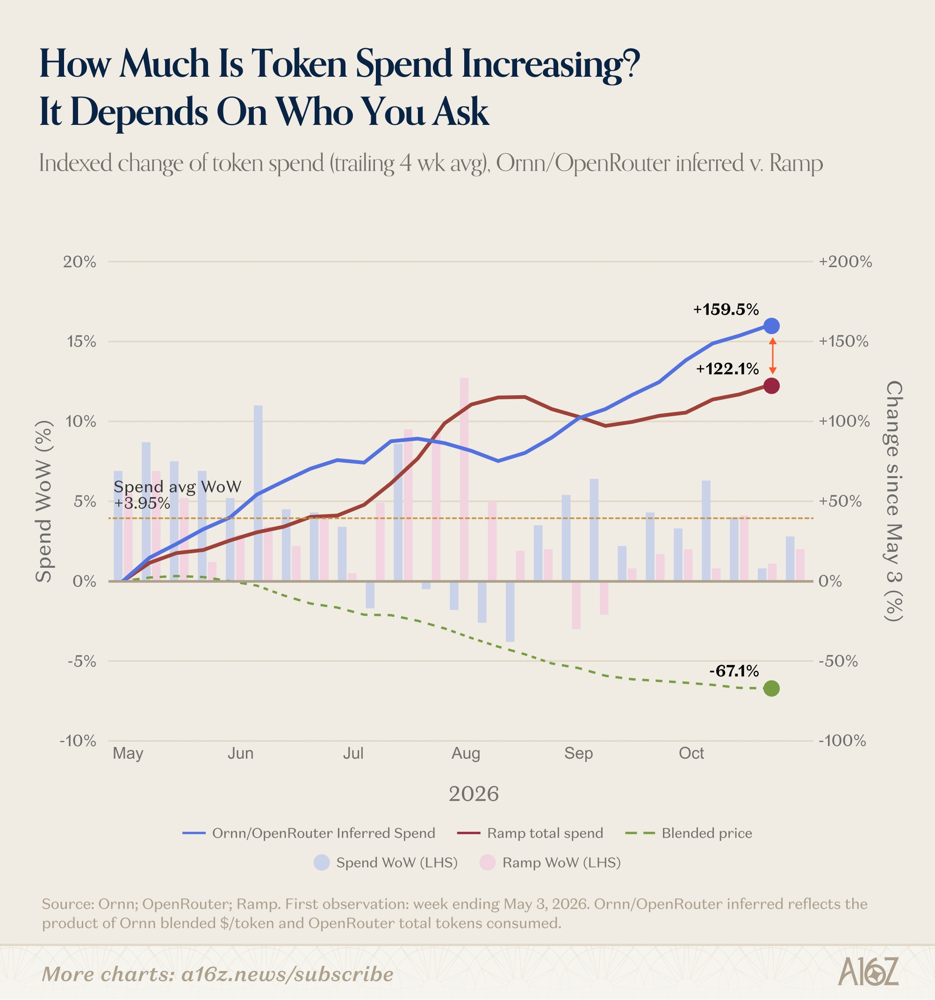

Ornn의 블렌디드 토큰당 가격에 OpenRouter의 토큰 물량 데이터를 곱하면, 엄밀한 방법론이 아니라는 전제 하에, 5월 이후 토큰 지출이 약 160% 늘었다는 계산이 나온다. Ramp의 토큰 지출 데이터를 쓰면 증가는 하되 약 122%다.

방향은 비슷한 숫자다. 그런데 이 편향된 우주(상당한 중복이 있을 수 있다) 안에서조차 지능 수요라는 지극히 중요한 프록시 주변에 여전히 상당한 분산이 있다. 시장이 모자를 걸기로 한 것이 그거라면, 놀라운 일이다.

AI 지출 데이터가 실제로 얼마나 시끄러운지 보여주는 또 다른 사례가 있다. 애틀랜타 연준의 최근 조사에서 직원 1인당 평균(mean) AI 지출이 1,000달러를 넘었다고 한다.

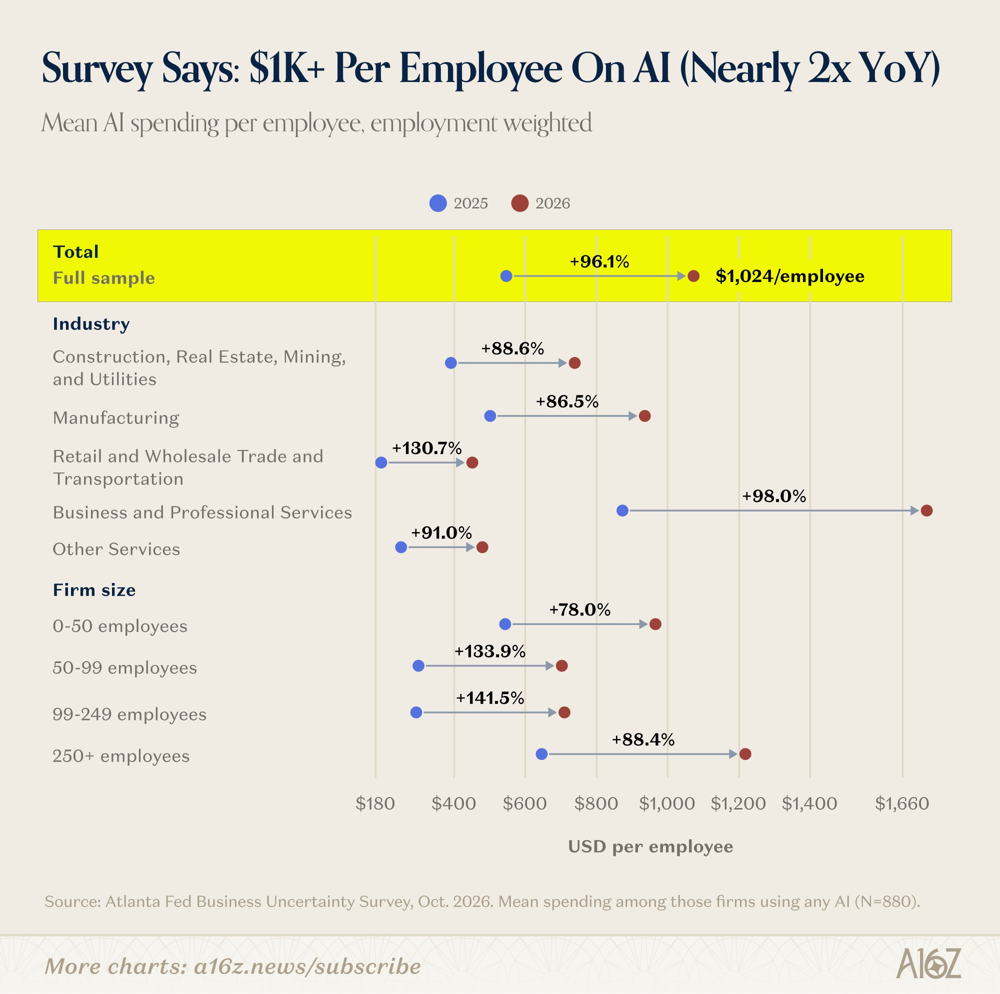

이와 대조적으로 Ramp의 데이터는 직원 1인당 월 15.70달러, 연 188달러의 중간값(median)을 가리킨다. 어느 데이터가 더 옳은지 알 수 없으니, 188달러가 1,000달러보다 훨씬 적다는 것만 말해두자. 평균과 중간값의 차이가 상당 부분 일을 하고 있을 수도 있지만.

현실은 이것이다. 실제 토큰 지출과 소비는 상대적으로 불투명하다. 아무도 AI 토큰 지출의 전체를 알지 못한다. AI 기업들은 실적을 공개하지 않고, 건전한 추정을 가능하게 할 만큼 크고 대표성 있는 지출 데이터 패널도 없다.

우리가 가진 대략의 프록시가 주목받는 것은 자연스럽다. 흥미롭고 유용한 지표인 것은 맞다. 그러나 그것을 바람이 실제로 어느 쪽으로 부는지에 대한 확정적 지표로, FUD론의(혹은 영구강세론의) 중심축으로까지 취급하는 것은 자연스럽지 않다.
