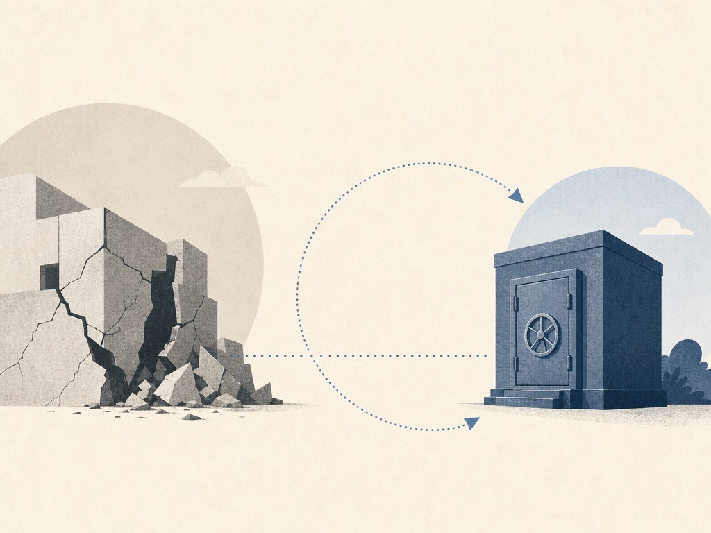

> 원문: <https://www.a16z.news/p/defense-in-depth-rebuilt-for-machine>

---

지난 글에서 우리는 공격 사이버의 병목이 취약점을 실제 동작하는 익스플로잇으로 바꾸는 숙련 작업이라고 주장했다. 2025년과 2026년, 그 작업은 값이 싸졌다. 패칭은 빨라지지 않았다. 이 글은 그 뒤에 오는 일에 관한 것이다. 우리의 견해는 이렇다. 익스플로잇과 패치 사이의 간극은 패치를 더 세게 밀어붙인다고 닫히지 않고, 앞으로 5년 동안 중요한 제품과 정책은 빨리 패치할 수 없을 때에도 시스템을 지키는 것들이다.

*지난 글의 짧은 요약: 취약점은 더 많아졌고, 수정 전에 익스플로잇이 먼저 오는 일이 흔해졌고, 패치 시간은 거의 그대로다.*

10월에 웹의 상당 부분을 떠받치는 언어 PHP의 두 치명적 취약점이 수정 전에 유출됐다. 익스플로잇 시도는 공개 4일 전부터 시작됐다. 다행히 호스팅과 콘텐츠 전송 회사들은 근본 서버가 패치되지 않은 상태에서 엣지에서 공격을 막을 수 있었다. 한편 그 우산 밖의 260만~440만 PHP 설치는 노출된 채로 남았고, 대부분은 영영 수정본을 받지 못할 버전이었다.

그 한 주가 논거를 축소판으로 보여준다. 보호는 패치를 기다리지 않아도 됐다. 공격자와 취약점 사이에 다른 누군가가 설 수 있었다.

## 계산이 맞지 않는다

패칭은 취약점 하나하나 사람이 관문을 통과시키는 과정이다. 누군가 취약점을 알아내고, 영향받는 시스템을 찾고, 수정을 테스트하고, 패치 일정을 잡고, 패치 후에 문제없는지 확인해야 한다. 이 단계들은 여전히 몇 주 걸린다. [2026 Verizon 유출 보고서](https://www.verizon.com/business/resources/T343/reports/2026-dbir-data-breach-investigations-report.pdf)는 전체 복구 중앙값을 43일로 잡았고, 데이터셋에서 알려진 악용 취약점 중 26%만 완전히 복구됐다고 밝혔다. [Veracode의 2025 보고서](https://www.veracode.com/press-release/veracode-reveals-half-of-organizations-burdened-by-critical-security-debt/)는 평균 결함 해결 시간을 252일로 잡았는데, 5년 전 171일에서 늘어난 수치다.

발견은 다르게 움직인다. AI 시스템은 취약점을 클래스 단위로 찾고, 공개된 수정본을 몇 시간 만에 동작하는 익스플로잇으로 바꾸는 일을 도울 수 있다. 10월에 Anthropic은 공개 전 모델이 [몇 주 전에 업스트림에서 수정된 리눅스 커널 취약점](https://www.anthropic.com/research/discovering-vulnerabilities-with-claude)의 원격 로그인 불필요 익스플로잇을 만들어냈다고 보고했는데, 그 시점에 [가장 널리 쓰이는 서버 배포판 두 개에는 여전히 수정 패키지가 없었다](https://thehackernews.com/2026/10/linux-kernel-tcp-flaw-with-98-cvss.html). Red Hat은 타이밍 레이스를 이기기 어렵다는 이유로 이 취약점을 중간 등급으로 평했고, 모델은 1시간 안에 그 레이스를 이겼다.

*익스플로잇은 몇 시간, 수정은 몇 주에서 몇 년, 어떤 시스템엔 영원히 오지 않는다. 각 행마다 지표가 다르므로 자릿수로 읽어야 한다.*

패칭을 빨리 할 수 있는 곳에서도 배포에는 자체 다운타임 위험이 있다. 2024년 7월에 잘못된 CrowdStrike 업데이트 하나가 [약 850만 대의 윈도우 머신을 다운시켰다](https://blogs.microsoft.com/blog/2024/07/20/helping-our-customers-through-the-crowdstrike-outage/). 패치를 하루 수백 수천 번 배포해야 한다면, 공격을 스스로 만든 다운타임으로 바꾸는 것에 지나지 않는다.

그래서 질문은 패치를 어떻게 더 빨리 하느냐가 아니다. 패치할 필요를 어떻게 없애느냐다.

## 제때 패치되지 않을 것들

사례는 업데이트가 설계상 느린 기계들에서 가장 선명하고, 그 기계들은 실패가 물리적으로 나타나는 곳이다.

- **산업 제어 시스템.** 전력망, 상수도, 공장 컨트롤러는 벤더의 회귀 테스트를 거친 뒤 유지보수 창에서, 흔히 1년에 한 번 패치된다. 수정이 아예 없을 때도 있다. [Dragos는 2025년 산업용 권고의 약 4분의 1이 패치나 완화책 없이 나왔다고 밝혔고](https://www.dragos.com/resources/press-release/dragos-2026-year-in-review-new-ot-threats-ransomware), 산업 취약점 중 즉각 조치가 필요한 것은 2%뿐이라고 했다. 나머지는 기다린다. [미국 전력망 규정은 패치 평가에 35일, 적용에 35일을 더 허용한다](https://www.nerc.com/globalassets/standards/reliability-standards/cip/cip-007-6.pdf).

- **의료기기.** 주입 펌프, 영상 장비, ECMO 머신은 10~20년을 쓰고, 종종 지원이 끝난 운영체제 위에서 돌며, 패치는 재인증을 의미할 수 있다. FDA 사이버보안 규정은 신규 기기에만 적용된다. 2025년 한 설문에서 [병원 시스템의 89%가 알려진 악용 취약점이 있는 연결 기기를 보유했다](https://claroty.com/blog/clarotys-state-of-cps-security-report-healthcare-exposures-2025).

- **차량.** 최신 차량은 무선(OTA) 업데이트를 받는다. 오래된 차량은 받지 않고, 소프트웨어 리콜은 안전 규제 속도로 움직인다.

- **칩이 들어간 나머지 전부.** 빌딩 컨트롤러, 카메라, 라우터, 냉장고는 업데이트 채널이 없고 온라인에 연결돼 있다는 걸 아는 소유자도 없는 경우가 많다. 10월에 [공격자들이 프랑스 슈퍼마켓 수백 곳의 냉장 설비를 하룻밤에 데웠는데](https://thehackernews.com/2026/10/attackers-heat-french-supermarket.html), 대부분 수정이 더 이상 나오지 않는 수명 종료 컨트롤러를 통해서였다. 국가 사이버 기구의 유일한 조언은 전원을 뽑으라는 것이었다. 3주 뒤 [같은 공격이 벨기에, 룩셈부르크, 스웨덴, 에스토니아의 매장을 쳤고](https://www.cp24.com/news/world/2026/11/02/european-supermarkets-hit-by-new-fridge-cyber-attack/), 벨기에 체인 한 곳의 협력업체는 [수정에 대당 물리적 개조가 필요하다고 말했다](https://www.tomshardware.com/tech-industry/cyber-security/supermarket-freezers-across-europe-struck-in-second-crippling-cyberattack-hackers-raise-temperatures-to-50-degrees-celsius-in-belgium-and-sweden-destroying-food-stocks).

이 모든 대상에게 패치는 애초에 통제 수단이 아니었다. 희망이었다. 실제로 통제가 되는 것은 기기 바깥에 있다.

## 얼마나 머리까지 미치는지 순서대로

빨리 패치할 수 없는 장비를 지킬 수 있는 방법은 네 가지다. 긴 꼬리(long tail)를 얼마나 깊이 커버하는지 순서로 매겼다.

*패칭이 따라가지 못할 때 방어가 작동하는 지점. 아래 문지기들은 이어지는 방법들과 우리가 보는 기회에 대응한다.*

**1. 공개 인터넷에서 치운다.** 가장 무해한 익스플로잇은 목표에 닿을 수 없는 것이다. [Censys 연구진이 온라인에 노출된 상수도 시설 제어 화면 약 400개를 찾았을 때](https://censys.com/blog/turning-off-the-information-flow-working-with-the-epa-to-secure-hundreds-of-exposed-water-hmis), 그중 40개는 로그인 없이 제어를 허용했다. Censys는 EPA와 벤더와 함께 소유자에게 닿았고, 9일 안에 4분의 1이 보안 처리됐다. 2025년 5월까지는 [6% 미만만 노출 상태로 남았다](https://www.cybersecuritydive.com/news/water-utilities-mitigate-flaws-find-exposures/749980/). 패치는 등장하지 않았고, 어떤 패치 주기보다 빨리 움직였다.

실무적 문제는 운영자와 협력업체에 원격 접속이 필요하다는 것이다. 기기를 뽑으라고 하면 대개 실패한다. 통하는 방법은 공개 노출 없이 원격 접속을 유지할 저렴한 방법을 주고, 소유자가 이미 답해야 하는 누군가, 즉 규제기관, 벤더, 인터넷 제공자, 보험사를 통해 다가가는 것이다.

메시지를 누가 전하는지가 중요하다. 감염된 소비자 기기에 대한 한 연구에서 [유럽 인터넷 제공자의 격리 및 통지 절차는 14일 안에 감염의 92%를 정리했다](https://www.ndss-symposium.org/ndss-paper/cleaning-up-the-internet-of-evil-things-real-world-evidence-on-isp-and-consumer-efforts-to-remove-mirai/). 이메일 경고는 아무 말도 하지 않은 것과 다르지 않았다. AI가 노출을 찾는 일은 거의 무료가 됐다. 소유자에게 알리고 행동하게 만드는 게 어려운 부분이다.

*소유자가 답해야 하는 누군가가 개입하면 노출이 빠르게 줄어든다. 패치는 등장하지 않는다.*

**2. 연결을 유지해야 하는 것은 분리한다.** 5월에 [Dragos는 프론티어 모델을 주요 운영자로 쓰는 침입자를 문서화했는데](https://www.dragos.com/blog/ai-assisted-ics-attack-water-utility), 그 침입자는 멕시코 상수도 시설의 사무 네트워크와 제어 시스템 사이 경계에 도달한 뒤 거기서 멈췄다. 제어 네트워크는 막혀 있었다. 세그멘테이션은 오래되고 화려하지 않지만, 네트워크 침입이 물리적 사건이 되는 걸 막을 수 있다. 그 경계는 협력업체와 원격 관리자가 쓰는 경로까지 유지돼야 한다.

**3. 공격을 네트워크에서 기계 속도로 막는다.** PHP의 그 한 주는 이것이 작동할 때의 모습을 보여줬다. 몇 시간 안에 작성된 보호 규칙이 수백만 대의 서버 앞에 배포됐다. 가상 패칭(virtual patching)이라 불리는 이 모델은 주로 대형 플랫폼용 웹 트래픽 제품이었다. 다음 단계는 익스플로잇을 쓰는 것과 같은 AI로 각 공개에서 그 규칙을 자동 생성해, 대형 플랫폼 뒤에 있지 않은 곳들, 즉 산업 프로토콜, 병원 네트워크, 소상공인 라우터에 밀어 넣는 것이다.

**4. 클래스 전체를 제거한다.** 가장 내구적인 수정은 개별 인스턴스가 아니라 그 종류의 버그를 없애는 것이다. 구글은 [안드로이드 취약점에서 메모리 안전성 버그 비율이 2019년 76%에서 2024년 24%로 떨어졌다고 보고했는데](https://security.googleblog.com/2024/09/eliminating-memory-safety-vulnerabilities-Android.html), 주로 새 코드를 메모리 안전 언어로 쓴 덕이다. 형식 검증, 더 안전한 기본값, 강화된 프로토콜 라이브러리는 다른 반복되는 약점을 줄일 수 있다. 느리고 긴 꼬리에는 마지막에 닿지만, 찾을 버그의 수를 실제로 줄이는 유일한 접근이다.

이들과 함께 놓여야 할 두 가지 투자가 더 있다. 안전한 폴백과 교체다. 상수도 처리장은 손으로 운영할 수 있어야 하고, 병원은 종이로 일주일을 버틸 수 있어야 한다. 그리고 어떤 기기는 경제적으로 지키기엔 너무 오래돼 은퇴시켜야 한다.

## 복구는 모두가 잊는 통제다

위 네 가지 방어는 모두 위험을 줄인다. 어느 것도 0으로 만들지 못한다. 긴 꼬리에게 공격이 나쁜 한 주가 될지 잃어버린 한 분기가 될지를 결정하는 건 백업이 작동하는지 여부다. 그리고 공격자들은 그걸 안다.

백업은 이제 1차 표적이다. [Sophos의 2024 랜섬웨어 피해자 설문](https://www.sophos.com/en-us/blog/the-impact-of-compromised-backups-on-ransomware-outcomes)에서 94%가 공격자가 백업을 침범하려 했다고 답했고, 그 시도의 57%가 성공했다. [Mandiant의 최신 보고서](https://cloud.google.com/blog/topics/threat-intelligence/m-trends-2026)는 선도 랜섬웨어 그룹들이 백업 인프라, 아이덴티티 서비스, 하이퍼바이저 관리를 함께 노리고 클라우드 백업을 통째로 삭제한다고 기술했다. [CISA의 Akira 그룹 업데이트 권고](https://www.cisa.gov/news-events/cybersecurity-advisories/aa24-109a)는 백업 서버 소프트웨어 익스플로잇을 진입 경로로 나열한다.

자신감은 따라가지 못했다. [Veeam의 2026 설문](https://www.veeam.com/company/press-release/veeam-report-reveals-a-market-wide-shift-from-recovery-confidence-to-proven-data-resilience-amid-ransomware-threats-and-ai-adoption.html)에서 리더의 90%가 복구 목표를 달성할 수 있다고 답했지만, 피해자 중 모든 데이터를 되찾은 비율은 28%였다. Sophos의 의료 설문에서 암호화된 데이터를 백업으로 복구한 비율은 [3년 전 72%에서 2025년 51%로 떨어졌다](https://www.sophos.com/en-us/content/state-of-ransomware). 백업을 잃는 비용도 크다. [백업이 침범당한 피해자의 중앙 복구 비용은 약 300만 달러로](https://www.sophos.com/en-us/blog/the-impact-of-compromised-backups-on-ransomware-outcomes), 백업이 살아남은 경우의 37만 5천 달러와 비교된다.

*복구는 가정이지 입증이 아니다. 백업은 이제 1차 표적이다.*

교훈은 백업이 보험이 아니라 공격 표면의 일부라는 것이다. 백업에는 보호된 자격증명, 침입자가 쉽게 바꿀 수 없는 사본, 공격자가 먼저 취하는 접근 경로와의 격리, 정기적인 복원 테스트가 필요하다. "백업이 있습니다"는 자세가 아니다. "지난 화요일 병원 기록 시스템을 전날 밤 사본으로 4시간 만에 복원했습니다"가 자세다.

## 우산에는 모양이 있고, 비용이 있다

답이 공격자와 취약한 시스템 사이에 다른 누군가가 선다는 것이라면, 그 누군가가 누구인지가 중요하다. 오늘날 그 자리에는 소수의 클라우드, 콘텐츠, 보안 회사들이 있다. 가장 큰 콘텐츠 전송 네트워크 하나만으로도 [모든 웹사이트의 4분의 1 앞에 서 있는데](https://w3techs.com/blog/entry/25_percent_of_all_websites_now_use_cloudflare_as_cdn), 10년 전엔 4% 미만이었다. PHP의 그 한 주가 잘 풀린 이유가 이 집중이다. 동시에 이것은 단일 장애점이다. 2024년 7월의 장애는 보안 벤더 하나의 잘못된 업데이트 하나였고, 미국 최대 기업들에 [약 54억 달러의 손실을 냈으며](https://www.parametrixinsurance.com/in-the-news/crowdstrike-to-cost-fortune-500-5-4-billion-insured-loss-range-of-540-million-to-1-08-billion) 그중 보험이 커버하는 건 10~20%로 추정됐다. 그리고 [Jason Healey가 지적했듯](https://www.lawfaremedia.org/article/driven-by-ai--the-future-of-cybersecurity-will-resemble-the-past), 몇몇 미국 플랫폼이 어떤 트래픽이 세계의 서버에 닿을지 결정할 때 누구의 규칙이 적용되는가라는 주권 질문을 제기한다. 국가와 규제기관들은 이제 막 묻기 시작했다.

경제학은 어차피 한 방향으로 민다. 단일 자산을 지키는 비용은 예전과 비슷한데, 공격하는 비용은 계속 싸진다. 시간이 지나면 긴 꼬리에는 선택지가 두 개다. 누군가의 플랫폼 아래에 숨거나, 노출된 인프라를 인터넷에서 치우거나. 둘 다 하지 않는 조직들, 즉 카운티 상수도 시설, 진료소, 소규모 제조업체가 데이터 편에서 보여준 것처럼 이미 비용을 내고 있는 곳들이다.

## 정책의 끝: 남의 기계를 고치는 일

어떤 소유자는 모르거나, 비용을 댈 수 없거나, 이미 존재하지 않아서 행동하지 않는다. 그러면 질문은 다른 누군가가 개입해도 되는가로 바뀐다.

전례는 있다. 2021년 4월에 [미국 법원은 FBI가 소유자가 움직이지 않은 수백 대의 사설 Exchange 서버에서 악성 웹셸을 제거하도록 승인했다](https://www.justice.gov/archives/opa/pr/justice-department-announces-court-authorized-effort-disrupt-exploitation-microsoft-exchange). 이듬해 12월에 이뤄져 한 달 뒤 공개된 작전에서는 [또 다른 법원 명령이 수백 대의 소규모 사무실 라우터에서 중국 국가 봇넷을 제거하도록 허락했는데](https://www.justice.gov/archives/opa/pr/us-government-disrupts-botnet-peoples-republic-china-used-conceal-hacking-critical), 그 대부분은 벤더 지원이 끝난 기기였다. 둘 다 특정 회사를 향한 좁은 개입이었다. 더 넓은 개입에 대한 압력은 커질 것이다. 통지하고, 격리하고, 타인을 위험에 빠뜨리는 기기를 복구하는 식으로. 그건 실제 시민자유 트레이드오프고, 위기 중에 즉석에서 만드느니 지금 논의하는 편이 낫다.

## 우리가 보는 기회들

우리가 이길 것이라 보는 카테고리들은 하나의 성질을 공유한다. 패칭을 불필요하게 만들거나, 남의 일로 만든다. 각각은 여러 카테고리를 하나로 합친다. 취약점을 찾고, 실행 중인 시스템을 지키고, 수정을 검증하는 일은 하나의 제품이 그 작업을 끝까지 가져갈 때 더 유용해진다.

기존 카테고리들만으로는 이 새로운 세계에서 하나의 피처로 전락할 위험이 있다. 합쳐진 카테고리를 가져가서 그 가장 어려운 부분에서 시작하는 회사가 세대급이 될 가능성을 가진다. 우리는 최소 6개의 기회를 본다.

**1. 실시간으로 고치고, 그다음 코드를 고친다.** 펜테스팅, 취약점 관리, 애플리케이션 보안이 하나의 루프가 된다. 옛 규칙은 소스 코드가 진실이고 프로덕션이 그 뒤를 따른다는 것이었다. 보안 속도가 그 규칙을 깨고 있다.

우리는 새 세대의 솔루션이 실행 중인 시스템의 취약점을 몇 시간 안에 완화할 것이라 믿는다. 악성 요청을 드롭하는 엣지 규칙, 함수 입력을 검사하고 익스플로잇을 거부하는 인프로세스 훅, 라이브 커널 패칭이 오랫동안 해온 것처럼 재시작 없이 메모리에 적용하는 패치.

이런 라이브 수정을 따라가는 건 비현실적이었다. 패치가 너무 많고, 내부와 서드파티 라이브러리에 걸쳐 버전이 너무 많다. 베팅은 코딩 에이전트가 호환성에 대한 높은 확신을 가지고 기계 속도로 버전별 라이브 수정을 적용할 수 있다는 것이다. 에이전트는 실제 배포된 정확한 라이브러리와 API 버전에 맞춰 수정을 작성하고, 풀 리퀘스트를 열고, 두 것이 일치하는지 확인한다.

세일즈 모션도 같은 능력에서 나온다. 하루 만에 잠재 고객의 현재 버전을 부수고, 라이브 보호가 적용된 시스템에 같은 공격을 실행해 실패하는 걸 보여준다.

같은 기계장치는 누가 돈을 내는지 더 명확한 벤더 쪽에도 속한다. 커널 수정을 몇 주가 아니라 며칠 만에 내보내는 리눅스 배포판은 모든 고객에게 더 빨리 수정을 준다. [유럽의 사이버 복원력법(Cyber Resilience Act)](https://ncsc.gov.ie/cra/)이 압력을 더한다. 2026년 9월부터 대상 제조사는 취약점이 악용되고 있다는 걸 알게 되면 24시간 안에 초기 경보를 내야 한다. 2027년 12월부터는 각 제품의 지원 기간 내내 취약점을 다루는 책임도 진다.

위험은 첫 글의 그것이다. 기계 속도로 잘못된 수정을 배포하면 스스로 만든 다운타임이 생긴다. 그래서 스테이지드 롤아웃과 자동 롤백은 부가 기능이 아니라 제품의 일부다.

**어디에 꽂히나.** 라이브 수정이 실행될 자리가 필요한데, 대부분의 회사는 이미 그 자리들을 갖고 있다. 콘텐츠 전송 엣지, API 게이트웨이, 서비스 메시, 함수에 훅을 걸거나 메모리에 패치할 수 있는 애플리케이션 프로세스 안의 경량 에이전트.

제품은 권고를 읽고, 배포된 버전을 확인하고, 그 버그를 커버하는 가장 좁은 라이브 수정을 쓴다. 라이브 또는 녹화된 트래픽으로 테스트하고, 가능하면 관찰 전용 모드를 쓰며, 자동 롤백과 함께 단계적으로 수정을 강제한다.

코드 수정은 두 번째 트랙에서 돈다. AI가 프로덕션 버전에 맞춰 패치를 쓰고, 녹화된 트래픽을 재생해 아무것도 안 깨지는 걸 보여주고, 풀 리퀘스트를 열고, 실제 수정이 배포되면 라이브 수정을 은퇴시킨다.

중요한 숫자는 공개에서 보호까지의 시간(시간), 영구 수정까지의 시간(일), 라이브 수정이 정상 트래픽을 막는 빈도다. 벤더 쪽에서는 같은 루프가 하나의 수정을 지원하는 모든 버전에 한꺼번에 백포트한다.

*몇 시간 만에 라이브 수정, 며칠 만에 코드 수정. 라이브 수정은 실제 수정이 리뷰를 통과하는 동안 프로덕션을 지킨다.*

**라이브 수정이 실행되는 곳.** 엣지 규칙, 인프로세스 훅, 메모리 패치는 각각 알려진 버그를 커버한다. 더 깊은 층은 기법 자체를 커버하는데, 권고가 존재하기 전에도 그렇다.

익스플로잇 작성은 싸지고 있지만, 많은 것들이 여전히 방어자가 볼 수 있는 시스템에서 익숙한 행동에 의존하고, 익스플로잇이 의지하는 기법은 버그가 아니더라도 목록이 짧다. [2025년에 공개된 48,185개 취약점](https://jerrygamblin.com/2026/01/01/2025-cve-data-review/) 중 [884개가 새로 악용됐고](https://www.vulncheck.com/blog/state-of-exploitation-2026), [CISA의 자체 검토](https://www.theregister.com/security/2026/08/28/cisa-most-exploited-vulnerabilities-should-have-been-eradicated-decades-ago/5293194)는 [악용 목록 뒤의 약점 유형 대부분](https://cwe.mitre.org/top25/archive/2025/2025_kev_list.html)이 업계가 수십 년 전부터 막는 법을 알고 있던 것들이라고 밝혔다.

신뢰할 수 없는 입력이 파싱되거나 코드가 운영체제로 넘어가는 지점에 놓인 같은 인프로세스 계측은 작은 모델에게 악용이 일어나고 있는지 판단할 자리를 주고, 더 큰 모델로의 에스컬레이션 경로를 둘 수 있다. 제품은 각 버그를 쫓는 대신 반복되는 기법을 막는다. 익스플로잇으로 증명하는 시행착오의 모든 미스는 학습 데이터가 된다. 어려운 부분은 속도와 오탐이다. 이 중 어느 것도 회사를 무적으로 만들지 않는다. 공격자가 계산에 넣는 공격 표면을 줄일 뿐이다.

*버그는 많고, 악용하는 방법은 적다. 그래서 버그 쫓기보다 기법을 막는 편이 더 잘 확장된다.*

**어디에 꽂히나.** 대부분의 익스플로잇은 몇 개의 관문을 지나간다. 신뢰할 수 없는 바이트를 객체로 바꾸는 파서와 역직렬화기, 데이터베이스 쿼리와 셸 명령을 만드는 코드, 메모리를 관리하거나 생성된 코드를 실행하는 런타임 연산, 프로그램 실행, 파일 열기, 메모리 실행 가능 설정을 위한 운영체제 호출.

그 지점들의 훅은 버그가 통제로 전환되는 순간을 잡을 수 있다. 웹 서버가 갑자기 셸을 시작하는 식으로. 경로 안의 작은 모델이 요청 안에서 허용, 차단, 에스컬레이션 중 무엇을 할지 결정한다.

더 큰 모델이나 애널리스트가 에스컬레이션을 몇 초 안에 검토하고 새 규칙을 엣지로 내보낼 수 있어 위의 보호로 이어진다. 개입은 요청 드롭부터 프로세스 종료, 머신 격리까지 이른다.

*런타임 익스플로잇 방어가 꽂히는 곳: 모든 익스플로잇이 지나가는 몇 개의 관문과 인라인으로 판단하는 작은 모델.*

**2. 규칙 없이 탐지하고, 먼저 대응한다.** AI SOC, 인시던트 대응, 관리형 탐지가 하나의 서비스가 된다.

오늘날 탐지는 사람이 쓰고 관리하는 규칙 위에서 돌고, 모든 규칙은 두 가지 방식 중 하나로 실패한다. 너무 구체적이면 다음 변형을 놓친다. 너무 광범위하면 어떤 팀도 다 읽을 수 없는 경보 큐에 더한다. 그리고 실제 경보가 나머지와 함께 무시되는 게 바로 그 방식이다. [Vectra의 2026 설문](https://www.vectra.ai/resources/2026-state-of-threat-detection)에서 보안 팀들은 하루 약 3,000개의 경보를 보고 63%에는 결국 손대지 않았다. [또 다른 설문](https://www.prophetsecurity.ai/blog/state-of-ai-in-the-soc-2026)에서 40%는 감지 규칙을 끄거나 그럴 생각을 했고, 60%는 아무도 조사하지 않은 경보가 실제 사건이 되는 걸 봤다.

또 다른 관문은 증거의 상당 부분이 애초에 SIEM에 닿지 않는다는 것이다. 수집과 저장 비용이 팀들에게 소음이라 믿는 걸 버리도록 압박한다. 우리가 이길 것이라 보는 버전은 이미 놓인 보안 제품에서 이벤트를 바로 읽고, 탐지를 개발하고, 사건이 진행되는 동안 움직인다.

그것은 이 제품을 최초 대응자로 만들고, 오늘날 애널리스트들이 하고 관리형 탐지와 인시던트 대응 서비스가 파는 일을 가져온다. 기계 속도로 들어온 침입자는 기계 속도로 움직이니, 대응도 그래야 한다.

**어디에 꽂히나.** 제품은 조직이 이미 돈을 내고 있는 이벤트 스트림, 즉 엔드포인트, 아이덴티티, 이메일, 네트워크, 클라우드 위에 앉아 SIEM에 도착한 뒤가 아니라 소스에서 읽는다. 모델은 시그니처가 아니라 행동을 감시하는데, 프로세스 체인, 로그인 패턴, 호스트의 이력에 맞지 않는 데이터 이동 같은 것들이고, 설명할 수 있는 탐지를 제안한다. 확정된 탐지는 규칙으로 배포되고, 모델이 조용해지면 그 규칙을 은퇴시킨다.

대응은 같은 제품들의 자체 컨트롤로 돈다. 엔드포인트 격리, 세션 종료, 발신자 차단, 포렌식을 위한 호스트 스냅샷. 프로덕션 시스템을 내려놓는 일에는 사람이 승인한다.

구매자는 첫 악성 이벤트부터 격리까지의 시간, 사람 없이 격리되거나 처리된 사건의 비율, 월별 오격리 수를 측정해야 한다.

*규칙 없이 탐지하고, 먼저 대응한다. 이미 돈을 낸 스트림을 읽고, 모델이 설명 가능한 탐지를 제안하게 하고, 제품들의 자체 컨트롤로 대응한다.*

**3. 모든 로그인이 아니라 모든 요청을 판단한다.** 아이덴티티, 엔드포인트 보안, 네트워크 접근이 하나의 결정이 된다. 옛 모델은 사용자와 머신이 같은 것이라 가정했다. 한 번 로그인하면 세션이 신뢰된다. 에이전트가 그걸 깼다.

개발자의 노트북은 이제 사람, 자기 키를 가진 코딩 에이전트, 자기 세션을 가진 브라우저 에이전트를 함께 싣고 있고, 셋 모두 같은 머신에서 같은 분에 요청을 보낸다. 신뢰는 요청별로, 누가 무엇을 만들었는지로 판단돼야 하고, 그 판단은 엔드포인트에서 일어나야 한다. 트래픽이 네트워크에 닿으면 그 구별은 이미 사라지니까.

접근은 just in time이 된다. 컨텍스트에서 한 작업에 부여되고, 작업이 끝나면 회수되고, 잘 작동하면 보이지 않는다. 이 중 어느 것도 방해가 될 필요가 없다. 오늘의 마찰은 누군가 검토해야 하는 상시 권한에서 나온다. 그걸 없애면 대부분의 결정은 배경에서 일어난다.

**어디에 꽂히나.** 엔드포인트의 에이전트가 각 아웃바운드 요청을 프로세스와 주체, 즉 사람이나 소프트웨어에 귀속시키고 서명한다. 브로커는 한 작업과 한 리소스에 스코프된 자격증명을 분 단위의 수명으로 발행하고, 네트워크 계층은 서명되지 않았거나 스코프를 벗어난 것을 거부한다. 돈을 움직이거나, 데이터를 지우거나, 접근을 부여하는 행동에는 사람의 승인이 필요하고, 에이전트가 하는 모든 일은 실행한 사람에 귀속돼 기록된다.

구매자는 프로덕션 접근이 있는 상시 자격증명 수, 주체에 귀속 가능한 활동, 세션이 플래그된 뒤 회수까지의 시간을 측정해야 한다.

**4. 복구를 입증한다.** 백업, 재해 복구, 사이버 보험이 하나의 제품이 된다. 백업 저장소는 기존 벤더의 몫이지만 입증은 아니다. 빠진 조각은 백업 자세 관리(backup posture management)다. 백업이 존재하고, 변경에 저항하고, 공격자가 먼저 취하는 아이덴티티 시스템 밖에 있고, 실제로 복원된다는 것을 감사인이나 보험사가 받아들일 증거와 함께 지속적으로, 독립적으로 검증하는 것.

예방이 실패했을 때, 이것이 장애가 며칠이 될지 몇 달이 될지를 결정한다.

**어디에 꽂히나.** 백업 사본은 공격자가 먼저 장악하는 아이덴티티 시스템 밖에 산다. 공유 관리자가 없는 별도 계정, 강제 보존이 걸린 쓰기 한 번 저장소, 두 사람이 필요한 삭제. 정해진 일정에 제품은 실제 시스템을 격리된 클린 룸에 복원하고, 부팅하고, 데이터를 확인하고, 임플란트를 찾고, 모든 단계의 시간을 잰다.

그 기록이 곧 제품이다. 마지막 성공 복원, 각 핵심 시스템을 되살리는 시간, 복구된 데이터의 비율을 이사회, 감사인, 보험사가 받아들일 형태로.

설문 데이터가 왜 중요한지 보여준다. [Sophos 연구에서 백업이 살아남은 피해자의 46%가](https://www.sophos.com/en-us/blog/the-impact-of-compromised-backups-on-ransomware-outcomes) 일주일 안에 완전히 복구됐고, 백업이 침범당한 피해자 중에서는 26%였다. 백업이 온전한 이들은 랜섬을 지불할 가능성도 절반쯤이었다. [Veeam은 복원력 예산을 올린 조직에서 완전 복구가 40%였다고 보고했고](https://www.veeam.com/company/press-release/veeam-report-reveals-a-market-wide-shift-from-recovery-confidence-to-proven-data-resilience-amid-ransomware-threats-and-ai-adoption.html), 그런 조직들은 불변 저장소와 자동 백업을 살 가능성이 높았다. 나머지는 16%였다.

복구 기록은 인수 심사 입력이기도 하다. 하나의 공유 버그가 수천 피해자를 동시에 치는 상관 손실은 모델링하고 가격을 매기기 어렵고, 정확히 보험사들이 오늘 제외하는 것이다. 그 위험을 모델링하고 커버리지 요건을 테스트된 통제와 연결할 수 있는 회사들이 제품과 함께 시장을 만들어간다.

**5. 설치 지점에서 하나의 통제.** 소프트웨어 공급망, CI/CD 보안, 개발자 엔드포인트가 하나의 통제가 된다. 10월의 가장 큰 손실 중 일부는 패치 누락으로 시작하지 않았다. [바이낸스는 피해를 63억 달러로 잡았고](https://decrypt.co/382194/binance-hack-exit-ramps-defi-exchange-ethereum), 초기 조사는 한 엔지니어의 침범당한 노트북을 지목했다. [변조된 패키지 하나는 코드 에디터의 확장 마켓플레이스를 통해 최대 5,000명의 개발자에게 닿아](https://cursor.com/blog/claude-code-extension-security-notice) 백도어 설치를 시도했다.

패키지 레지스트리와 마켓플레이스, 개발자 머신, 에이전트 자격증명은 이제 공격 표면의 또 다른 부분이다.

모델은 이메일 보안이 20년 전에 정착시킨 것이다. 들어오는 물건을 게이트웨이에서 보류하고, 샌드박스에서 열고, 실제 발신자가 누구인지 확인한 뒤, 사람이 보기 전에 릴리스하거나 격리한다. 오늘날 입력은 패키지 매니저, 확장 마켓플레이스, 브라우저, 벤더 연결, 그리고 점점 더 AI 에이전트가 스스로 가져오는 스킬, 도구, 문서나 웹페이지를 통해 온다. 에이전트에게 문서는 명령이기도 하다.

제품은 같은 세 가지 검사다. 보류(hold), 실행(detonate), 출처 검증(verify provenance). 모든 채널에 하나의 정책 아래 적용된다.

[Verizon의 최신 보고서](https://www.verizon.com/business/resources/T343/reports/2026-dbir-data-breach-investigations-report.pdf)에서 악용된 버그는 31%로 단일 최초 침투 경로 1위였지만, 피싱, 도난 자격증명, 프리텍스팅을 합치면 35%였다. 제3자가 관여한 유출은 48%로, 2년 전 15%에서 늘었다. [Sonatype은 2025년 한 해에만 45만 4,600개가 넘는 새로운 악성 오픈소스 패키지를 세었다](https://sonatype.com/state-of-the-software-supply-chain/2026/open-source-malware).

*많은 유출이 패치할 버그가 없는 곳에서 시작되고, 점점 더 많은 몫이 벤더나 파트너와 관련된다.*

**어디에 꽂히나.** 각 경로는 설치나 접근이 허용되는 지점에 통제를 필요로 한다. 개발자 머신에는 허용 목록에 올린 확장과 패키지, 프로덕션에 닿기 전 기기 검사, 노트북에 오래 살아남는 프로덕션 자격증명 없음이 필요하다.

패키지 레지스트리와 내부 미러는 새 버전을 잠시 보류하고, 설치를 샌드박스에서 돌려 무엇을 하는지 지켜보고, 서명된 출처를 확인한다. 벤더 접근은 스코프되고, 만료되고, 검토된다. 에이전트 스킬과 도구 커넥터는 패키지처럼 보류되고 검사된다(에이전트가 그 다음에 무엇을 할 수 있는지는 카테고리 3의 일이다).

지켜볼 숫자는 검사에 드는 시간, 샌드박스에서 테스트된 설치의 비율, 첫 사용 전 보류를 통과한 에이전트 스킬과 커넥터의 비율, 오래 살아남는 프로덕션 자격증명을 담은 노트북의 수다.

**6. 긴 꼬리 플랫폼.** 노출 관리, 보안 원격 접속, 제어 네트워크 세그멘테이션, 수동 폴백이 보안 팀을 절대 운영하지 못할 조직들, 즉 상수도 시설, 병원의 바이오메디컬 부서, 슈퍼마켓 체인의 냉장 협력업체를 위한 하나의 제품이 된다.

노출 제거는 대안을 팔 때만 제품으로 작동한다. 공개 인터넷에 앉지 않고 원격 접속을 유지할 저렴한 방법, 그리고 소유자가 이미 답해야 하는 누군가, 즉 벤더, 인터넷 제공자, 보험사를 통해 소유자에게 닿는 채널.

같은 서비스가 제어 네트워크를 막고, 수동 폴백을 훈련된 상태로 유지하고, 규제기관이나 보험사가 확인할 수 있는 인벤토리를 쥐고 있다. 관리형 플랫폼은 이미 소상공인에게 스스로 운영할 수 없는 서비스를 준다. 이것은 클라우드로 옮겨갈 수 없는 기계들을 위한 같은 모델이다.

이 제품들과 함께, 메모리 안전 코드로의 이전은 AI가 번역의 상당 부분을 맡을 수 있어 새로 실용적이 됐다. 긴 꼬리에는 마지막에 닿지만, 찾을 버그의 수를 줄이는 유일한 접근이다.

이들 각각은 어려운 문제에서 시작한다. 실제 배포된 버전에 맞는 안전한 패치, 수동 규칙 작성 없는 탐지, 모든 요청 뒤의 주체, 가정이 아니라 입증된 복원. 거기서 시작하는 게 맞다. 대시보드와 리포트는 쉬운 부분이고 어려운 부분이 작동하면 따라온다. 그리고 어려운 부분이 합쳐진 카테고리를 방어 가능하게 만든다.

## 베팅

지난 글은 이렇게 내기를 걸고 끝났다. 2026년은 사이버 전쟁의 시작이라기보다 길고 값비싼 웜 시대의 시작처럼 보인다. 지난 웜 시대는 한 회사가 문제의 소유권을 가져가 고쳤을 때 끝났다. 이번엔 아무도 소유하지 않는다.

많은 시스템에게 익스플로잇과 패치 사이의 창은 열려 있을 것이다. 할 일은 그 창이 덜 중요해지게 만드는 것이다. 노출된 것을 줄이고, 즉각적인 패치에 의존하는 운영을 줄이고, 실제로 시스템을 되살리는 백업.
