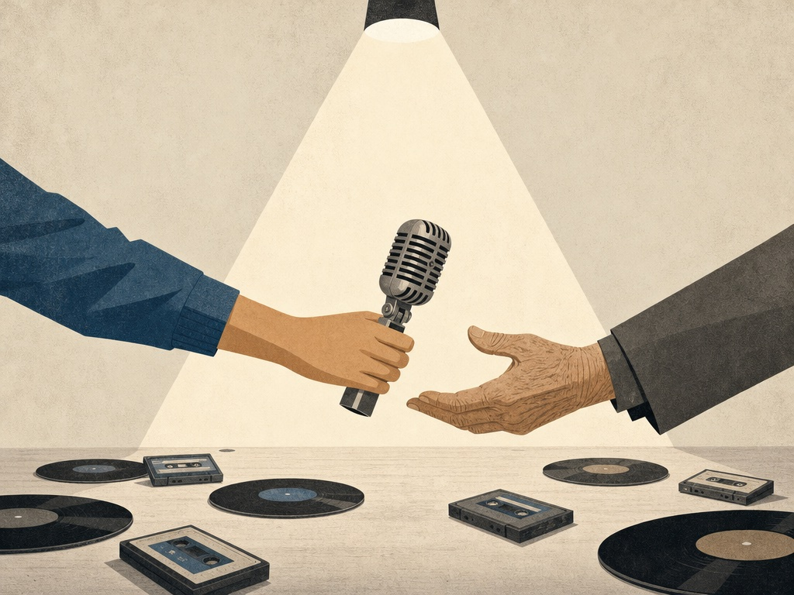

> 원문: https://www.a16z.news/p/hip-hop-has-no-social-security-paid

---

a16z의 주말 문화 특집으로 음악 저널리스트 제프 와이스가 쓴 글이다.

*"난 바가지를 씌운다 … 콜드 크러시에게 당했던 일 때문에."*
제이-Z, "Izzo" (2001)

*"힙합에는 사회보험이 없다."*
콜드 크러시 브라더스의 그랜드마스터 카즈, 2026년

1979년 가을, 뉴저지의 작은 독립 레이블이 낸 12인치 레코드가 세계가 리듬과 속어, 뉴턴 물리학을 이해하는 방식을 바꿔놓았다. 15분짜리 싱글에 나선 건 자신들을 Sugarhill Gang이라 부르던 무명 래퍼 셋이었다. 가사는 컬러 TV로 닉스 경기를 보는 즐거움부터 슈퍼맨의 침실에서의 한계, 비트가 "당신을 이 대기 밖으로 데려간다"는 말까지 아우렀다.

"Rapper's Delight"는 레이블 자체 집계로 최소 200만 장이 팔렸고, 빌보드 톱40에 오른 최초의 힙합 곡이 됐다. 밖에서 보기엔 수수께끼였고 골동품이었고 한철 지나가는 신기했다. 나이 든 세대 중 많은 이들은 음악이 아니라 했다. 멜로디는 어디 있나, 화음은 어디 있나, 그냥 소음이 아니냐고. 그러나 세계의 십대들은 이 곡의 놀이터 유머와 매끈한 브래그다시오, Chic의 "Good Times"에서 그대로 떼어온 펑키한 그루브를 받아들였다.

장르가 세계 정복의 첫걸음을 내딛는 순간부터 그 사업 쪽은 사기, 협박, 착취로 얼룩였다. "Rapper's Delight" 현상은 힙합의 원죄 이야기를 그대로 겸한다. Sugarhill Gang은 전직 소울 가수 실비아 로빈슨과 그 아들 조이가 보이밴드처럼 조립한 팀이었다. 뉴욕 다섯 자치구에서 그들을 래퍼로 인정한 이는 거의 없었다. 멤버 한 명, "빅 뱅크 행크"라 불리던 전직 나이트클럽 도어맨(본명 헨리 잭슨)은 뉴저지 엔글우드의 피자 가게에서 근무 중 시간을 때우며 랩을 읊다가 발굴됐을 뿐이다.

스튜디오에 들어갈 때가 되자 행크는 콜드 크러시 브라더스의 그랜드마스터 카즈를 찾아갔다. 행크는 잠시 카즈의 매니저였던 사이였다. 당시 힙합이 음반에 담길 거라고 믿는 이는 거의 없었고, 뉴저지 턴파이크를 넘어 퍼질 거라고 믿는 이는 더 없었다. 그래서 18살 카즈는 어깨를 으쓱하고 가사 노트를 행크에게 빌려줬고, 무심코 역사를 다시 짜놓았다. "Rapper's Delight"에서 행크는 카즈의 구절을 그대로 읊었고, 카즈가 자기 이름을 철자하는 부분("I'm the C-A-S-A, the N-O-V-A, and the rest is F-L-Y")조차 고칠 마음을 내지 않았다.

힙합을 상업적 존재로 만든 가사를 쓰고도 그랜드마스터 카즈는 로열티도 정식 작곡 크레딧도 받지 못했다. 그의 미래적이고 복잡한 라임 스킴은 빅 대디 케인, 라킨, 쿨 G 랩 같은 황금기 전설들의 기초가 됐다. 그러나 가벼운 팬들에게 카즈의 공헌은 묻혔다. 대신 Sugarhill Gang이 힙합의 첫 얼굴이 됐다.

카즈의 배신은 힙합 설화의 기본 소재로 자주 다시 들려졌지만, 그 부정행위가 얼마나 깊은지 아는 이는 훨씬 적었다. 10월 24일, Paid in Full 재단의 네 번째 연례 힙합 그랜드마스터 어워즈에서 벨라지오 호텔 타워 볼룸의 관중은 Chic의 나일 로저스가 그 사기의 전체 규모를 설명하는 자리를 들었다. 로저스는 올해 이 비영리단체의 퀸시 존스 업적상을 받았다.

Sugarhill Gang의 히트곡이 "Good Times"를 훔쳤다는 걸 알아차린 로저스와 Chic의 동료 버나드 에드워즈는 힙합 역사상 최초의 저작권 소송을 추진하겠다 위협했다. 처음엔 몰랐다. Sugar Hill 레이블의 돈은 악명 높은 모리스 레비가 대고 있었다는 것을. 제노바 패밀리와 연이 있었고, 드라마 소프라노스의 헤시 캐릭터의 모델로 널리 믿어지는 인물이었다.

로저스는 레비의 스모선수급 양아치들이 뉴욕 파워 스테이션 스튜디오에서 벌인 즉석 매복을 묘사했다. 권총을 반쯤 감춘 채 젊은 음악인들을 겁주려 했다는 것. 스튜디오 직원들은 방을 비웠고, Chic은 운명에 맡겨졌다. 로저스에 따르면 레비의 심복들은 위협적으로 말했다. "이겨도 넌 진다."

Chic은 굴하지 않고 변호사를 고용했다. 로저스의 표현으로 "레비가 시체를 묻어둔 곳을 다 아는" 변호사였다. 협상 끝에 Chic은 퍼블리싱과 후한 로열티를 받는 합의에 이르렀다. 그들은 운이 좋은 쪽이었다. 1위 싱글과 플래티넘 트로피가 있었고, 최고의 변호사를 둘 여유도 있었다. Sugar Hill 래퍼들 중 일부는 자기 몫을 돌려받는 데 거의 40년과 수십 년의 소송이 걸렸다.

올해 라스베이거스가 되기 전까지 카즈와 나일 로저스는 같은 무대에 선 적이 없었다. 이 역사를 모르는 사람에겐 지극히 평범한 문장이다. 아는 사람에겐 힙합 탄생 이래 곪아온 정신적 상처를 향한 기념비적인 한 걸음이었다. 놓친 기회와 지난날의 횡령을 완전히 바로잡을 방법은 없다. 그러나 십 대에 남브론스에서 쓴 가사를 로저스와 Chic의 반주로 카즈가 뱉는 걸 보는 건, 있었어야 하고 있었을지도 모른 광경을 보는 일이었다. DJ가 바늘을 늘 내려놨어야 할 지점으로 되감는 순간이었다.

그날 밤 초현실적 순간이 최소 여섯은 있었다. 고액 도박꾼들이 100달러짜리 파이 가우 포커를 하는 자리에서 수백 피트 떨어진 곳에 힙합 역사의 팝업 성소가 나타난 듯 보였을 정도였다.

벤 호로위츠와 펠리시아 호로위츠가 세운 Paid in Full 재단은 예술적 공헌이 받은 금전적 보수를 크게 넘어서는 힙합의 불멸자들을 기린다. 벤이 에릭 B & 라킨의 데뷔 걸작, 재단 이름의 유래가 된 Paid in Full에 대해 한 말은 이렇다. "10달러 주고 샀는데 최소 500만 달러어치 가치를 뽑아냈다. 갚아야 했다." 수상자마다 조건 없는 5년 보조금을 받는다. 퀸시 존스가 재단에서 한 일에서 영감을 받은 이 보조금 덕분에 라킨, 스카페이스, 조지 클린턴, 록산 샹테, 그랜드마스터 카즈, 쿨 모 디, 그랜드 푸바, 쿨 G 랩 같은 수상자들이 집을 사고, 병원비를 갚고, 오래 미뤄둔 창작 프로젝트를 끝냈다.

호로위츠 부부 외에 이사회와 자문위원회에는 나스, 퀸시 존스 3세, 팹 5 프레디, 음반업계 베테랑 스티브 스투트, 아폴로 극장 사장 겸 CEO 미셸 에뱅크스가 있다. 야구 명예의 전당의 옛 베테랑 위원회 같은 것이다. 매년 선정은 자기들도 지울 수 없는 공헌을 남긴 이들이 만든다. 본질을 안다.

쿨 G 랩은 플래티넘도 골드도 못했다. 소스 어워드 후보에 오른 적조차 없다. 그러나 그의 초고속 비트 해부와 영화 같은 스토리텔링은 힙합의 스코세세에 가깝다. 나스는 "G 랩이 성서를 썼다"고 했다. 세상을 떠난 빅 퍼니셔는 퀸즈의 이 전설을 만났을 때 무릎을 꿇고 반지에 입을 맞추기까지 했다. 그런데 그의 돈을 처음 낸 건 Paid in Full이었다.

이번 행사에서 G 랩은 군용 위장복 차림으로 언더월드 히트곡들을 맹렬히 뱉었다. 여전히 그라이미했다. 블랙타이 차림의 관중을 말의 포격으로 두들겼다. 그랜드 푸바는 브랜드 뉴비언 전성기의 활공으로 미끄러졌다. 록 스테디 크루의 미스터 위글스는 비트 스트리트의 배틀에서 막 나온 것처럼 춤췄다. 이 광경은 피라미드가 어떻게 지어졌는지 이해하게 만든다. 고대 외계인이 준 첨단 기술이 아니라, 공유된 지혜와 공동의 노력 때문이라는 것. 뛰어난 엔지니어들의 집단이 곡예 같은 케이던스와 라임 스킴으로 예술을 한 걸음씩 밀어낸 것.

가장 가슴에 남는 순간은 파이어사이드 채트에서 나왔다. 최고의 자들이 자기 영웅들에게 경의를 표하는 자리였다. Paid in Full이란 나스가 2026년 수상자 커티스 블로에게 "If I Ruled the World"를 리메이크한 이유를 말하는 걸 보는 것이다. "당신이 너무 인상 깊어서요 … 크러시 그루브에서 그 노래를 하는 당신을 보고 뭔가가 저를 움직였어요."

"브론스가 불타던 그 시기에, 당신은 뉴스와 다른 이야기를 하고 있었어요," 나스가 말을 이었다. "브론스를 일으켜 세우고 사람들에 대해, 최악의 시기에 우리가 얼마나 아름다웠는지 전하고 있었어요 … 이 흑인 남자가 스크린에 나와 '내가 세상을 다스린다면'이라고 말할 배짱이 있었어요. [그리고] 당신은 정말로 세상을 다스렸죠!"

커티스 블로가 나스에게 답하는 걸 듣는 것도 그런 자리였다. 록산 샹테와 Run-DMC의 런이 감탄하며 지켜봤다. 최초의 솔로 힙합 슈퍼스타는 나스와 로린 힐의 노래가 담긴 카세트 테이프를 받아 몇 시간을 들었고, 의미를 풀어내려 되감기를 반복했다. 그리고 흥분해서 소니에 전화를 걸어 얼마나 훌륭한지 알려줬다.

"평범한 홍보만 해준다면 더블 플래티넘을 보장한다고 말했어요," 블로가 말했다. "그리고 그렇게 됐죠."

Paid in Full은 오래된 원한보다 예술을 위에 놓는 자리이기도 하다. 1985년 뉴 뮤직 세미나의 배틀 포 월드 서프리머시 결승에서 15살 록산 샹테는 버지 비 스타스키와 맞붙었다. 샹테의 말에 따르면 블로는 그녀의 최종 라운드에 4점을 줬고, 그로 인해 타이틀이 베테랑에게 넘어갔다. 샹테의 회고로는 블로가 그렇게 한 이유는 십 대 소녀가 세계 최고로 왕관을 쓰면 신생 장르가 진지하게 받아들여지지 않을 거라고 믿었기 때문이었다. 그런데 올해 수상자를 뽑을 때 샹테가 직접 "Breaks"의 래퍼를 지명했다. 그리고 무대에서 그의 옆자리에 앉아 꽃을 바친 첫 사람이었다.

Paid in Full은 아이스 큐브가 웨스트코스트 힙합 개척자인 더 D.O.C.에게 경의를 표하는 걸 보는 것이기도 하다. 1988년과 1989년, 이 둘은 N.W.A.의 주된 가사 설계자였다. 큐브가 솔로를 하겠다며 그룹과 격렬하게 갈라설 때까지는. 그러나 큐브가 세상에서 가장 위험한 그룹에 선전포고하기 전에, 더 D.O.C.는 닥터 드레가 프로듀싱한 No One Can Do It Better를 냈고, 지금도 동부 전통을 따른 최고의 웨스트코스트 갱스터 랩 레코드로 꼽힌다.

앨범 발매 몇 달 후, 더 D.O.C.는 심야 고속도로에서 차를 콘크리트 방호벽에 들이받았다. 사고와 그 뒤의 기도 삽관은 그의 목소리를 영구히 망가뜨렸다. 그럼에도 더 D.O.C.는 닥터 드레와 스눕 도그가 The Chronic, Doggystyle, Chronic 2001을 쓰는 걸 도왔다. 그 과정에서 그가 당한 재정적 약탈은 이 재단의 필요성을 또 한 번 보여준다. 더 D.O.C.의 말로는 이지-E가 퍼블리싱을 빼앗으려 그에게 금 목걸이를 줬다. 데스 로우 레코드스 설립 때는 레이블 지분 35퍼센트를 약속받았다고 하는데, 1996년 Vibe는 그 레이블의 가치를 1억 달러로 잡았다. 그러나 동료들처럼 그도 약속받은 몫을 받지 못했다.

아이스 큐브는 멀티미디어의 거인이 됐다. 영화와 TV 배우, 감독, 프로듀서, 쿠어스 라이트 광고의 스타. 그러나 라스베이거스에서 그는 더 D.O.C.에게 진심 어린 헌사를 바쳤다. "시대를 수십 년 앞서 있으면서 정확히 그 시대에 있었던, 그 시대와 동시에 있던 MC … 웨스트코스트 힙합의 건축가 … 가사적 빛남만이 아니라 힙합 문화의 사운드와 정신, 유산을 빚어낸 기초적 역할 때문에도."

즉각성과 휘발성을 전제로 하는 풍경에서는 더 D.O.C.가 무엇을 의미했는지 잊기 쉽다. 2004년 롤링 스톤이 자기 최애 힙합 앨범 목록을 만들 때 코미디언 크리스 록이 남긴 말이 아마 가장 잘 잡아낸다.

"브루클린에서 학교를 다녔는데, 랩 비디오를 볼 수 있는 시간은 랄프 맥대니얼스의 주말 프로그램 Video Music Box뿐이었어요," 록이 썼다. "D.O.C.의 'It's Funky Enough' 비디오가 첫 방영됐는데, D.O.C.가 LA 킹스 모자를 쓰고 있었어요. 월요일에 학교에 가니 브루클린 아이들의 절반이 LA 킹스 모자를 쓰고 있었죠."

80년대 말 브루클린에 대한 록의 기억은 맥대니얼스의 지진 같은 영향력을 보여준다. 그는 올해 기여상(Contributor Award) 수상자다. 1983년 뉴욕 지역 방송에 데뷔한 그의 Video Music Box는 Yo! MTV Raps와 BET의 Rap City보다 수년 앞서 있었다. "shout out"이라는 말을 유행시킨 것도 맥대니언스다. 나스의 "It Ain't Hard to Tell", 우탱 클랜의 "C.R.E.A.M.", 샹테의 "Roxanne's Revenge" 비디오를 연출한 것도 그다. 힙합의 기록과 초기 비주얼 미학에 그보다 많이 기여한 사람은 거의 없다. 흔히 장르 최고의 기록보관관이라 불리는 남자다.

지난 50년간 힙합은 70년대 남브론스의 놀이방, 공원, 아직 김이 나지 않는 폐허에서 십대들이 낳은 반항적 하위문화에서 수십억 달러 규모의 글로벌 거대종으로 진화했다. 그 슈퍼스타들은 모든 당의 대통령 후보에게 러브콜을 받는다. 혁명과 탄산음료 광고의 사운드트랙을 맡았고, 몇 세대의 말버릇과 언어를 바꿨으며, 그 리듬과 철학은 대중문화의 모든 구석에 흡수됐다. 처음부터 대계를 꾸민 사람이라 해도 더 효과적인 것은 만들지 못했을 것이다.

과정에서 전통은 희석됐다. 뉴욕 안에 거의 갇혀 있던 밀착 공동체로 시작했고, 예술의 수호자들이 무자비하게 지켰다. 저마다의 윤리와 행동 강령을 갖고 온 자족적 지하 문화였다. 즉흥적 혁신, 독창성, 창작적 온전함이 가장 중요했다. "와일드 스타일"이 왕이었다. 초기 문화는 퀸시 존스가 훗날 한 말을 구현했다. 돈 생각을 하면 신이 방을 나간다는 것. 그러나 국가 전체처럼 밸류에이션을 밸류 앞에 세우는 태도가 뿌리내렸다.

건설자들에게 배당금은 흘러내리지 않았다. 2011년 힙합의 발명자로 널리 인정받는 DJ 쿨 허크는 의료보험이 없어 신장결석 수술비를 인터넷에 호소했다. 제이-Z는 양키 스타디움에서 여러 밤을 매진할 수 있다. 그러나 그 오버차지는 콜드 크러시까지 닿지 않았다. 그랜드마스터 카즈는 Paid in Full 수표가 처음 도착할 때까지 공영주택에 살고 있었다.

오래된 미국 이야기다. 뉴올리언스 재즈의 건국자 킹 올리버는 말년에 당구장 청소부였다. 파산한 채 죽었고, 누이가 장례비로 월세를 썼다. 최초의 위대한 재즈 작곡가 젤리 롤 모턴은 판권금을 놓고 출판사와 다투다 가난 속에 죽었다. 빌리 홀리데이는 마지막 날 은행에 70센트와 다리에 테이프로 붙인 현금 몇 장을 가진 채, 병상에서 경찰의 감시를 받았다고 전해진다. 카즈는 이미 이들 누구보다 더 오래 살았다.

물론 연간 보조금 몇 건으로 한 세대를 갚을 수는 없다. 그러나 시작이다. Paid in Full은 이 문화의 거인들이 우리 곁에서 풍전파절당하는 걸 거부하고, 그 보조금은 예술가들의 삶을 근본적으로 바꿨다. 그래도 예술가들이 우리 삶을 바꾼 만큼은 아니다. 운이 좋다면 그랜드마스터 카즈가, 미국인 대부분이 사회보험을 받기 시작하는 나이에, 거의 반세기 전에 빌려준 전설의 노트에서 나온 가사를 뱉으며 새벽이 어떤 기운이었는지 엿보게 해주는 순간을 볼지도 모른다. 이번에는 자기 이름으로.
