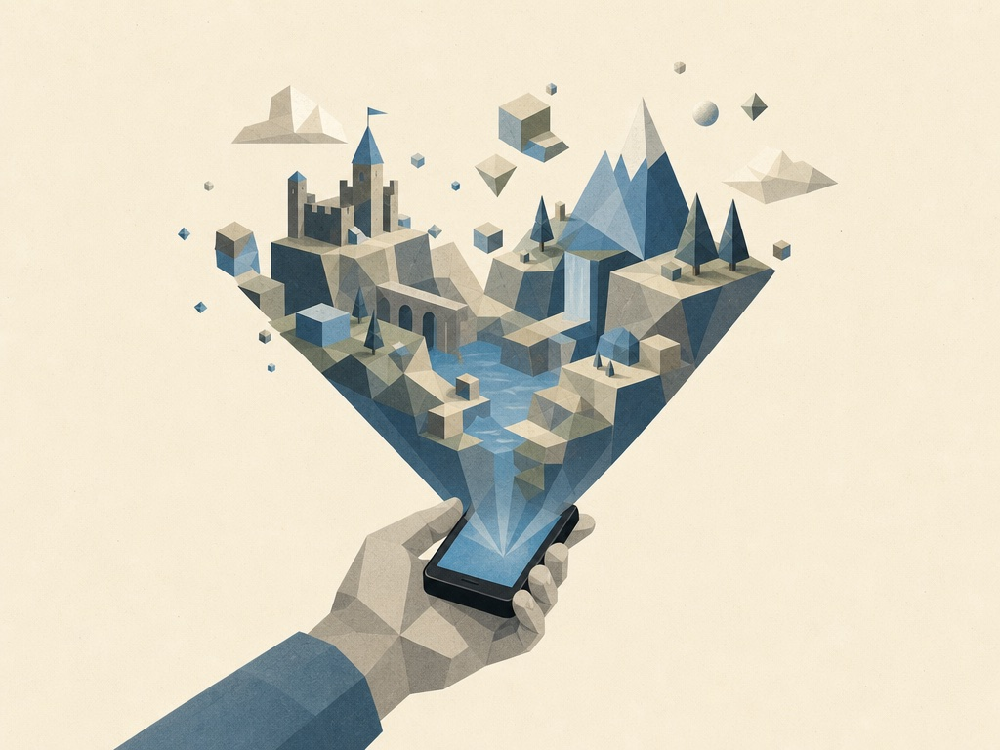

> 원문: https://stratechery.com/2026/an-interview-with-roblox-ceo-david-baszucki-about-aggregating-play/

---

이번 주 스트래터리 인터뷰는 로블록스 CEO 데이비드 바주키와의 대화다. 바주키와는 2022년 2월과 2023년 11월, 두 번 인터뷰한 적이 있다.

이번 인터뷰에서 눈에 띈 것은 AI가 로블록스의 환경을 얼마나 바꿨는가였다. 로블록스는 누구나 게임을 만들 수 있다는 개념 위에 세워진 회사인데, 이제 처음으로 문자 그대로 누구나 게임을 만들 수 있게 됐다. 그것은 풍요의 세계를 의미하고, 그 세계에서 애그리게이터가 될 기회가 있다. 로블록스는 그 기회를 적극적으로 쫓고 있다.

그런 맥락에서 AI가 바주키의 가능성에 대한 생각을 어떻게 바꿨는지, 게임 제작 하네스에는 무엇이 들어가는지, 휴대폰에서 게임을 만드는 일, 추천의 힘에 대해 이야기했다. 이어서 로블록스 게임이 모든 곳에서 돌아가는 유니버설 플레이어(Universal Player)의 비전, 로블록스 개발자가 로블록스 앱 밖에서도 플랫폼을 쓸 수 있게 하는 로블록스 에브리웨어(Roblox Everywhere)를 다뤘다. 애그리게이터의 자연스러운 비즈니스 모델인 광고 이야기도 나왔고, 바주키가 여전히 자신을 메타버스를 만드는 사람으로 여기는지도 물었다.

인터뷰는 가독성을 위해 다소 편집했다.

## AI가 가져온 변화

**데이비드 바주키, 스트래터리에 다시 오신 것을 환영한다.**

**DB:** 벤, 다시 초대해줘서 고맙다. 올 수 있어서 기쁘다.

**이번이 세 번째 인터뷰다. 재미있는 맥락에서 질문을 시작하고 싶다. 2004년에 로블록스를 시작했고, 2021년에 상장했고, 2022년에 처음 만났고, 2023년에 다시 만났다. 거의 20년에 가까운 기간이다. 이제 2026년인데 질문은 이것이다. 지난 3년 사이의 변화가, 회사를 시작해서 우리가 마지막으로 만나기까지의 20년 내내의 변화보다 더 큰가?**

**DB:** 세상의 변화가 확실히 훨씬 빨라지고 있다는 걸 모두가 느낀다. 로블록스를 처음 출시했을 때, 이 팟캐스트 청취자들이 기억할지 모르겠지만, 소프트웨어는 플로피 디스크와 CD로 배포됐다.

**웃긴 건, 최근 2~3주 사이에 인터뷰한 사람 중 당신이 두 번째인데, '패키지 소프트웨어'라고 부르는 이유는 실제로 패키지에 담겨 팔렸기 때문이라는 이야기를 다시 꺼냈다.**

**DB:** 정신없는 시기다. 회사를 시작할 때 인터넷은 있었고, 우리는 '몰입형 공동 경험(immersive co-experience)'이라는 카테고리를 구상했고, SF 작가들은 홀로덱을 오래전부터 써 왔다. 그렇게 우리는 나아갔다.

**나는 여전히 메타버스 찬성이고, 그 단어를 써도 된다.**

**DB:** 좋다, 우리는 다 쓴다. 『스노우 크래시』의 메타버스, 홀로덱, 다 좋다. 우리는 인간의 공동 경험을 만든다는 비전으로 시작했고, 모바일 시대가 지나가는 걸 봤고, 암호화폐 시대도 봤다. 지금 우리가 있는 AI 가속 파도는 내가 본 어떤 것보다 빠르고 크고 정신없다. 제품을 생각하는 방식을 바꾸고 있고, 사람들이 게임을 만드는 방식을 바꾸고 있다. 정말 흥미로운 것은, 회사를 시작할 때 "You Make the Game"이라는 슬로건이 있었다는 점이다.

**그렇다.**

**DB:** 그 슬로건으로 시작했지만, 그 과정에서 게임을 만들고 싶은 사람과 플레이하고 싶은 사람의 비율이 흘러갔다는 걸 알게 됐다. 게임을 만드는 것보다 그냥 플레이하고 싶은 사람이 더 많아졌는데, 역사적으로 게임 제작은 로블록스 스튜디오와 3D 편집, 스크립트 작성이었기 때문이다.

"You Make the Game"이 정말 실현되는 시점, 게임 제작이 모두에게 열리는 시점이 다가오고 있을 수 있다. 정말 재미있는 일이고, 로블록스 빌드(Roblox Build)로 진행한 실험들을 이야기하겠다. 게임 제작이 게임 플레이만큼 커질 수 있는 시대에 들어서고 있다.

**나도 같은 생각이다. 이 모든 주제를 다룰 텐데, 뭘 이야기하고 싶은지는 예상할 수 있을 것이다. 2023년으로 돌아가면, 당신은 AI를 당시 "완전한 대체재가 아니라 슈퍼 붓이자 슈퍼 3D 모델러"라고 불렀다. 아직도 그렇게 생각하는가?**

**DB:** 데이터가 그렇게 증명하고 있다. 몇 주 전 실적 발표에서 많은 가속을 강조했다. 첫째, 사람들이 로블록스에서 AI로 증강할 수 있는 방법이 여러 가지다. MCP를 쓸 수 있는데, 이는 모델을 연결하는 것과 같다. 로블록스 AI 어시스턴트를 써서 제작을 도울 수도 있다.

**그 MCP 서버가 무슨 말인가? 분기 대비 5배 성장이라고 언급했는데, 실제로 Claude Code나 Codex 같은 걸로 로블록스와 작업하는 걸까?**

**DB:** 사람들이 연결하고 있다. Claude Code, Codex, 다른 모델들, 전부 로블록스 스튜디오에 연결해서 제작을 돕고 있다. AI로 만든 게임 두 개가 top 20에 들었고, 자산 수 같은 다른 지표도 있다.

**'AI로 만들었다'는 정확히 무슨 뜻인가? top 100 게임의 80%에 AI가 기여한 콘텐츠가 들어 있다고도 했다.**

**DB:** AI가 손을 댄 것, AI로 직접 바이브코딩한 것이 있고, 가속 중인 자산 수를 볼 수 있다.

**알겠다.**

**DB:** 내가 말했던 것에 어느 정도 충실한 결과라고 본다. 이것은 인간의 붓을 가속하는 도구다. 좋은 아이디어는 여전히 아주 중요하고, 새로운 유형의 게임플레이도 여전히 아주 중요하다. 하지만 사람들이 훨씬 빨리 창의성을 펼칠 수 있게 됐다. 로블록스 이사회 멤버가 휴대폰을 들고 다니며 하루에 15번 게임을 만든다. 회사 안에서 엔지니어나 프로덕트 매니저가 아닌 사람들도 이제 만들고 있다. 새로운 시대의 여명이라고 본다.

## 게임 제작 하네스

**슈퍼 붓, 슈퍼 3D 모델러를 말했다. 슈퍼 게임플레이 개발자도 있는가? '게임 아이디어가 있다'와 게임의 실제 메커니즘 사이에는 큰 간격이 있다. AI는 그 부분에서 얼마나 도울 수 있는가?**

**DB:** 게임 제작 하네스와 코딩 하네스가 무엇이 다른가라는 꿈을 건드렸다.

**파고들자. 이건 정말 흥미롭다. 차이점과 당신의 생각을 정리해달라.**

**DB:** 모두가 코딩 하네스에 익숙해지고 있다. Claude Code, Cursor, Replit, Lovable, Codex, 뭐든. 게임은 코드보다 훨씬 복잡하다고 할 수 있다. 말했듯이 아트가 있고, 3D 오브젝트가 있고, 씬이 있고, 아바타가 있고, 게임플레이 코드가 있을 수 있고, 미션이 있을 수 있고, 그 아래에 코드가 있을 수 있다. 게임을 만들기 위해 만들어지는 하네스는 여러 모달리티로 돌아가야 하고, 당신의 말을 들어야 한다. "100명이 플레이할 수 있는 멀티플레이어 토끼와 거북이 게임을 만들고 싶은데, 금성에서 하고 싶고, 모든 기기에서 돌아가길 원한다"고 말하면 생성해야 할 것이 아주 많다.

아바타와 자산, 그리고 게임플레이. 게임플레이는 내 생각에 아주 인간적인 것이다. 어떤 유형의 게임인지에 대한 당신의 생각은 실제로 아주 고유하다. 이사회 멤버 한 명이 자신만의 비전으로 워들과 크로스워드를 섞은 하이브리드 게임을 만들고 있는데, 그건 그에게 아주 고유한 것이다. 나는 여전히 인간과 가속하는 붓이 결합된, 본질적으로 게임을 만들기 위한 아주 복잡한 하네스라는 그림을 보고 낙관적이다.

**이야기한 조각이 많다. 자산 생성 부분은 2023년보다 훨씬 앞섰고, 사실상 도달했다고 할 수 있다. 비디오 구성요소나 움직이는 세계도 있을 수 있다. 그런데 이 조각들이 각각 따로 있는 것 같다. 하나의 하네스, 즉 잠시 후 이야기할 Build 앱이 그 모든 걸 처리해야 하는가? 아니면 모델이 충분히 좋아질 때까지 조각조각 해야 하는가? 각 부분마다 다른 모델이 필요한가?**

**DB:** 코딩에서도 하네스가 여러 모델을 라우팅하는 걸 보는 것처럼, 많은 회사가 여러 모델을 나란히 돌리고 하네스가 최적화한다. Build와 스튜디오 빌드 안의 우리 하네스는 특정 작업에 여러 모델을 쓰는 것뿐 아니라 '씬을 만드는 중인가, 3D 오브젝트를 만드는 중인가, 코드를 만드는 중인가, NPC를 만드는 중인가'라는 두 번째 차원도 있다. 그렇다. 생성되는 특정 자산의 종류별로도, 각각 안에서 여러 모델로도 라우팅하고 있다. 그리고 로블록스에 놀라운 데이터가 있는 영역을 결합한다. 예컨대 플레이어 캐릭터가 아닌 캐릭터(NPC), 당신 곁에서 자연스럽게 행동하는 캐릭터를 만드는 데 도움이 되는 데이터다. 한편 정말 좋은 코딩 모델들도 있다. 오픈소스와 프론티어 모두. 그래서 하네스가 이 모든 것을 하나로 묶을 수 있다고 본다.

**그 모델들의 조합은 어떤가? 프론티어, 판매용 오픈소스 모델, 직접 학습시킨 모델, 세 카테고리가 있다고 하자. 거기서 또 둘로 나뉜다. 자체 파운데이션 모델을 만드는 건가, 아니면 포스트트레이닝만 하는 건가?**

**DB:** 세 가지가 전부 우리 Build 하네스에서 돌아가고 있다. 어떤 경우에는 프론티어의 비용을 오픈소스의 능력으로 최적화하고 있다. Cube 모델이 있다. 발표했던 모델인데, 3D 자산으로 학습됐다.

**아주 흥미롭다. Cube 모델에 대해 말해달라.**

**DB:** Cube 모델은 로블록스 안의 모든 3D 오브젝트로 학습된 우리 자체 3D 자산 생성 모델이다. 개발자가 학습에 동의한 오브젝트들이다. 아주 빠르고 효율적이고, 우리 자체 하드웨어에서 돌아간다. Build에 들어가서 "저 토끼와 거북이 게임을 만들어줘"라고 말하고, 그 거북이를 좀 독특하게 묘사한다면, "거북이가 이렇게 생겼으면 좋겠고, 털이 이렇고, 이런 것도 있었으면"이라고 하면 Cube 모델이 개입해서 그 거북이를 생성해준다.

**비용 구조는 어떻게 되나? 개발자 입장에서 사용량 기반인가? MCP 서버가 있으니 직접 가져올 수도 있고, 조합은 어떤가?**

**DB:** 프로덕트 매니저 같은 질문이군. 한 시간 전에 나도 정확히 같은 논의를 했다. 궁극적 비전은 로블록스 빌드가 숏폼 비디오 제작과 같아지는 것이다. 10년 전 숏폼 비디오. 어느 순간 우리 모두가 휴대폰으로 비디오를 만들고 편집할 수 있다는 걸 깨달았다. 여러 제품 중에서 그것은 거대한 계시 같은 것이었다.

**완전히 같은 생각이다. 인터뷰 뒷부분에 숏폼 비디오 섹션이 통째로 있다. 좋은 복선이다.**

**DB:** 그래서 숏폼 비디오가 오고, 우리는 휴대폰이 있고, 갑자기 모두가 비디오를 만들고 공유하기 시작했다. 게임은 훨씬 복잡하다고 할 수 있다. 몰입형 3D 환경일 수 있고, 여러 사람이 들어올 수 있다. 코드와 지오메트리와 아바타가 있다고 말했듯이. 하지만 그게 Build가 가려는 방향이다. "휴대폰을 꺼내서 뭔가를 만들겠다"는 같은 개념이다. 일부 모델은 여전히 비싸다.

하지만 꿈은, 이미 테스트 중이다. 캐나다가 오늘 라이브됐다고 생각한다. 세르비아와 뉴질랜드에서도 테스트 중이다. 모두에게 열려 있기를 원한다. 그러면 모델을 아주 효율적이면서 강력하게 쓸 기회가 생긴다. 수백 번의 반복을 원하는 사용자가 정말 깊이 들어가고 싶으면 토큰을 사게 할 기회도 만든다. 이게 모두에게 무료가 되리라고 낙관적이다.

## 로블록스 빌드

**Build를 계속 언급한다. 너희 웹사이트에서 Build를 이렇게 설명하고 있다. "Build는 휴대폰에서 바로 나만의 로블록스 게임을 만드는 새로운 방법이다. 원하는 게임을 자기 말로 설명하면 Build의 AI가 실시간으로 플레이 가능한 게임을 만들어준다. 코딩이나 게임 디자인 경험이 필요 없다. 설명할 수 있으면 만들 수 있다. 뭔가 바꾸고 싶은가? Build에게 조정하라고 말하고, 마음에 들 때까지 계속하라." 이게 원래 원하던 것인가? 우리가 나중에 돌아봐서, 로블록스 스튜디오, 너희의 자랑스러운 보물이, 이것으로 가는 징검다리였다고 말하게 될까?**

**DB:** 회사를 시작할 때는 이건 SF적 판타지였고, 실현될 거라고 생각하지 않았던 판타지였다. 시작할 때는 상상조차 못했고, 오랫동안 업계의 많은 사람들이 3D 편집을 더 쉽게 만들 방법을 찾으려 했다. "정말 쉬운 소비자용 3D 모델러"라고. 그런데 최고의 소비자용 3D 모델러조차 여전히 꽤 복잡하다.

**믿기지 않는 일인데, 내 현재 3D 경험은 3D 프린팅에 푹 빠져 있는 것이다. 관련 앱을 한 번도 연 적이 없다. 전부 AI에서 하고 바로 프린터로 간다. 믿을 수 없다. 지난 몇 년간 실제 모델링을 해온 사람들에게 감사를 표한다. 나는 그걸 모두 건너뛰었는데, 디지털 공간에서도 같은 일이 일어나고 있다.**

**DB:** 지난 5년 동안 AI가 이걸 할 수 있을지 모르겠다고 보기 시작했고, 지난 2~3년 동안 가속률이 사람들을 놀라게 하기 시작했다고 본다. 그 가속률이 사람들을 놀라게 하면서 이 꿈이 훨씬 가능해졌다. 지금 로블록스에는 로블록스 빌드로 만들어서 돈을 버는 게임이 있다. 수십, 수백 개가 아니라 수천 개의 게임이 로블록스 빌드로 출판됐다. 미국에는 아직 라이브가 아니다. 테스트 중이고 곧 열릴 것이다. 그러니 데이터는 이미 나와 있다.

**흥미로운 건 당신이 "상상조차 못했다"고 말하는 것이다. 이전 인터뷰들에서 계속 드러났던 건 비전의 연속성이었다. "그때 봤고, 이제 도달하고 있고, 계속 이 비전을 갖고 있었다." 그게 내 첫 질문으로 돌아간다. 최근 몇 년 사이에 당신조차 "이런 곳으로 올 줄 몰랐다"고 하는, 거의 단절 같은 것이 있었나?**

**DB:** 기술 업계의 우리 모두가 그걸 느끼고 있다고 본다. CEO도, 프로그래머도, 이 제품을 쓰는 사람들도, 소비자도. 지난 몇 년간 우리 모두 그 한가운데에 있다고 본다.

## 로블록스 디스커버리

**이게 로블록스를 더 가치 있게 만드는가, 덜 만드는가? 누구나 게임을 만들 수 있으면, 당신의 보석인 로블록스 스튜디오는 더 이상 대단한 게 아닌가?**

**DB:** 정말 가치 있는 것은 몇 가지의 조합이라고 본다. 유니버설 플레이어라는 개념을 공유했고, 곧 다룰 것이다. 로블록스 에브리웨어라는 개념도 있고, 게임이 만들어질 때 배포 플랫폼의 힘이 점점 강해진다는 개념도 있다. "어디서 찾나, 어디서 돌아가나, 어떻게 안전하게 유지하나, 친구와 어떻게 플레이하나, 경제가 있는가." 그런 면에서 배포 플랫폼이 더 강해진다.

배포 플랫폼을 하나 골라서 생각해볼 만하다. 틱톡이든 유튜브든. 어떤 면에서 AI는 그 플랫폼들을 가속할 수 있다. 하지만 어떤 면에서 그 플랫폼들은 AI가 있든 없든 엄청난 강점이 있다. 누군가 AI로 유튜브 플랫폼 전체를 재현할 수 있어도, 클라우드든 클라이언트든 전부 재현할 수 있어도, 사람들은 여전히 유튜브에 가서 비디오를 볼 것이다.

**내가 그리던 연결이 바로 그것이다. 숏폼 비디오 플랫폼 아이디어로 가는 것. 나는 배포와 디스커버리를 구분해왔다. 배포는 무료다. 누구나 웹사이트를 올릴 수 있고, 일반적으로 말하자면 웹사이트에 게임을 호스팅할 수 있고, Vercel이든 어디든 호스팅할 수 있다. 그런데 디스커버리는, 게임이 천문학적으로 많아지면 원하는 걸 어떻게 찾는가의 문제다. 둘 중 로블록스의 미래에 더 중요한 것은 어느 쪽이라고 보나?**

**DB:** 둘 다 엄청나게 중요하다. 로블록스 플랫폼 자체에 매일 1억 명 이상이 온다. 플랫폼의 디스커버리 쪽에는 두 각도가 있다. 첫째, 모두가 게임을 만들면 어떻게 되는가. 갑자기 과거에는 없던 풍요로운 새 게임과 경험이 생긴다. 어떻게 적합한 사람과 적합한 게임을 친구와 연결하나? AI 슬롭이라고 불릴 만한 것 안에도 놀라운 게임이 박혀 있을 수 있다. 100개 중 1개일지라도. 그리고 손으로 만든 게임 중에도 사람들의 관심을 끌지 못하는 게 있을 수 있다. 그래서 디스커버리가 엄청나게 중요해진다.

로블록스에서 진행 중인 것, 그리고 로블록스의 기회는, 전통적인 디스커버리, 즉 모든 사용자-게임 쌍을 최적화하고 그 연결에서 장기 리텐션을 예측하는 것에 더해, 게임이 많아질수록 콘텐츠 이해(content understanding)가 엄청나게 중요해진다는 것이다. 로블록스는 모든 게임이 클라우드에서 돌아가는 플랫폼이기 때문에 콘텐츠를 살펴보고, 학습한 것에서 배우고, "이 게임은 흥미롭고 새롭고 다양한 방식으로 구성됐다", "이 게임은 다른 게임들과 많이 다르게 보인다"라고 말할 수 있다. 그것이 위대한 콘텐츠를 새 사용자에게 노출하는 데 도움이 될 수 있다.

플랫폼 내 디스커버리 외에 또 하나는 우리가 공유했던 로블록스 에브리웨어 개념이다.

**그 얘기 하자고 했는데, 이 맥락에서 아주 흥미롭다고 본다. 플레이어를 적합한 게임에 매칭한다고 했는데, 추천 알고리즘에 뛰어들면서 뭘 배웠나? 나는 계속 그 경로를 언급하는데, 이게 소셜 네트워크화다.**

**DB:** 그래, 비디오와는 아주 다르다. 게임은 사용자가 여러 번 플레이할 수 있는 것이고, 친구들이 즐길 수 있는 환경이다. 좋은 게임은 몇 년씩 지속된다. Adopt Me는 플랫폼에 오래 있었다. 오랫동안 기쁨을 주는 Adopt Me를 찾는 것이 일회성 비디오보다 아주 중요하다. 우리가 배운 것은 단기 리텐션이 아니라 장기 리텐션을 최적화하는 것이라고 본다.

**몇 분기 전에 그 전환을 했을 때 실적에 크게 반영됐다. 그때 생각은 어땠나? 예상대로였나?**

**DB:** 실적에 대한 언급은 하지 않겠다. 하지만 수학적으로, 장기 리텐션을 올릴 수 있다면, 더 많은 사람이 플랫폼에 머물고, 더 많은 사람이 좋은 시간을 보내고, Adopt Me에서 말했듯이 10년 동안 플레이할 게임을 찾는다면 계산이 맞는다. 리텐션은 사용자를 키우고 입소문을 키우는 데 결정적으로 중요하다. 그래서 장기 리텐션 최적화가 점점 나아지고 있다.

우리는 그것을 직접 측정한다. 모든 사용자-게임 쌍의 장기 리텐션 기여도를 측정한다. 흥미로운 것들이 보인다. 다른 유형의 사람 그룹이 다른 유형의 게임을 좋아한다. 로블록스 홈페이지로 가면 사람들이 만장일치로 말한다. "점점 내가 오래 플레이할 것 같은 게임들이다."

**2022년에 로블록스의 초기 제품이 멀티플레이어와 소셜이 아니어서 실패했다고 말했고, 그게 회사의 근본 교훈 중 하나였다. 이제 오프라인 싱글 플레이어 게임을 허용하고 있다. 움직였나? 무엇이 바뀌었나? 소셜 측면은 여러 번 언급했고, 하지만 혼자 플레이하고 싶은 사람들도 있다. 훌륭한 게임, 혼자서?**

**DB:** 장기적으로 로블록스의 기반은 계속 멀티플레이어, 함께 모이는 친구들이라고 본다. 실시간일 수도 있고, 비동기일 수도 있다. "내가 한 턴, 네가 한 턴"일 수도 있다. 언젠가 매치-3 퍼즐을 플레이하고 결과를 비교할 수도 있다.

싱글 플레이어로의 이동, 퍼즐로의 이동이 정말 말하는 것은, 유니버설 플레이어와 로블록스 에브리웨어라는 야망과 함께 이제 전체 스펙트럼을 커버할 만한 대역폭이 있다는 것이다. 유니버설 플레이어라는 개념은 전통적인 2D 오프라인 퍼즐 게임에서부터 아직 발명되지 않은 것, 즉 초대규모 멀티플레이어, 포토리얼리스틱 리얼리티까지, 그 사이의 모든 것을 아우른다.

그래서 퍼즐 게임과 로블록스 리얼리티의 비전은 비디오 유추로 돌아간다. 어떤 면에서 비디오에서는 카메라와 플레이어가 어느 정도 발명됐다. 카메라가 도처에 있고, 4K가 있고, 60헤르츠 재생이 있고, 모바일 재생이 있고, 거실에서의 재생이 있다. 그래서 세상의 비디오는 대체로 내 거실 4K 60헤르츠 TV에서 재생된다. 게임에서는 그렇지 않다. 지금까지 발명된 모든 게임과 앞으로 발명될 게임이 재생될 수 있는 유니버설 레일이 아직 없다. 그것이 2D 퍼즐과 유니버설 플레이어의 개념이다.

## 유니버설 플레이어

**한 발 물러나서 유니버설 플레이어를 설명해달라. 넓게 말해서, 여러 표면이라는 측면에서도, 다른 플랫폼의 게임을 로블록스 경험으로 가져오는 것도 포함해서.**

**DB:** 그중 일부는 AI 각도에서 먼저 접근하고, 그다음 퍼즐 게임 각도에서 접근하겠다.

AI 각도에서, 스튜디오 어시스턴트나 MCP 모델을 로블록스 스튜디오에 연결하고 "이걸 만들고 싶다"고 말할 때, 여전히 기술적 제약이 있다. MCP를 연결하고 "캘리포니아 주에서 일어나는 게임을 만들어줘, 3D 멀티플레이어 환경으로, 포토리얼리스틱하게, 10만 명이 걸어 다니고 차를 운전할 수 있게"이라고 하면, 기술적으로 불가능하다. 하지만 우리는 그쪽으로, 다시 말해 멀티플레이어 고규모 포토리얼리즘으로 최대한 빨리 나아가고 싶다. 게임을 상상하는 사람이든 MCP 서버로 만드는 사람이든, 그리고 궁극적으로 이미 만든 게임을 가져와서 그 유형의 환경으로 변환하는 사람에게 자리를 만들어주고 싶다.

그래서 유니버설 플레이어가 있으면, 그것은 멀티플레이어로 돌아갈 수 있는 모든 게임의 상위집합이다. 오프라인 퍼즐 게임이 있으면 연결하고, 원하면 소스 코드를 일부 가져와서 로블록스로 변환해줄 수 있다. 싱글 플레이어 고해상도 게임이 있어도 로블록스로 변환해주고, 그 변환 과정에서 멋진 일들이 몇 가지 더 일어난다.

우리는 '로블록시피케이션(Robloxification)'이라는 용어를 만들었다. 그게 로블록스 아키텍처의 진짜 차이다. PC의 싱글 플레이어 게임이 이제 기본적으로 멀티플레이어가 될 수 있다. 클라우드에서 돌아가기 때문이다. 3D 스트리밍을 하기 때문에 싱글 플레이어 게임이 휴대폰에서도 돌아간다. 아, 로블록시피케이션이 되고 있구나. 싱글 플레이어 게임이 500기가바이트 다운로드가 아니라 즉시 참여할 수 있다는 것도 아주 흥미롭다. 싱글 플레이어 게임이 경제 등에 접근할 수 있다. 유니버설 플레이어의 개념은 기존 게임과 새 게임을 모두 변환하고 로블록시피케이션하는 것이다.

**디스커버리 대 배포로 돌아가서, 이게 로블록스 디스커버리 엔진에 들어가고 싶은 사실을 활용하는 것인가? 로블록스에 사람들이 있고, 개별적으로 게임을 다운로드하러 가지 않을 테니까.**

**DB:** 정확하다. 로블록스 에브리웨어를 통해 유니버설 플레이어로 들어온 게임이 로블록스 앱에서 이용 가능해진다. 그리고 생각해보면, 앱 밖에 있는 훌륭한 게임들이 앱에서도 발견될 수 있다는 것만큼 콘텐츠를 발견하기 좋은 방법이 있을까?

**이게 유추다. 숏폼 비디오로 돌아가서, 메타 대 틱톡 이야기가 있었다. 틱톡은 소셜 네트워크라고 불리지만 실은 소셜 네트워크가 아니라는 걸 깨달았다. 그냥 당신이 좋아할 비디오를 주는 것뿐이고, 팔로우하는 사람과는 아무 상관이 없다. 메타는 소셜 네트워크라는 정체성에 갇혀 있었다. "그게 우리를 강하게 만든다"고. 틱톡과 경쟁하고 릴스를 만들기 위해서는 그걸 내려놔야 했다. "그냥 원하는 걸 주겠다." 싱글 플레이어 게임 수용, 추천 알고리즘에 대한 유추가 있는가? 메타는 소셜 네트워크 부분이 중요하다고 말할 것이다. 로블록스도 소셜 측면이 중요하다고 말하겠지만, 진짜로 성장하고 잠재력을 다 채우려면 좀 더 원자화해서 플레이어에게 정확히 원하는 것을 맞춰줘야 하는 것 아닌가?**

**DB:** 그래, 오히려 그것보다 더 크다고 본다. 세 가지 깨달음을 말하겠다.

첫 번째 깨달음. 물리적 세계를 보면, 사람들이 놀 때, 스포츠든 보드게임이든 어떤 형태의 놀이든 친구들과 부딪히면서, 대체로 단지 놀이가 아니다. 놀이면서 연결하고, 커뮤니티를 이루고, 놀이를 만들고, "우리 뭐 할까?"라고 하고, 때로 다른 사람의 놀이를 보고, 놀기 위해 차려입기도 한다. 그래서 우리는 시장을 게임 시장이 아니라 놀이 시장으로 생각하기 시작했다. 그 조각들이 어떻게 함께 작동하는지. 그것은 우리에게 약간의 확장, 재고였다.

두 번째는, 놀이 시장이라고 하면 이제 "로블록스는 3D 멀티플레이어 게임 엔진이다"라고만 말할 수 없다.

**스스로를 제약하고 있었던 거다.**

**DB:** 맞다. 과거에 우리가 특정 규모에서 집중하고 성장하도록 도왔던 모든 제약은, 집중의 제약에서 내려놓는 제약으로 뒤집혀야 한다.

**무엇이 더 어려웠나, 회사를 설득해서 그 제약을 내려놔야 한다고 하는 것, 아니면 스스로를 설득해야 하는 것? 두 가지가 눈에 띄었다. 하나는 장기 비전이 실제로 연속적이었는데 이제 "큰 전환이었다"고 말한다는 것. 그리고 둘째는 집중, "이게 우리가 하는 일"이었는데 이제 "아니, 그걸 내려놓고 모든 걸 하자"고 말한다는 것.**

**DB:** 우리는 이런 전환을 몇 번 겪었다. 초기 로블록스는 PC와 매킨토시였다. 한동안, 믿기 어렵겠지만, 휴대폰 버전이 없었다. iOS 앱스토어 top 100을 봤을 때 3D 게임이 없었다. 중국이 조금 앞서 있었고, 미국은 아니었다. 거대한 회사 내 논쟁이 있었다. "로블록스가 휴대폰에서 어떻게 작동할 수 있는가? 휴대폰은 2D다. 안 될 것이다." 다행히 사과하건대, 우리는 도전했고 이제 그 전환을 지나왔다.

로블록스의 아주 초기에는, 블록 모양이 너무 단순하고 만들기 쉬워서 3D 메시 오브젝트의 수입을 허용하지 않았다. 그것도 사과하건대 내려놨다. 궁극적으로 우리는 모든 스타일의 게임을 원하기 때문이다. 그래서 2D와 오프라인이 그런 맥락에서 마지막 보루 중 하나라고 본다. 정말 놀이 시장이고, 더 이상 제약할 수 없다.

**이 시장으로 밀려 들어간 것인가, 아니면 끌려 들어간 것인가? 시장 기회가 너무 큰 건가?**

**DB:** "우리는 놀이 시장을 노린다"라고 말하는 것이 훨씬 재미있고 단순하다.

**(웃음) 그렇지, 전부 하자.**

**DB:** 커뮤니티를 위한 통합되고 안전한 방법이 필요하고, 함께 플레이할 훌륭한 게임을 찾는 통합되고 안전한 방법이 필요하다. 그 모든 게 사실 더 단순한 제품 스펙이고 더 재미있는 제품 스펙이다.

**그것이 의미하는 바는, 회사로서 당신이 공급으로 정의된다, "우리가 뭘 할 수 있고 이걸 제공할 것이다"에서, 이제 그것이 "시장이 무엇이고 그 시장을 어떻게 채울 것인가"로 뒤집혔다는 것인가?**

**DB:** 그래, 그것은 제품의 흥미로운 기능들로 이어진다. 예를 들어 숏폼 비디오는 전통적으로 혼자 보는 용도다. 숏폼 비디오 같은 느낌인데, 친구가 이미 플레이 중인 3D 게임을 보는 것을 상상해봐라. 친구를 찾고 게임에 뛰어드는 방법이다.

**맞다. 숏폼 비디오 비교를 했는데, 당신은 문자 그대로 숏폼 비디오를 하고 있다.**

**DB:** 3D 방식으로 디스커버리를 찾는 것은 아주 흥미롭고, 친구와 연결되는 방법을 찾는 것도 아주 흥미롭다. 놀이에 대한 이 단일한 비전이 다리가 있는 카테고리라고 느낀다. 아직 풀어야 할 것은 창작과 친구와 함께 플레이하기의 크기가 얼마나 되는가다.

Build의 초기 플레이어에서 본 것은, 이런 플랫폼에서 숏폼 비디오를 만들고 친구들이 보는 것에 많은 기쁨이 있다는 것이다. 그것은 스파이크로 일어나고, 사람들이 그렇게 하는 걸 봤다. 로블록스에서 게임을 만드는 사람들이 휴대폰을 들고 앉아서 "와, 내 게임에 네 명이 있어, 그 네 명이 내 게임을 플레이하면서 피드백을 준다"라고 말하는 기쁨을 봤다. 그건 정말 강력하다고 봤다.

**흥미롭다. 피드백 메커니즘에 행동할 수 있다는 점에서. 비디오에 피드백을 주면 그건 그저 비디오에 대한 댓글이다.**

**DB:** 그리고 강조했듯이, 이사회 멤버들이 하루에 15번 게임을 수정해서 네 명이 여섯 명이 된다.

**정말 흥미롭다. 게이밍에는 비디오의 2D 측면과 달리 3D 측면이 있는 것 같다. 이건 거의 4D 측면이다. 상호작용이 있고, 시간이 지나면서 상호작용과 함께 진화하고 움직이는 오브젝트를 중심으로 하는, 아주 다른 방식의 소셜 네트워크다. 4D 제품이 있다고 본다.**

**DB:** 맞다. 우리는 물리 엔진에서 4D라는 용어를 애정으로 쓴다. 4D 오브젝트는 행동과 코드가 있고 무언가를 하는 오브젝트다. 정적 오브젝트가 아니다.

## 로블록스 에브리웨어

**계속 언급해온 또 다른 주제는 로블록스 에브리웨어다. 먼저 그것이 무엇이었는지 설명해달라. 우리가 이야기해온 것과 연결된 질문들이 있다. 로블록스 에브리웨어는 처음부터 무엇인가?**

**DB:** 우리가 공유했다. PC, 맥에서 "어머, 모바일을 하는데 될까?"로 점프한 것. 그리고 그 과정에서 만든 다른 변화들. 한동안 우리가 붙잡고 있던 것 하나는, 100% 모든 것이 로블록스 앱 안에 있어야 한다는 것이었다.

**그렇다.**

**DB:** 하지만 유니버설 플레이어라는 비전을 보면서, 로블록스에서 만들든 변환하든 AI를 쓰든, 레일 아래에서 유니버설 플레이어는 게임이 대규모로 구성되고 실행될 수 있는 장소라는 것. 점점 더 생각할수록, 유니버설 플레이어의 힘이 로블록스 앱 안에서만이 아니라, iOS 앱스토어, 구글 플레이 스토어, PC, 콘솔에서 스탠드얼론 게임을 출시하고 싶은 창작자에게도 매력적이게 됐다. 그리고 고민 끝에, 창작자에게 앱 밖에서도 유니버설 플레이어에 대한 접근을 주는 것의 이점은 우리에게 엄청난 이점을 가져온다. 그들의 콘텐츠가 앱에서 디스커버리 가능하게 된다는 것이다.

**그게 내 질문이다. 좋다, 모든 기기로 나가는 것에는 동의한다. 블록 캐릭터만이 아니라 3D 캐릭터도 하자, 우리가 말하는 모든 것. 하지만 나는 이 논의 전체를 이렇게 프레이밍해왔다. 숏폼 비디오와 비교해왔는데, 그건 애그리게이터 플레이다. 당신은 최종 사용자를 소유하고, 소비자를 소유하고, 유니버설 플레이어가 있고, 사람들이 게임을 가져와서 고객에게 도달하게 할 수 있고, 지난번에 많이 이야기한 광고 비즈니스가 있다. 로블록스 에브리웨어를 보면 마치 회사 전체가 한 방향으로 흐르고 있는 것 같다. 로블록스라는 장소가 있다. 게임을 만들고 싶으면 거기 가라, 고객이 있고 수익화가 있고, 전부 거기에 있다. 그런데 이제 "실은 옆구리에 함정문을 열어서 모두가 옆으로 나가게 하자"고 한다. 내가 지금 "좀 더 집중할 수 없나"라고 말하는 겁쟁이인가?**

**DB:** 그 통찰에 감사한다. 하지만 우리에게 정말 흥미로운 것은 게임 시장의 아주 큰 비율이 로블록스 에브리웨어에서 돌아가게 될 가능성과, 우리 앱 안에서 일어날 콘텐츠 폭발의 가능성이다.

로블록스 에브리웨어를 이렇게 생각했다. 창작자라면, 작은 앱을 내는 인디 창작자일 수도 있고 큰 스튜디오일 수도 있다. 우리가 가장 놀라운 기술 플랫폼, 실은 유니버설 플레이어를 갖출수록, 그리고 그 기술 플랫폼 위에서 돌아가는 것이 절대적으로 타당해질수록, 로블록스 앱 안에 있든 스탠드얼론이든, 우리는 그 콘텐츠가 우리 앱에 있다는 이득을 얻는다. 그 앱은 소셜이고, 즉시 실행할 수 있고, 공통 소셜 구조를 공유하고, 공통 안전 구조, 공통 경제 구조를 실어나르고, 전부 함께 돌아간다. 그래서 우리의 계산은, 당신 말대로 위험해 보일 수 있지만, 실은 이것이 로블록스 앱 자체의 사용자를 키우는 최선의 방법이라는 것이다.

**그래. 흥미롭다. 우리가 함께 그려온 유추, 숏폼 비디오와 게이밍 사이의 유추다. 하지만 당신 말대로 게이밍은 여전히 훨씬 어렵다. 지난 40~50년의 게이밍 역사를 보면 이것이 추세였다. 시간이 지나면서 개발 비용이 너무 커져서 멀티플랫폼이 되어야 한다. PS3가 대표적인 예다. 어떤 게임도 활용하지 못한 초복잡하고 강력한 아키텍처를 만들었다. HD 자산 제작 비용이 너무 높기 때문이다. Xbox에도 있어야 하고 PC에도 있어야 한다. 그래서 모든 것이 멀티플랫폼이 되고, 소니는 독점 전략으로 대응한다. 이것도 비슷한 논리인가? 게임 제작이 어렵고, 그래서 개발자가 게임을 어디서든 돌릴 수 있게 하지 않으면 로블록스에도 오지 않을 것이라는?**

**DB:** 정말 어렵고, 지금은 분리가 많이 있다. 내가 보는 초고사양 PC 게임과 해외의 2기가바이트 안드로이드 폰에서 돌릴 수 있는 것 사이에. 그것들은 대개 다른 제품이다.

**그래서 개발자에게 세계 전체를 시장으로 만들려는 건가? 이걸로 만들면 세계 전체가 시장이 될 것이라고?**

**DB:** PC에서 초고사양 AAA 멀티플레이어 게임을 만들고, 해외의 2기가바이트 안드로이드 폰에서 같은 게임에 접속하는 것이 기술적으로 가능했다면 상상해보라. 그것이 창작자들에게 기술적 기회라고 생각한다.

**스트리밍과 어떻게 다른가? 콘솔 게임을 휴대폰으로 스트리밍하잖아. 제안하는 것과 뭐가 다른가?**

**DB:** 게임 스트리밍이라고 불리는 것의 아주 창의적인 역사가 있다. 게임이 멀리서 돌아가고, 내 키보드와 마우스를 게임으로 보내면, 비디오가 돌아온다.

**(웃음) 맞다. 그리고 별로다.**

**DB:** 20년 전에도 그랬다. Gaikai, OnLive, OTOY. 긴 역사를 봤다. 별로라고 했는데, 내가 말하자면, 우리가 비디오에서 하는 것들 중 일부는, 당신과 나는 지금 줌 통화 중이고, 내 캐릭터를 보면 내 캐릭터가 즉시 반응한다. 거울을 보는 느낌이다. 순수 비디오 스트리밍 아키텍처에서는 50~100밀리초 늦게 움직일 수 있고, 사람들은 그것에 아주 민감하다. 비디오 서버에 가까우면 꽤 빠를 수 있지만, 로컬 3D의 즉각적 피드백이 아주 중요하다고 본다. 그것이 비디오 스트리밍이 우리가 생각한 만큼 폭발하지 못한 이유일 수 있다.

**스트리밍에 문제가 있나? 기존 것을 개조하려고 하고, 당신은 이 경험을 위해 네이티브로 만드는데, 그게 차이를 만드나?**

**DB:** 우리는 네이티브 3D를 원한다. 멀티디바이스 네이티브 3D, 아주 낮은 지연이 그것들에서 일어나길 원한다.

게이밍이 더 어려워지는 다른 차원들도 있다. 규제 환경이다. 예전처럼 내가 게임을 만들 수 있는 시대가 아니다. 주마다, 나라마다 다른 법이 있고, 문화적 법이 있다. 기회 중 하나는 그것에 자동으로 맞출 수 있는 플랫폼이다. 나이에 관한 모든 규칙이 무엇인가, 등급에 관한 규칙은 무엇인가. 창작자가 그런 것들을 고민하지 않고 세계에 도달할 수 있게 돕는 또 다른 것이다.

**에브리웨어 게임의 수익화는 어떻게 생각하나? 플랫폼 수수료 같은 게 있을 건가, 유니티 같은 방식? 아니면 보상은, "우리 기술로 만들면 로블록스에도 있게 되고, 그게 돈을 버는 곳"인가?**

**DB:** RDC에서 공유했다. 로블록스가 출판하는 게임의 수익화는 어느 정도 비슷할 수 있다는 것. 앱스토어에 가면 로블록스가 출판한 게임이 로블록스 안의 게임과 정확히 같은 게임일 수 있다. 개발자의 허가가 있을 때만 그렇게 할 것이다. 하지만 정말 멋질 수 있다. 앱스토어에서 "Grow a Garden"을 검색하고 "와, 그 게임이 있다"고 말할 수 있다.

개발자가 직접 앱스토어에 올리는 게임의 경우, 경제 구조를 공유하지 않았다. 하지만 내가 말한 명제, 창작자가 고민할 이유를 없애는 것, 그것은 경제 구조가 상당히 파격적이어야 함을 의미한다. 기대하라.

## 광고

**광고는 이것과 전체 비전에서 어디에 맞는가? 광고 업데이트를 달라. 3년 전에 많은 시간을 보냈다.**

**DB:** 실적 발표에서 점점 더 기대가 커지고 있다고 공유했다. 로블록스 플랫폼 광고뿐 아니라 전력을 다하고 있다. 그것도 빠르게 성장하고 있다고 공유했다. 창작자가 로블록스에 들어와서 로블록스 스튜디오 어시스턴트나 Build나 MCP를 쓸 때, "초기 트랙션을 얻어야 한다, 천 명의 사용자가 필요하다", 그 광고들이 로블록스 플랫폼에서 이용 가능하다.

**풍요가 오면 그게 좋은 점 아닌가. 게임이 너무 많아서 발견해야 한다. 유저 획득 광고는 매우 수익성이 좋다.**

**DB:** 그 유형의 광고의 가속을 봤다. 그리고 이전 유추로 완전히 되돌아가면, 이사회 멤버들이 휴대폰으로 광고를 사고 있다.

**(웃음) 이해충돌이다. 자기들 주가를 올리는 중이다.**

**DB:** 점점 더 이용 가능해지는 두 번째 유형의 광고가 있다. 아주 짧은, 5초 이상의 스킵 가능한 프리롤 비디오다. 로블록스 역사의 아주 먼저, 프리롤 비디오를 시도한 적이 있다. 좋은 실험이 아니었다. 비디오 품질이 그렇게 흥미롭지 않았고, 당시 프리롤 비디오는 30초나 45초였다. 기술적으로도 골치 아팠고, 사용자 경험이 마음에 들지 않아서 뽑아냈다.

그것은 한동안 우리에게 "어머, 프리롤은 안 된다"로 남겨뒀다. 하지만 오늘날, 재미와 품질, 브랜드를 아주 선별한다면, 21살 로블록스 플레이어에게 흥미로울 브랜드를 상상할 수 있다. 의류 브랜드, 전자제품 브랜드, 영화 브랜드. 그들이 "이런 걸 보는 건 꽤 멋지다"라고 말할 수 있다. 그리고 로블록스의 전형적인 게임은 완전 즉시 실행이 아니라 5~7초 걸려 실행된다.

**맞다, 시간이 있다.**

**DB:** 실제로 아름다운 기술적 오버레이가 있다. 제대로, 네이티브로 하면, 이 모든 것을 함께 묶을 수 있다. 그래서 이 잠재적 조합에 대해 아주 기대하고 있다.

**회사들, 특히 처음 광고를 할 때, 너무 고민하는 측면이 있나? "세계에서 가장 창의적인 광고가 필요하다, 게임 안에 빌보드가 있고 이런 경험들이"라고. 실은 아니고, 그냥 프리롤 비디오를 보여주면 되는 거잖아.**

**DB:** 맞다고 본다. 우리는 크게 생각하는 역사가 있고, 궁극적으로 사람들이 하는 다양한 유형의 브랜딩이 있을 것이라고 느낀다. 3D에서 문자 그대로 쇼핑하고 그 모든 것을 하는 몰입형 3D의 가능성이 많이 있다. 하지만 엄청난 양의 프리롤 비디오도 있다.

**맞다, 결국 그곳에 도달할 수 있다. 실제로 많은 저노력 과실(low-hanging fruit)이 있는 것 같다. 많은 첫 광고주 플랫폼들이 고르기를 꺼려하다가 "실은 저노력 과실부터 고르자"가 되는 것 같다.**

**DB:** 맞다고 본다. COPPA 준수, 프라이버시 준수, 로블록스 가치준수 방식으로, 여전히 놀라운 광고 사용자 경험을 상상할 수 있다.

**이게 에브리웨어의 잠재적으로 파격적인 가격과 연결되나? 게임을 만들면 모든 곳에 있다, 축하한다. 하지만 실제로 돈을 벌려면 로블록스에 있어야 하고, 그게 유저를 획득하는 데 돈을 쓰기에 최선의 장소다. 메타에 쓰는 것보다 낫고, 다른 어디보다도.**

**DB:** 로블록스의 18세 미만에서, 미국 게임 수익의 문자 그대로 20%가 플랫폼을 통해 흐를 수 있다고 공유했다. 그 연령대에서 엄청난 침투율이다. 18세 이상으로 같은 침투율로 이동하면서, 갑자기 내 새 게임을 위한 로블록스 광고의 가치가 점점 더 커진다. 그 사용자들이 이미 거기 있기 때문이다.

**나이 든 플레이어가 당신의 흰 고래인가? 우리가 이야기할 때마다 항상 "나이 든 플레이어로 확장할 것이다"였다. 그게 기회가 아니라 현실이 되는 건 언제인가?**

**DB:** 현실은 지금이다. 우리 플랫폼에서 가장 빠르게 성장하는 것이 18세 이상이고, 매우 빠르게 성장하고 있다.

**새 사용자를 얻는 건가, 나이 들어 들어와서 머무는 사람들인가?**

**DB:** 확실히 둘 다다. 18세 미만보다 작은 코호트다. 하지만 수익에서 점점 더 큰 비율이 되면서, 상단의 성장률도 더 이끌 것이다.

**그게 싱글 플레이어 오프라인, 새로운 유형의 게이밍, 퍼즐과 어떻게 연관되나?**

**DB:** 그 세그먼트 중 일부는 아주 3D 멀티플레이어이고, 일부는 퍼즐이다. 겹치는 부분이 있다. 전체 놀이 시장을 생각하고 앞으로 어떤 유형의 게임도 제한하지 않으면, 그 시장의 좋은 부분을 실제로 만들 기회가 더 많아진다. 그리고 그 사용자들이 일단 플랫폼에 오면, 아주 가치 있다. 다른 게임들도 그들에게 매력적일 수 있기 때문이다.

**첫 인터뷰에서, 당신은 유료 획득을 의도적으로 피했다고 말했다. 유기적 바이럴이 로블록스에 필수적이었기 때문이고, 부분적으로는 게임의 소셜 측면 때문이었다.**

**DB:** 우리는 신중했다고 본다.

**지금은 훨씬 큰가?**

**DB:** 18세 미만에서도 초기부터 유료 획득을 실험했지만, 지출의 수익을 항상 얻는 것에 아주 신중했고, 유기적 바이럴이 가장 커야 한다는 것을 항상 알고 있었다. 하지만 논리적인 지출액은 있다. 18세 이상에서도 지금 같은 일을 하고 있다. 유기적과 유료를 섞고, 최적 조합이 있다. 획득에 쓰는 무엇이든 쓴 것보다 증분 수익을 더 만들길 원하고, 그 위생을 지키고 있다. 그래서 유료 획득이 우리에게 타당하다.

## 메타버스

**로블록스는 메타버스인가? 여전히 그 꿈인가? 나는 그 단어를 좋아한다. 다른 사람들은 그렇지 않은데.**

**DB:** 그 단어가 왔다 갔다 한 게 이상하다고 느낀다. 하지만 시간이 지나면 그 단어가 돌아올 수도 있다고 본다. 80년대, 90년대, 2000년대에 그것은 단지 게이밍 플랫폼이 아니라 커뮤니케이션 플랫폼을 묘사하는 아주 인기 있는 방식이었다. 사람들이 함께 모여 플레이하거나 일하거나 여러 가지를 하는 장소.

궁극적으로 게이밍을 넘어서도 여전히 타당하다고 느낀다. 이 줌 통화는 언젠가 3D 시뮬레이션 메타버스 통화가 될 것이다. 전통적인 2D 모드로도 돌릴 수 있고, 포토리얼리스틱할 것이다. 하지만 내가 당신 뒤의 그 지구본을 보고 싶다면, 허락을 받고, "벤, 지구본을 보러 가도 될까?"라고 말하면, 희망컨대 당신은 괜찮다고 할 것이고, 나는 가서 볼 수 있다. 그것은 줌에서 할 수 없는 것, 궁극적으로 메타버스 통화에만 고유한 것이다.

**아주 멋진 지구본이다. 골동품 가게에서 샀다. 기압계가 있고, 온도계가 있고, 실제로 불이 들어온다. 램프이기도 해서 내 배경이다.**

**DB:** 나는 지구본을 사랑한다. 망원경도 사랑한다.

**그렇군요. 메타버스, 이 3D 세계에서, 실제 세계의 것을 이야기했다. 내 방에 들어올 수 있다고. 하지만 예로 돌아가서, 캘리포니아 주를 만들고 차를 운전하고 10만 명, 이것이 궁극적으로 폴리곤 드로잉을 통해서가 아니라 전부 AI 생성으로 실현될 것인가?**

**DB:** 그렇게 되지는 않을 것이라고 본다. 그리고 우리가 이 로블록스 리얼리티 아키텍처를 만드는 이유는, 조금 공유하겠다. "멀티플레이어, 포토리얼리스틱, 몰입형 게이밍으로 가는 가장 빠른 길은 무엇인가"를 원하기 때문이다.

멀티플레이어가 재미있는 부분이고, 우리가 하이브리드라고 말하는 이유다. 영화 산업에서 지금 여러 유명 감독들이 하이브리드로 가고 있다. 그들이 하는 것은, 실제 배우를 촬영하거나, 3D 시스템에서 영화를 위한 아주 러프한 씬을 만들고, 3D 정보를 가져가서 AI 모델로 4K 포토리얼리즘으로 업샘플링한다. 그래서 전통의 최고를 결합한다. 실제 배우의 경우 실제 필름을 촬영할 때 얼굴과 감정의 훨씬 더 정확한 캡처가 있지만, 세트는 원하는 대로 꾸밀 수 있다.

게이밍에서 1만 명의 플레이어를 동기화하는 것은 가능한 한 가장 효율적인 방식으로 해야 한다. 그것을 비디오 잠재 공간에서 하는 것은 가장 효율적인 방식이 아니다. 러프한 3D 표현에서 하는 것이 가장 효율적이다. 하지만 그 1만 명의 플레이어 각각은 꽤 효율적인 3D 표현을 받으면서, 각자를 위해 AI 비디오 모델로 업샘플링된 표현을 받는다고 상상할 수 있다. 4K, 포토리얼리스틱 60헤르츠처럼 보이는. 그것이 나올 곳이라고 본다.

**기술적 이점으로 이기는 건가, 해내는 것으로, 아니면 이미 청중이 있어서인가? 많은 사람이 이걸 만들 수 있다.**

**DB:** 둘 다, 희망컨대. 이것은 수직 통합 플레이다, 수직 통합.

**맞다, 그건 항상 로블록스 이론의 핵심 부분이었다.**

**DB:** 예를 들어 Grow a Garden이나 로블록스의 클래식 게임을 포토리얼리스틱 업샘플링의 초기 버전으로 플레이해봤는데, 별도 설정 없이 작동한다. 기존 게임이 모든 플레이어에게 같은 게임플레이로 돌아가고, 일부에게는 포토리얼리스틱하게 업샘플링될 수 있다는 개념이 있다.

하지만 기술 플레이라고도 느낀다. 오늘 만들어지는 대부분의 비디오 모델은 싱글 플레이어 월드 모델이거나 비디오 생성 모델이다. 우리나 당신이 이 모델 중 하나로 멋진 15초 비디오를 만들고 싶어하는 것처럼. 이 기술은 다르다. 이것은 3D 비디오와 3D 뎁스 맵과 여러 다른 것들에서 실시간, 저지연 비디오가 생성되는 것이다. 그래서 아주 특정한 유형의 비디오 모델이고, 약간의 겹침이 있다. 기술로도, 수직 통합으로도 기회가 있다고 본다.

**내가 가져가는 것은, 당신과 이야기할 때 항상 그래왔듯이, 야망의 규모다. 하지만 큰 전환은 실제로 "문자 그대로 모든 것을 하자, 공급 측면을 하고, 수요 측면을 소유하고, 모든 종류의 게임을 하자"처럼 느껴진다. 오늘의 로블록스가 그것인가? 우리는 게이밍, 그뿐인가?**

**DB:** 놀이의 미래에 대한 신중하게 고민된 경계 안에서 모든 것을 한다고 말하겠다. 그래서 놀이 안에서는, 그래, 2D 퍼즐에 열려 있자. 2기가 안드로이드부터 포토리얼리스틱 로블록스 리얼리티까지, 그 사이의 모든 것까지 가자. 로블록스 앱과 로블록스 에브리웨어에서 모두 이용 가능하게 하자. 그래서 희망컨대 사려 깊게 구성된 가드레일 안에서, 그렇다, 어떤 면에서 모든 것을 하는 것이다.

**집중 없이 괜찮은가? "이것이 우리가 하는 일"을 모르는 것이, "우리는 모든 것을 한다"가, 그 자체로 집중인가?**

**DB:** 집중이다. 여전히 꽤 타이트한 가드레일이 있기 때문이다. 그리고 회사의 크기와 AI로 엔지니어링을 가속하는 능력을 고려하면, 현재의 올바른 제품 스펙이라고 본다. 시작했을 때처럼, PC 전용이고, 블록 모양이었고, 그걸로 충분했다.

**마지막 질문, AI 구성요소를 언급했다. 이 "모든 것을 한다"는 것, "이제 AI로 프로그래밍할 수 있다"의 하류인가? 아니면 AI 프로그래밍이 이 비전을 가능하게 하기 위해 정확히 맞춰서 도착한 것인가?**

**DB:** 많은 회사가, 우리 같은, 오가며 반복한다. AI 엔지니어링 가속, 제품 스펙의 정의 확장, AI 엔지니어링, 제품 스펙의 정의 확장. 하지만 세계의 회사들이 이제 9개월짜리 프로젝트라고 생각했던 것을 2개월짜리 프로젝트로 생각하기 시작한다고 본다. 어떻게 아키텍처를 다시 생각해서 이 9개월짜리 프로젝트들을 2개월로 만들 것인가?

**좋았다. 데이비드 바주키, 아주 흥미로웠다. 하는 일을 보는 게 멋지다.**

**DB:** 이야기해서 즐거웠다. 다시 고맙다, 벤.
