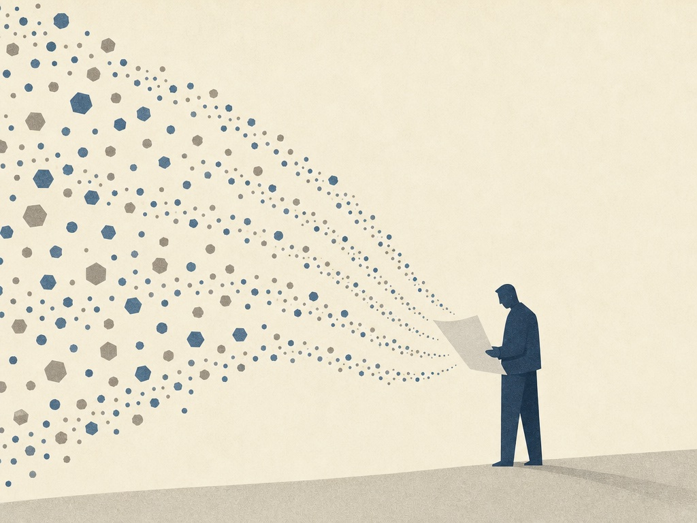

> 원문: <https://www.lennysnewsletter.com/p/metas-muse-how-we-launched-the-most>

---

뮤즈(Muse)는 앱스토어 1위 앱이고, 역대 가장 빠르게 성장한 소비자용 AI 제품으로 꼽힌다. 모나 사란타코스(Mona Sarantakos)는 첫날부터 이 제품의 프로덕트를 이끌었다. 메타 슈퍼인텔리전스 랩스(Meta Superintelligence Labs)의 프로덕트 부사장이고, 메타에서 10년, PM 경력은 20년이 넘는다. 팟캐스트 출연은 이번이 처음이다.

이번 대화에서 다룬 내용:

1. 라즈베리 파이 위의 OpenClaw로 보낸 주말이 어떻게 뮤즈가 됐는지
2. 경쟁사보다 일찍 시작했는데도 출시까지 7개월을 기다린 이유
3. Nat Friedman, Alex Wang, 마크 주커버그가 각각 제품에 남긴 흔적
4. 에이전트 스웜으로 사용자 인사이트를 대규모로 뽑아내는 방법
5. 팀 아무도 예상하지 못한 사용 사례
6. 임시 아바타였던 졸리(Jolly)가 아이콘이 된 이야기
7. AI 에이전트의 활성화를 실제로 움직이는 두 가지 레버
8. 모나가 요즘 PM에게 가장 중요하게 보는 것

## OpenClaw와 함께 보낸 주말

**레니:** 뮤즈의 프로덕트 책임자죠. 메타 슈퍼인텔리전스 랩스의 프로덕트 부사장. 뮤즈는 갑자기 나타난 것 같은데, 지금 가장 성공한 AI 어시스턴트 같습니다. 주커버그도 역대 가장 빠르게 성장한 AI 소비자용 제품이라고 힌트를 줬고요. 처음부터 함께했고, 팟캐스트 출연도 처음이고 SNS에도 거의 글을 안 올리셨죠. 뮤즈의 기원 이야기부터 듣고 싶습니다. 이 팀에 합류하기 전에 뭘 하고 있었나요?

**모나:** 메타 AI 쪽에서 일하고 있었습니다. 메타에서 10년 정도 됐고, 그중 약 2년은 AI 쪽이었어요. 주로 메타 AI, 우리 어시스턴트 제품을 맡았습니다. 그때 우리는 메타 AI를 제로베이싱하고 있었어요. 제로베이싱은 우리가 자주 쓰는 표현인데, 뭔가가 있는데 원하는 방식으로 작동하지 않을 때 계속 최적화할 수도 있지만 그냥 처음부터 다시 시작할 수도 있다는 뜻입니다. 랩에서 뮤즈 스파크(Muse Spark) 시리즈의 첫 번째 모델을 만들고 있었고, 우리는 그걸 기대하며 즐겁게 작업하고 있었죠.

1월 말이나 2월 초 목요일쯤에 Nat Friedman이 우리 몇 명에게 메시지를 보냈습니다. "OpenClaw를 써보고 있는데, 개인 슈퍼인텔리전스와 소비자용 에이전트의 가능성에 대한 내 생각이 완전히 바뀌고 있다. 너희도 써봐야 한다." 사실 우리도 그 주제를 머릿속으로 이야기하고 있었어요. 나는 H1 브리프에 이런 식으로 적어뒀던 기억이 납니다. "아마 2026년 말, 2027년쯤이면 이런 게 본격적으로 올 것이다."

금요일에 남편한테 말했습니다. 맥 미니를 사러 가야 한다고. OpenClaw를 설치해야 한다고. 애플 스토어에 맥 미니가 없어서, 남편이 "라즈베리 파이가 어딘가 있을 텐데" 하더라고요. 그걸로 설치했습니다. 마침 주말이었고, 아이들은 스키 레이스 프로그램 때문에 주말 대부분을 밖에 보냈어요. 그래서 나랑 OpenClaw 둘이 남았고, 나는 주말 내내 그거랑 대화를 했습니다. 이메일 접근 권한을 줬고, 캘린더 접근 권한도 줬어요. 일요일에 남편이 아이들과 돌아와서 물었습니다. "뭐 하는 거야? 완전 위험하지 않냐." 나는 아니라고, 일부러 맥시멀리스트로 가는 거라고 했죠.

월요일 아침, 아이들이 학교에 갈 때였습니다. 나는 개인 이메일을 정말 못 챙기는 사람이에요. 학교 뉴스레터라든지 포털이라든지, 거의 안 확인합니다. 아이들한테 spirit week 같은 걸 챙겨주지 못하는 일이 많았고요. 그런데 내가 만들어둔 OpenClaw가 뉴스레터를 받아서 여러 소스를 추적하고, 이번 주에 뭘 예상해야 하는지, 오늘 뭘 해야 하는지 한 장으로 정리해줬습니다. 지금 돌아보면 어시스턴트도 할 수 있는 일이지만, 그때는 마법처럼 느껴졌어요. 내가 쓴 프롬프트는 몇 단어 정도밖에 안 됐는데도요. 월요일 아침에, 특히 개인 생활에서, 이렇게 일이 정리된 기분을 느껴본 적이 없었으니까. 그걸 보고 생각했습니다. 바쁜 부모가 얼마나 많을까. 이런 기분을 느끼는 사람이 얼마나 많을까. 그래서 Nat에게 갔고, 이거다, 나는 탑승한다고 말했어요. 어디로 가는지는 몰라도.

공식적인 피치는 아니었습니다. "이걸 만들자"는 지시도 없었어요. 어떤 핑 하나였고, 그 핑이 나를 완전히 집어삼켰을 뿐이죠. 합류할 팀도 제품도 정해져 있지 않았습니다. 우리 몇 명이 비슷한 걸 만들어볼 수 있는지 시험해보기로 한 것뿐이에요. 제품을 쓰면 쓸수록 깨달은 게 있었습니다. 소비자 기반을 위해 만들려면 정말 달라야 한다. 훨씬 안전해야 하고, 설치가 훨씬 쉬워야 하고, 확장 가능해야 한다. 마법 사이사이에서 이런 문제들을 발견했고, 개인 에이전트를 만들려면 큰 배팅이 필요하다는 걸 알았어요. 어디로 가야 하는지 아직 몰랐기 때문에 바로 공식 프로젝트로 만들지는 않았고, 한동안 시제품 만들고 시험해보는 구간에 머물렀습니다. 그러다 어느 시점에 "좋아, 이건 된다. 제품이 나올 것 같다"가 됐고, 그때 제대로 된 팀을 꾸렸습니다.

## 출시까지 7개월

**레니:** 타임라인이 흥미롭습니다. Nat의 핑이 대략 언제였죠?

**모나:** 1월 말, 2월 초였어요. OpenClaw가 화제가 된 게 그 즈음이었으니까. 2월에야 이걸 개념 장난 이상으로 진지하게 밀고 가자고 확신했습니다.

**레니:** 여러분이 남들보다 훨씬 일찍 시작한 것 같은데, 출시는 오래 걸렸죠. Grok은 아이디어에서 출시까지 몇 달이었고, Duet이나 Dots도 비슷한 타임라인이라고 들었어요. 여러분은 처음부터 끝까지 7개월 걸렸다고 읽었습니다.

**모나:** 그 기간 내내 "거의 됐다" 싶었다가 뭔가가 생겨서 더 생각하게 되는 순간이 여러 번 있었어요. 작업은 크게 세 단계였습니다. 첫 번째는 이 제품이 뭔지, 뭘 만드는 건지 정하는 단계였어요. 이때는 신뢰성이나 확장성, 안전성을 크게 신경 쓰지 않았습니다. 우리 몇 명만 쓰고 있었으니까요. 선례가 거의 없었습니다. 가장 가까운 것도 OpenClaw인데, 그건 결국 완전히 다른 종류의 제품이고요. 가상머신을 여러 대 돌리는 것 자체가 풀 만한 문제였습니다. 제품 안의 결정들, 챗 스레드로 할까 어시스턴트처럼 할까 하는 설계 선택을 두고 많이 고민했고요. 봄쯤에는 꽤 완성된 엔드투엔드 제품이 있었습니다.

그다음에 시간을 많이 쓴 건 신뢰성, 안전성, 보안 세 가지였어요. 기준이 아주 높았습니다. "이벨 기준을 어디까지 잡을까" 하는 대화가 기억납니다. 선례가 없어서 비교할 게 없었고, 업계에 나와 있는 벤치마크는 우리가 원하는 수준에 못 미쳤어요. 이 제품은 개인 맥락을 담고 있습니다. 대신 물건을 사줄 수도 있고, 실제로 일을 해냅니다. 그래서 우리가 직접 만들어야 하는 전혀 다른 기준이 필요했다고 느꼈죠. 팀 시간을 많이 들여 레드팀 작업을 했습니다. 그리고 새 기능이 생길 때마다 새 공격 경로가 열렸어요. 아주 초기의 뮤즈에는 브라우저가 없었습니다. 브라우저가 붙자 보안 관점에서 풀어야 할 문제가 새로 생겼고, 중요하다고 생각한 기능이 들어올 때마다 그 벡터를 완전히 막았는지 확인해야 했어요.

제품을 잡아둔 건 아니지만 품질 게이트를 확실히 치고 싶었습니다. 내부에서는 "trust is a must"라는 말이 있어요. 너무 일찍 출시해서 문제가 잔뜩 터지면 사람들은 이 에이전트를 신뢰하지 않게 됩니다. 에이전트를 신뢰하지 않으면 절대 안 쓰게 되죠. 그 지점까지 가야 한다고 생각했어요. 며칠 전 남편이 물었습니다. 다른 에이전트들이 비슷한 시기에 다 나왔는데, 더 일찍 출시하고 싶었냐고. 뭘 바꾸겠냐고요. 넘어야 할 기준이 있었고, 거기까지 필요한 시간이 걸린 겁니다. 다행히 지금까지 치명적인 문제는 없었어요. 이 업계 전체가 아직 초기라 알 수 없는 것들이 많습니다. 완벽할 수는 없지만요.

내부 도그푸딩도 많이 했습니다. 직원들이 쓰게 했고, 외부 알파 테스터도 있었어요. 제품을 출시한 건 아니지만 점점 더 큰 그룹이 쓰면서 피드백을 보내줬습니다. 여름 내내 실제 사용자 피드백이 쌓였고, 그 덕분에 마지막엔 훨씬 자신감이 있었어요.

## The claw is the law

**레니:** "trust is a must" 말고도 내부 모토가 몇 개 있다고 들었습니다. "the claw is the law" 같은 것도요.

**모나:** 아, 그건 깜빡했네요. 초기 며칠 동안 써보고 나서 나온 건데, 이것도 Nat Friedman의 손길이 닿은 겁니다. 우리는 그 개념의 마법을 봤지만 다른 사람들은 우리가 뭘 말하는지 몰랐어요. OpenClaw를 쓰는 사람이 몇 있긴 했지만 대부분은 들어본 적도 없었고, 들어본 사람은 솔직히 무섭게 느꼈죠. "그걸 왜 쓰는 거야?" 그래서 왜 우리가 이걸 그렇게 중요하게 여기는지, 이게 우리가 만드는 제품과 AI와 개인 슈퍼인텔리전스의 미래라고 왜 믿는지 설명해야 했습니다. 그때 "the claw is the law"라는 문서가 쓰였고, 캐치프레이즈가 됐어요. 우리가 어디쯤 서 있는지 사람들이 이해하도록 돕는 방법이기도 했습니다.

**레니:** 비전 같은 노스스타였던 거군요. 맥 미니 얘기가 나왔는데, 저도 제 맥 미니가 바로 여기 있어요. OpenClaw를 돌리던.

**모나:** 웃기네요. 저도 결국 맥 미니를 샀어요. 라즈베리 파이를 업그레이드해야겠다 싶어서, 며칠 걸렸죠.

**레니:** 재밌는 건 이제 필요 없다는 겁니다. 그때는 맥 미니가 필요하다고 큰 논쟁이었는데, 이제는 더 나은 도구들이 나와서요.

## Nat, Alex, Mark의 역할

**레니:** Nat Friedman, Alex Wang, 주커버그가 뮤즈 개발에서 각각 어떤 역할을 했는지 궁금합니다.

**모나:** 팀은 작았습니다. 메타에서 오래 일했지만 이런 제품 빌드는 경험해본 적이 없어요. 여러 제품을 만들었지만 이번이 가장 특이한 경험이었고, 메타 입사 전 스타트업 시절에 더 가까웠습니다. 팀이 작았고 엔지니어링 주도였기 때문이기도 하고, 리더십과의 방식 때문이기도 해요. 보통 회사에서는 리더십과 정기 리뷰 리듬이 있죠. 우리의 생각에 리더십이 반응하는. 이건 완전히 달랐습니다. 정식 리뷰를 안 했다는 게 아니라, 슬라이드를 안 만들었다는 얘기예요. 8월에 출시 직전으로 한 번 슬라이드를 만들어야 했는데, 만드는 법을 잊어버렸더라고요. 구글 슬라이드를 열고 "이런 걸 어떻게 하는지 잊어버렸네" 했어요. 대신 우리는 방에 가서 프로토타입을 만들어 누군가의 폰에 돌렸습니다. 주커버그에게 우리 폰을 건네며 "어때 보이냐" 하고 그가 만져보고 피드백을 줘요. 브레인스토밍을 하기도 했고요. 셋과 함께이거나 셋 중 한 명과, 그런 대화들이 이어지면서 최종 제품이 나왔습니다. 대화가 이뤄지는 방도 보통 아주 작았어요. 주커버그와 30분 미팅을 잡고 한 시간 뒤에도 그 자리에서 얘기하고 있고, 그러다 "잠깐, 나보다 중요한 분이시죠? 저 갈 일이 있는데" 하면 "아니야, 나 이 얘기 하고 싶어" 하는 분위기였습니다. 메타에서의 대부분 경험과는 전혀 달랐어요.

역할로 보면 셋 모두 지금 제품에 흔적을 남겼습니다. Nat은 사실상 팀의 일원이었어요. 아니, 팀 그 자체였고, 이 모든 걸 시작하게 만든 사람이죠. 우리에겐 마법의 원천이었습니다. Nat과 함께 일하는 건 큰 영광이에요. 천재이고, 자기가 만드는 제품과 그걸 만드는 사람들에 대한 애정이 남다릅니다. 진짜 엔지니어의 엔지니어예요. 방에 앉아서 "XYZ 아키텍처 다이어그램 좀 띄워봐"라고 하는 사람입니다. 센티넬(Sentinel)을 설계할 때도 그랬어요. 핵심 뮤즈 에이전트 바깥에 안전망을 두는 방식으로, 정말 안전하게 만들기 위한 설계였는데, 아키텍트와 보안 팀과 함께 그 결정에 깊게 관여했습니다. 항상 곁에 있으면서 "이거 해볼까, 이 설계 어때" 하고 있었고요.

Alex Wang은 모델 쪽에서 결정적이었습니다. 첫 뮤즈 스파크 모델이 우리가 예상했던 것보다 훨씬 에이전틱해서 놀랐어요. 그리고 Alex는 금방 이게 중요해질 걸 알아챘고요. 리서치는 바꾸기 어려운 장기적인 작업인데, 그는 특정 영역에서 민첩하게 움직이면서 리서치 팀이 하려는 것과 제품에 어떻게 맞아떨어지는지를 함께 보고 우선순위를 정하는 데 정말 능숙했습니다. 그리고 Alex는 뮤즈를 사랑해요. 결국 문밖으로 우리를 밀어낸 사람도 Alex입니다. "야, 준비된 것 같다. 그냥 가자." 출시 후에는 최고의 마케팅 기계가 됐고요. 첫 트윗들이 나가기 시작했을 때 "저 사람이 저런 트윗을 쓸 수 있는 줄 몰랐다"고 했던 기억이 납니다. 성경에 "이런 시간을 위해 만들어졌다"는 구절이 있죠. Alex는 자기 제품을 찾은 느낌이에요.

마크와는 이런 방식으로 함께 일한 게 처음이었는데, 뮤즈가 무엇인지에 대한 그의 생각들이 최종 제품을 정의했습니다. 예를 하나 들면, 아주 초기에 그가 말했습니다. "뮤즈의 목적은 사람들의 삶을 낫게 만들고 목표 달성을 돕는 것이다." 우리 모두 알고는 있었지만 명시적으로 말해본 적이 없었어요. 우리는 태스크 완성이라는 부분에 빠져 있었죠. 태스크 완성, 태스크 완성. 이걸 사줄 수 있나, 저걸 해낼 수 있나. 마크가 우리를 그곳에서 끌어냈습니다. "아니, 가장 중요한 건 얼라인먼트다. 사용자가 뭘 하려는지, 어디로 가려는지, 우선순위가 뭔지 아는 것. 그리고 뮤즈가 그걸 계속 도와주는 것." 그 말을 듣고 우리는 새 영역이 열렸다고 느꼈어요. 우리가 드리밍 앤 스터딩(dreaming and studying)이라고 부르기 시작한 개념입니다. 뮤즈가 너에 대해 이 모든 걸 알고 있다면, 24시간 에이전트이니까 너에 대해 늘 생각하면서 우선순위를 어떻게 도울지 고민하고 더 나은 제안을 할 수 있다. 마크가 그 문을 열자 엔지니어들의 눈이 반짝였고, 뮤즈가 어떻게 더 프로액티브하고 더 도움이 될 수 있을지 아이디어가 쏟아졌어요. 골스 탭(goals tab)도 만들었는데, 이 개념을 UI에 명시적으로 담은 겁니다. 마크는 개인 슈퍼인텔리전스가 무엇인지 늘 생각해왔고, 사람을 위해 만드는 사람이에요. 많은 회사가 기업이나 엔터프라이즈 사용자를 위해 만들지만, 그는 궁극적으로 소비자 CEO다 보니 대중화를 생각합니다. 모두에게 닿게 하려면 확장성을 우리만의 방식으로 걱정해야 하고요. 이것도 빌드 과정과 로드맵 우선순위에 큰 영향을 줬습니다.

## 졸리(Jolly)

**레니:** 졸리라고 하는 캐릭터도 메타 같은 대기업에서 나올 법하지 않은, 아주 귀엽고 엉뚱한 캐릭터죠. 여기에 이야기가 있나요?

**모나:** 디자이너에게 농담으로 말했어요. "졸리는 우리의 바퀴벌레다. 절대 안 죽어." 몇 달마다 누군가 "말 봉제인형을 앱 상단에 두고 이 제품을 출시할 수는 없다"고 했고, 우리도 "그럼, 절대 안 되지" 했다가 일주일 뒤에 "아니, 남겨두자"가 됐습니다. 한 달 뒤에 또 다른 사람이 와서 "말도 안 돼" 하고요. 시작은 프로토타입이었습니다. 리드 디자이너 Alex Cornell이 뮤즈의 첫 프로토타입을 만들었는데, 그 안에 원샷 프롬프트로 만든 생명체 하나를 넣었어요. 처음엔 앱을 열면 잠들어 있다가 깨어나는 방식이었습니다. 이름은 졸리봇(Jollybot)이었는데, Alex가 딸을 "졸리 버그"라고 불렀거든요. 이름은 거기서 왔고, 전부 임시일 의도였습니다. 언젠가 코퍼레이트 마케팅 어딘가에서 "로고를 넣어라"라고 돌아올 거라고 생각했어요.

그런데 저 위에 두고 보니 개념들이 자라기 시작했습니다. "이 아바타를 계속 보니까 움직여야겠는데? 일하고 있으면서 날 쳐다보고 있잖아. 이상하지. 헤드폰을 씌우고 노트북으로 일하게 하자. 애니메이션을 만들자." 일부는 그냥 지루해서였어요. 계속 쳐다보기 싫으니까 재밌는 걸 해보자는 거죠. 그러다 "사람들이 자기 아바타를 원하는 대로 만들 수 있어야겠다. 다들 졸리를 보고 있는 게 이상하잖아. 나는 다른 아바타를 쓰고 싶고, 당신도 다른 걸 쓰고 싶을 거고." 여기에 우리의 개념이 담겨 있었습니다. 뮤즈는 당신의 것이라는 거예요. 메타의 실체가 아니라 진짜 당신의 것이어야 한다. 그래서 사람들이 각자 아바타를 만들기 시작했고, 어느 시점에는 졸리봇을 빼는 게 점점 어려워졌습니다. 이것 하나를 둘러싼 시스템을 통째로 만들어놨으니까요.

그래도 졸리가 정말 죽었다고 생각한 순간은 있었습니다. 대체 로고를 넣을 뻔했어요. 이유는 많지만, 마크도 그중 하나였습니다. 그는 아바타를 정말 좋아했어요. 하지만 가장 큰 이유는 이겁니다. 너무 개인적인 것과 대화할 때, 마지막으로 대화하고 싶은 건 기업 로고다. 그건 마법을 완전히 깨뜨려요. 답이 아니라고 느꼈고, 불편했습니다. 작업 팀의 여러 명이 "우리 시체 위에라도"라는 태도였고, 직원들도 자기 아바타와 졸리를 사랑했어요. 결국 마크와 우리와 여러 사람 사이에서 "졸리는 남는다"로 끝났습니다. 출시 일주일 전쯤이었나 싶어요. "이걸로 간다"고 한 게요. 얼마나 아이코닉해질지는 그때 몰랐습니다. Alex Wang 덕분인 부분도 있고요. 우리를 위한 결정이었는데, 지금 돌아보면 당연한 선택이 됐습니다.

**레니:** 놀랍네요. 그게 성공의 핵심 부분이 됐는데, 개성과 개인화, 다르게 느껴지는 것 말이죠. 회사라면 죽였을 만한 거잖아요. 여기에 배울 점이 있을까요?

**모나:** 메타 PM들에게 하는 이야기 중 하나가 이겁니다. 거대 기업의 일원이지만 당신에겐 권한이 있고, 마크는 당신 얘기를 들어준다. Nat도요. 우리도 "코퍼레이트 로고를 넣자, 이게 현실이니까" 하고 넘어가기 쉬웠을 거예요. 하지만 팀은 그렇게 작동하지 않았습니다. 우리는 이 제품을 사랑하고, 우리가 만들었고, 강한 견해가 있었다. 그게 통했어요. 여러분도 권한이 있으니 하고 싶은 말을 하라. 거절당할 수도 있지만 시도해봐야 한다.

다른 하나는 브랜드와의 트레이드오프입니다. 많은 대화에서 브랜드가 얼마나 드러나야 하는지가 정말 중요한 주제죠. 하지만 우리가 만드는 것이 당신의 뮤즈, 당신의 개인 에이전트가 되려면 완전히 당신의 것처럼 느껴져야 합니다. 메타는 거기서 사라져야 해요. 우리가 에이전트를 만든 방식은, 에이전트가 당신을 위해 일해야 한다는 것이었습니다. 소유자는 당신이다. 우리는 가드레일을 두고, 헌장을 두고, 에이전트가 법을 지키도록 하겠지만, 나머지는 당신의 것이다. 제품 수준에서 이 원칙을 처음부터 정해두고 주변 모두에게 명확히 하니 큰 도움이 됐어요. 그러면 근거 없는 변명이 아니게 됩니다. "우리는 늘 이렇게 말해왔다. 이게 늘 원칙이었다." 이 원칙을 받아들이면 기업 로고가 그 안에 있는 상상 자체가 어려워지죠. 제품 원칙을 정면으로 위반하는 거니까요.

## 예상 못한 사용 사례

**레니:** 주커버그가 좋아하는 사용 사례로 MMA를 하면서 피드백을 받는 걸 언급했는데, 예상 밖의 사용 사례를 어떻게 다뤘는지 궁금합니다. 어느 날 누가 와서 "이거 쓰고 싶은데" 하는데 "그건 이 제품이 잘하는 게 아닌데" 같은 상황요.

**모나:** 초기 대화 상당수가 사용 사례에 관한 것이었습니다. 몇 시간씩 사용 사례 얘기를 했어요. 사내 사람들과 이야기하면 웃기기도 하는데, 우리는 여러모로 정상적이지 않거든요. 거대 테크 회사에서 일하고, 누구보다 AI에 빠져 있고, 마크는 유니크한 분이고. 우리는 자기 개인 사용 사례를 중심으로 이야기했습니다. 초반부터 외부 UXR 패널을 돌렸어요. 3월에 시작했던 걸로 기억합니다. 외부에서 모집한 사람들과, 당연히 내부 사용자도 있었습니다. 내부용으로는 워크플레이스 포럼에 뮤즈 피드백 그룹이 있었고요. 이 두 경로로 사람들이 뭘 하고 어떻게 쓰는지 피드백이 쏟아졌고, 우리는 그걸 거의 주 단위로 마크, Nat, Alex에게 가져가서 들여다봤습니다. 들은 이야기들, 사람들이 마법을 느낀 지점과 느끼지 못한 지점들요. 그래서 MMA 이야기 같은 걸로 흔들리진 않았습니다. 모두를 실제 경험에 뿌리를 두고 있었으니까요. 대신 놀라움은 있었습니다.

쇼핑이 이렇게 커질 줄 몰랐어요. 나는 개인적으로 쇼핑을 좋아하지만 예상 못했습니다. 나는 개인 생산성, 건강, 개인 금융 세 가지에 집중하고 있었고, 몇몇은 홈 오토메이션을 얘기했죠. 그런데 도그푸더들 사이에서 쇼핑이 계속 튀어나왔습니다. 완전한 놀라움이었어요. 그래서 "잠깐, 이벨이 전부 저쪽에 있잖아. 이제 쇼핑에 집중해서 큰 사용 사례로 만들고 거기에 맞는 이벨을 만들어야 한다"가 됐습니다. 우리는 사용 사례 단위의 이벨을 갖고 있거든요. 반대로 홈 오토메이션은 엄청 클 줄 알았는데 그렇게 크지 않았습니다. OpenClaw 시절엔 정말 컸어요. 아마 쓰는 사람들이 이미 홈 오토메이션을 갖춰놓은 사람들이었으니까요. 더 넓은 사용자 기반으로 가니 다른 사용 사례만큼 튀지 않았습니다. 지금 쇼핑은 우리 최상위 사용 사례 중 하나입니다.

**레니:** 쇼핑을 사랑하는 엔지니어가 팀에 있다고 들었는데요.

**모나:** Christine Awad예요. 엔지니어링 매니저입니다. 타르(Tar)가 기술 리드이자 코어 아키텍트고, Christine이 엔지니어링 매니저예요. Christine이 뮤즈로 쓴 돈 규모를 생각하면 무섭습니다. 아침에 일어나면 쇼핑 사용 사례의 버그 리포트가 쏟아져요. "Christine, 신용카드를 뺏어야겠다. 엔지니어들이 오늘은 잠을 자야 해." 그녀는 그 영역의 1번 도그푸더였습니다.

그리고 저도 요즘 쇼핑을 많이 하게 됐어요. 지난주에 멜로파크에 있었는데, 오늘 아침 남편이 전화해서 말했어요. "집에 택배가 일곱 개 와 있다." 깨달았는데, 예전에는 한꺼번에 주문했어요. "아이들 운동복 바지가 필요하네" 하면 나이키 사이트에 가서 다섯 벌을 사는 식이었죠. 이제는 뮤즈가 여러 매장을 돌면서 내 조건에 맞는 다섯 곳을 골라서 삽니다. 다양성이 생겨서 훨씬 낫지만, 택배도 다섯 개, 일곱 개씩 오는 거예요. 남편이 "지금 무슨 일이 일어나는지 모르겠지만 좀 진정하라"고 하더라고요. 그러다 어느 순간 "나 네 뮤즈랑 대화해서 내 쪽에서 지시를 내리고 싶다"고 했어요. 재밌는 말이지만 대단히 타당합니다.

**레니:** 새로운 세계가 열리고 있죠. 소매업은 "우리가 마케팅하고, 광고를 보여주고, 사게 만든다"로 만들어져 있는데 이제 에이전트가 결정을 내리니까요. 광고, 마케팅, 쇼핑이 바뀌는 것에 대해 생각해본 적 있나요?

**모나:** 사람들은 영감을 즐기고, 둘러보는 행위 자체를 즐깁니다. "휴지는 그냥 내일까지 오면 된다" 같은 것도 있지만, 많은 것들은 옷과 코디를 보며 고민하는 게 즐겁죠. 그래서 둘 다 작동하게 만들어야 한다고 생각해요. 사용자가 영감을 얻도록 두고, 브랜드와 기업이 선택지의 공간을 보여주도록 두고, 에이전트가 범위를 좁히고 트레이드오프를 돕도록 하는 거예요. 가끔은 선택지 앞에서 마비되죠. "이거 아니면 저거인데" 하다가 그냥 아무것도 안 사는 경우요. 에이전트가 정말 도움이 되는 지점입니다. 다만 전체 사용 사례가 존재할 방법을 찾아야 해요. 탐색 자체를 잘라버리면 사람들이 만족하지 못할 겁니다. 사람들은 여전히 그걸 하고 싶어하니까요.

우리는 아주 이른 시기에 있습니다. 누구도 준비됐던 적이 없고, 그려진 마스터플랜도 없었어요. 기술 혁명이라면 늘 그런 것 같습니다. 함께 알아가는 게 이상적이죠. 우리는 운이 좋게도 이 가능한 미래에 흥분하는 리테일 파트너와 판매자들과 함께하고 있습니다. 그들도 에이전트를 시험 중이에요. 비즈니스 에이전트를 갖고 있죠. 비즈니스 에이전트와 소비자 에이전트가 서로 소통하면서 양쪽을 돕는 게 얼마나 멋진 일인지요. 비즈니스 에이전트가 갖고 있는 정보가 소비자에게 더 나은 경험을 줄 수도 있습니다. 웹사이트에 가서 필터 걸고 정렬하고 검색해야 하는 일들 중에는 에이전트가 시간을 확 줄여주는 것들이 있어요. 하지만 대체해서는 안 되는 것들도 있습니다. 그건 사용자의 즐거움이고, 사용자가 결정을 내리는 방식이니까요.

## 에이전트 스웜

**레니:** 에이전트 스웜 이야기를 들었어요. 사용자 피드백을 확장하고 무엇에 주목할지 파악하는 데 썼다고요. 어떤 이야기인가요?

**모나:** 에이전트들이 떼처럼 퍼져나가서 벌어지고 있는 대화와 데이터를 훑어보고 결과를 돌려줍니다. 합성 데이터를 만들 수도 있어요. 이렇게 모은 걸 우리 이메일로 밀어넣는 방식이었죠. 밖에 무슨 일이 일어나는지, 잘 되는 건 뭔지, 안 되는 건 뭔지. 스웜에게서 "덤프"를 받기도 했습니다. 생태계에서 무슨 일이 일어나는지, 사람들이 어떤 태스크를 하는지를 잘 정리된 형태로 풀어서 내놓는 거예요.

배경을 설명하자면, 메타 AI 시절 대화는 대부분 제가 보기에 싱글턴이었습니다. 한 턴 하고, 응답을 받고, 가끔 한 턴 더. 이건 이제 모든 어시스턴트에서 바뀌고 있지만 한동안은 그랬죠. 그런데 이걸 만들기 시작하니 완전히 멀티턴이었어요. 왔다 갔다를 계속하는 거죠. 우리는 그런 모양의 데이터가 없었습니다. 이벨을 만들려면 데이터가 필요하고, 보통은 내가 직접 쓴 데이터가 아니라 프로덕션의 데이터를 원하니까요. 그래서 폼(form)이 결정적이었습니다. 코딩이 아닌 영역에서, 일주일 식단을 짜는 같은 일의, 장기 실행 태스크의 멀티턴 대화가 어떤 모습인지 데이터를 모으고 이해할 수 있는 통로였어요. 데이터셋을 만들고 무슨 일이 벌어지는지 이해하는 데도요.

지금은 새 모델이 들어올 때마다 그렇게 합니다. 얼마 전에 "이거 실제 문제인지, 아니면 나만 그런 건지 모르겠다"는 걸 발견했는데, 엔지니어들이 "스웜 해볼게요" 해서 스웜했습니다. 돌아왔더니 "실제 문제 맞아요. 사람 붙여서 고치겠습니다"였어요. 엄청 빠르고 유용합니다. 이제는 대시보드만 보던 시절이 어땠나 싶어요. 지표가 오르내리는 걸 보던 게 전부였는데, 이제는 그 위에 프로덕션의 실제 사례가 얹힙니다. "이 웹사이트에서 사려고 한 사람이 10명인데 전부 막혔다" 같은 구체성으로 바로 좁혀서 개선 지점을 겨냥할 수 있어요. 제 PM들한테 무조건 하게 시킵니다. 공감이 생기기 때문이에요. 스웜이 돌려주는 건 숫자가 아니라 인사이트라서, 사용자가 겪는 일에 대한 공감이 생기고, 우리가 고통을 느끼게 해줍니다. 제품 개발에 정말 중요하다고 생각해요. 공감이 없고 고통을 느끼지 못하면 좋은 제품을 절대 만들지 못합니다.

**레니:** 이 팟캐스트에서 제가 좋아하는 인용 중 하나가 Nan Yu의 말인데요. 리니어의 전 프로덕트 책임자이고 지금은 OpenAI에 있죠. "PM의 일은 고객의 고통을 고객만큼 느끼는 것"이라는 문장이요.

**모나:** 100% 그렇습니다. 저를 움직이는 두 가지는 끊임없는 불안과, 이 제품이 사람들의 삶을 낫게 해주길 바라는데 그러지 못할 때 느끼는 사용자의 고통이에요. 그럴 때 움직여야 하니까요.

## 이벨

**레니:** 이벨 얘기를 더 듣고 싶네요. 핵심 사용 사례마다 성공을 정의하는 이벨이 있다고 생각하는데, 대략 몇 개나 되고 누가 쓰나요? PM인가요, 엔지니어인가요?

**모나:** 정말 많아요. 세어본 적도 없습니다. 메이저 이벨, 우선순위 이벨들이 있어요. 이건 코어입니다. 이게 통과 못 하면 제품이 작동하지 않는 것들이요. 안전이 대표적이죠. 프롬프트 인젝션 이벨, 일반 안전 이벨, 해악 관련 이벨. 카테고리 하나가 됩니다. 그리고 캐퍼빌리티 이벨이 있어요. 브라우저를 잘 쓰고 있는가, 태스크를 완수하는가. 행동 이벨도 있습니다. 에이전트의 성격과 사용자와의 행동 방식에 관한 거예요. 후속 질문을 하는가, 의도 이해를 얼마나 잘 하는가. 그리고 우선순위 사용 사례의 이벨 카테고리가 있고요. 각 안에 하위 이벨이 수없이 생깁니다. 어느 시점이든 우선순위 이벨은 항상 통과해야 하고, 안전이 그 대표 사례예요. 그다음은 많이 퇴보하지만 않으면 되는 2차 이벨들, 조금 트레이드오프할 수 있는 것들이고, 기능 단위 이벨도 있습니다. 팀별로요. 계층이 있고, 양은 정말 많습니다.

쓰는 사람도 다양합니다. PM들이 쓰기도 하고, 엔지니어들이 많이 쓰고, 리서처들도 많이 씁니다. 에이전트와 함께 만들기도 하고요. 하지만 사람들이 데이터를 전부 리뷰하는 게 정말 중요합니다. 안 하면 늘 문제가 생겼어요. 최근에 생긴 재밌는 경향이 하나 있습니다. 시스템 프롬프트는 손으로 써야 한다는 거예요. AI로 시스템 프롬프트의 어떤 부분도 쓰면 안 된다. 이벨의 프롬프트 분포도 확인해야 하죠. 제품 현실과 맞는지 확인해야 하니까요. 행동 스펙(behavioral spec)도 손으로 씁니다. 에이전트를 많이 쓰지만, 이런 부분에는 사람의 시간과 노력이 많이 들어갑니다.

## 활성화

**레니:** 방향을 바꿔서 액티베이션 얘기를 하죠. 제품 성장의 큰 레버 중 하나가 가입해서 써보기 시작한 사람을 "와, 이거다"라는 아하 모먼트로 옮기는 겁니다. AI 어시스턴트에서는 특히 이게 제일 큰 레버 같아요. 너무 강력해서 아무도 뭘 해야 할지 모르는 상태라. 퍼스트 마일에 많은 시간을 썼을 텐데, 액티베이션을 올리는 데 배운 게 있나요?

**모나:** 우리의 1순위 문제입니다. "나 이미 챗봇 있어. 왜 하나 더 필요하지?" 가장 효과적인 레버는 입소문이에요. 다른 사람의 이야기를 듣는 것. 그게 1위입니다. 얼마 전에 아이 친구들의 부모들과 있었는데, 뮤즈 얘기가 나왔어요. 모두 광고는 봤었죠. 뉴욕이나 샌프란시스코에 사는 한 졸리나 아바타를 피하기 어려울 테니까. 그래서 뭔지는 대충 알지만 어떻게 쓰는지는 몰랐어요. 그중 한 어머니가 한 달 동안 파워 유저였는데, 자기 폰을 꺼내서 건네줬습니다. 부모들이 폰을 돌려가며 그녀가 쓰던 화면을 스크롤했고, "어머, 세상에" 하면서 두 사람이 그 자리에서 다운로드했어요. 광고를 아무리 해도, "개인 슈퍼인텔리전스예요", "당신을 위해 일하는 AI예요"라고 아무리 말해도, 닿지 않았습니다. 자기와 닮은 사람이 쓰는 걸 직접 봐야 했고, 그 사람이 어떻게 쓰는지 봐야 했죠. 친구들이 ChatGPT를 쓰기 시작했을 때를 떠올려보세요. 저녁 먹으며 이야기했던 것 때문이었어요. "믿을 수 있어? 걔가 그걸 해냈다고?" 사람들이 에이전트를 어떻게 쓰는지 이야기를 공유할수록, 더 많은 사람이 가치를 이해하고 시도하고 싶어집니다.

두 번째는 첫 프롬프트를 꺼내게 하는 일이에요. 사람들은 첫 프롬프트에서 얼어붙습니다. 대부분의 첫 프롬프트는 "오늘 날씨 어때"나 "안녕" 정도죠. "이것에게 무슨 말을 해야 하지?" 우리는 여기에 많은 시간을 썼습니다. 제품에 아이디어 탭(ideas tab)이 있는데, 시작 팩 같은 것들이 미리 포장돼 있어요. 영감을 주는 거죠. "이걸로 X를 할 수 있어" 하고, X 안에서 크론(알림)을 만들어주거나 대시보드를 만들어주거나 합니다. "해보자"라고만 말하면 뮤즈가 과정을 시작해서 뭔가를 만들어줘요. 이것에 집착했습니다. 뮤즈가 할 수 있는 게 너무 많아서, 말 그대로 설명서를 주지 않고선 무엇을 할 수 있는지 어떻게 설명할 수 있겠냐는 거죠. 잘 되어가는 편인데, 솔직히 아직도 사람들이 상상하기 어려운 건 사실입니다.

온보딩에도 시간을 많이 썼어요. 첫 메시지로 뭘 보낼지, 두 번째 메시지는 뭘지. 발견한 건, 초기 코호트에 효과가 있던 게 후기 코호트에는 안 통한다는 겁니다. 초기 코호트는 에이전트가 뭔지 어느 정도 알던 사람들이었어요. 뮤즈가 어떻게 더 안전하고 보안이 잘 된 채로 자기들이 아는 에이전트의 경계를 밀어내는지 보러 온 사람들이었죠. 후기 코호트는 "내가 쓰는 AI 제품이랑 뭐가 다른데?"입니다. 그래서 이제 코호트에 따라 다른 온보딩을 제공해야 해요. 어디서 왔는지, 이런 것에 대한 노출이 얼마나 됐을지 기준으로 변형을 서빙하는 식으로요. 흥미로웠지만 아직 푼 게 아니라고 생각합니다. 시간이 지나고, 더 많은 사람이 쓰고, 그 이야기들이 공유될수록 커질 거예요.

## 명백하지 않았던 결정들

**레니:** 개발 과정에서 내렸는데 지금 보면 성공의 핵심이 된, 명백하지 않은 결정이 있나요?

**모나:** 아바타는 확실히 그랬어요. 사람들이 이상하게 생각했는데, 이제 보면 졸리는 셀러브리티입니다. 다른 하나는 챗 버블이요. 우리는 "이건 당신의 개인 에이전트다"라는 개념에 집착했습니다. 대부분의 사람은 개인 비서가 없죠. 직장에 어드민이 있는 사람도 드물고요. 우리는 이게 그 개념을 대중화한다고 생각했어요. 모두가 하나씩 갖게 될 거라고. 그럼 사람은 개인 에이전트와 어떻게 대화할까? 요즘은 보통 채팅 서비스로 하죠. 전화나 대면도 있지만 대부분은 채팅입니다. 그래서 챗 버블을 만들었어요. 다른 AI 제품들, 메타 AI를 포함해서, 가던 방향은 큰 캔버스 경험이었습니다. 빈 캔버스가 화면 전체를 차지하고 그림이 곁들여진 에세이 형태의 아름다운 응답이 나오는. 우리는 챗 버블을 골랐고, 그러면 공간이 많이 제약됩니다. 챗 버블 안에 아주 긴 답을 담는 건 꽤 짜증나니까요. 그러면 "챗 버블을 쪼개야 하는데, 생각을 어떻게 쪼개지?" 하는 문제로 넘어갑니다. 이 결정은 명백하지 않았어요. 다들 챗 버블이 아니라, 리스킨한 메타 AI나 아무 AI일 거라고 예상했을 테니까. 우리는 다른 방향을 택했습니다. 메시징 서비스처럼 느껴져야 한다고 생각했거든요. 사람이나 어떤 존재와 소통할 때 익숙한 패턴처럼.

그런데 그 결정을 내리자 예상 못한 하위 결정들이 쏟아졌어요. "이제 이걸 생각해야 하는구나. 메시지를 쪼개는 걸 생각해야 하고, 캐러셀이 있는 게 이상한가? iMessage 스레드에는 캐러셀이 없잖아. 이상한 건지 괜찮은 건지." 솔직히 여전히 고민하는 결정들입니다. 푼 게 아니에요. 하지만 명백하지 않았고, 논쟁적이었고, 고수하려고 꽤 강하게 느꼈던 결정이었죠.

메인 채트도 그랬습니다. 지금은 사이드 챗과 메인 채트가 있지만 한동안 메인 채트 하나만 있었어요. 우리 머릿속 논리는 이랬습니다. 예전에는 스레드가 의미가 있었어요. 장기 실행 컨텍스트가 없었으니까. "이건 어때?"라고 하면 에이전트가 "무슨 말인지 모르겠다, 10턴 전 일이니까" 하는 게 이상했죠. 뮤즈는 장기 실행 컨텍스트가 있었습니다. 전부 기억하는 게 요점이고, 멀티턴이니까요. 개인 비서에게는 그렇게 말하잖아요. 비서는 전에 있었던 일을 기억하고, 모든 일이 같은 곳에서 일어납니다. 직원들에게 공개했을 때 가장 양극화된 반응이었어요. "팀 메인 채트", "팀 사이드 채트" 티셔츠를 만들어야겠다고 했을 정도입니다. 댓글에서 직원들이 서로 싸웠어요. "당연히 사이드 채트가 필요하지, 스레드가 유일한 방법이야" 하는 사람과 "절대 아니다, 당신은 석기 시대에 사는군" 하는 사람. 결국 사람들이 대화를 정신적으로 분리할 방법이 필요하다는 수요가 충분해서 사이드 채트를 만들었습니다. 물론 에이전트는 어디에 있든 모든 대화를 알고 있지만요. 솔직히 저도 아직 어떻게 느껴야 할지 모릅니다. 계속 고민하고 반복할 영역이에요. 하지만 저는 개인적으로 메인 채트가 필사입니다. 사이드 채트 안 쓰고 메인 채트만 씁니다.

**레니:** 결국 그 결정은 누가 내렸나요? Nat인가요, Alex인가요?

**모나:** 우리였어요. 팀이죠. 과정 내내 결정이 유동적이었습니다. 긴 대화를 계속 나눴기 때문에 각자 어디에 서 있는지를 다들 알았어요. 회사나 제품 규모로 정말 중대한 결정은 마크가, 아니면 Nat이나 Alex가 내려야 한다는 게 명백한 경우도 있었죠. 하지만 대부분은 팀에 자율성이 있었습니다. 어떤 결정을 가지고 Nat이나 그중 누군가에게 가면, 그들이 오히려 되물었습니다. "당신은 뭘 하고 싶은데?" 그러면 이런 거죠. 좋아, 나에겐 권한이 있구나, 내가 고르는구나. 그건 뮤즈 리즈 그룹이 결정을 내린 사례였습니다.

## Let them cook

**레니:** 내부에서 들은 다른 모토가 있어요. "let them cook"이라던가.

**모나:** 빌더 문화였습니다. 엔지니어링 포워드였고, 그뿐 아니라 프로토타이핑을 하고 물건을 만들고 아이디어를 내는 문화였어요. 제품에 있는 아이디어 상당수는 엔지니어 한두 명이 아이디어의 씨앗 하나를 갖고 며칠 동안 떠나 있다가, 프로토타입이나 그런 걸 들고 돌아오면서 나왔습니다. 제 머리를 날려버리는 것들이요. "이런 게 존재하는 줄 몰랐는데." 어떤 건 내가 씨앗을 준 거였는데, 내 머릿속에서는 이렇게 갈 줄 몰랐던 방향이었죠. 엔지니어들이 요리하게 둬야 합니다. 공간을 조금 줘야 하고, 사람들 사이에 신뢰가 느껴져야 해요. 탤런트 밀도 높은 팀이고, 제품 감각과 취향이 있는 엔지니어들이고, 미래를 생각할 수 있는 사람들이라면, 공간을 줘야 합니다. let them cook이에요.

## 뮤즈끼리 대화했던 날들

**레니:** 뮤즈들이 서로 대화하면서 웃긴 일을 저지른 적이 있다고 들었습니다.

**모나:** 이야기가 나서 말인데, 우리 뮤즈들 전부 서로 대화하고 있었어요. 두 사람, Fu와 Quinn의 뮤즈가 그룹 채팅에 있었습니다. 정말 초기라서 디스크리션 같은 개념을 고민 안 했어요. "우리 뮤즈들이 같은 채팅에 있으면 재밌지 않을까? 해보자"였죠. 몇 가지 일이 일어났습니다. 아주 재밌는 것도, 아주 이상한 것도. 두 뮤즈가 대화하는 게 귀여웠어요. 작은 로봇 둘이 서로 수군대는 걸 보고 있으면 "어머" 하는 느낌이죠. 공존하는 법을 알아가는.

그중 하나로 우리는 디스크리션을 몸으로 배웠습니다. 한 여성이 전날 병원 진료가 있었고, 당연히 그녀의 뮤즈는 그걸 알고 있었어요. 다음 날 다른 여성이 물었습니다. "괜찮아? Fu가 어제 병원 갔다고 했어." 나는 "뭐야, 그거 말하면 안 되는 거야" 했죠. "디스크리션이 진짜 문제구나." 이런 컨텍스트로 어떤 멀티플레이어 경험이든 만들려면, 두 에이전트가 그렇게 소통하는 방법을 푸는 게 어려운 문제 중 하나일 겁니다.

그러다 어느 시점에 뮤즈들이 서로 싸웠어요. 뭔가 불일치가 생긴 건데, 싸우는 두 AI를 보는 건 세상에서 제일 웃긴 일 중 하나입니다. 서로 disagree하면서도 매우 수동적으로 공격적인 방식으로 말해요. 좀 지속됐고, 결국 한 여성이 자기 AI에게 그 싸움에 대해 소리쳤고, 화해 회담이 있었습니다. 아주 즐거운 시간이었죠. 그리고 우리는 "아직 준비 안 됐다. 여기 가기 전에 풀어야 할 문제가 많다"고 했어요.

**레니:** 이렇게 가면서 알아가는 게 재밌네요. 해보고, 아 거기가 문제구나.

**모나:** PM을 오래 했는데, 그게 안 됐던 시절이 기억납니다. 완전한 스펙 문서를 쓰고, 세상의 모든 엣지 케이스를 다 생각했기를 바랐던. 지금은 보고 배운 걸 기반으로 매일 마음을 바꿀 수 있어요.

## PM 역할의 변화

**레니:** 그 스레드를 이어가자면, PM 경력이 20년이 넘으셨죠. PM 역할이 지난 20년보다 지난 2년 동안 가장 많이 바뀌었다는 데 동의하나요? 동의 안 해도 뭐가 가장 달라졌는지 궁금합니다. 3년 전 모나와 지금 모나를 놓고요.

**모나:** 시작하자면, 20년 지나서도 PM이 정확히 뭘 하는 건지 저는 모르겠어요. 회사와, 누구인가와, 뭘 좋아하는가에 따라 너무 달라지니까. 하지만 지금은 완전히 다릅니다. 몇 가지가 바뀌었어요. 프로토타이핑이 엄청나게 바뀌었습니다. 누구나 뭐든 프로토타입할 수 있다는 것. 나는 엔지니어가 아니지만 아이디어를 내면 대화를 나눌 수 있을 정도로 만들 수 있어요. 메타 데이터베이스에 코드를 쓰게 하면 아무도 반기지 않지만, 무언가를 구상하거나 디자인을 하고 그걸 두고 대화할 정도는 됩니다. 예전에는 종이에 글을 잔뜩 쓰고 누군가 그걸 통째로 읽어줬으면 좋겠다고 바랐죠. 이건 꽤 큰 변화였어요. 자기 도구를 직접 만드는 것도 그랬습니다. 특히 이렇게 빠르게. 내부 도구는 늘 고통의 지점이에요. 비효율의 상당수가 그냥 적절한 내부 도구가 없어서 생기는데, 우선순위를 줄 수가 없죠. 최종 제품을 만들고 있으니까. AI가 이걸 훨씬 쉽게 만들어줬고, 정말 놀랍고 도움이 됩니다.

그리고 지금 좋아하는 것은, 프로토타이핑 문화 덕에 물건이 너무 빨리 나오니까, 추상적으로가 아니라 구체적으로 논의하는 시간이 훨씬 많아졌다는 거예요. 내 손에 있으니까요. 보이잖아요. 안 되거나, 되거나, 싫거나, 좋거나. 아주 구체적이죠. 그러니 예전보다 훨씬 빨리 움직입니다. 2D 디자인을 보면서 모든 걸 상상하고 대화하고, 그러고 나서 어떤 엔지니어가 오랜 시간을 들여 빌드했던 시절과는 달라요. 그 시점엔 매몰비용이 너무 커서 "이거 싫다"고 말하기 어렵습니다. 세 달을 만들었는데요. PM으로서 이게 정말 놀라운 부분이에요. 우리가 이 일을 하는 이유는 최종 결과물을 만들고 싶어서지, 문서를 잔뜩 쓰고 싶어서가 아니잖아요. 트래커를 관리하고 싶어서도, 고통스러운 순환 회의를 하고 싶어서도 아니고. 더 이상 멀리 있는 세계를 상상하지 않아도 됩니다. 24시간 주기로 가져올 수 있고, 가끔은 스스로 만들 수 있어요.

우리 조직에서 바뀐 건 PM의 기준이에요. 이제 제품 취향(product taste)이 가장 중요합니다. 높은 취향, 높은 기준, 제품 인스팅트요. 실행도 여전히 중요하고, 다른 것들도 여전히 중요합니다. 하지만 우리는 제품 감각이 있는 훌륭한 엔지니어들과 일해요. PM이 존재하는 이유, 우리 역할이 여전히 중요한 이유는 어느 정도 고객의 목소리가 되어줘야 하기 때문입니다. "좋아, 그거 멋지네, 네가 좋아한다니 다행이다. 하지만 다른 사람들은 안 그럴 거야." 그 말을 할 수 있어야 하죠. 공감이 그래서 중요했습니다. 우리는 만드는 모든 사람들 앞에서 소비자 기반을 대표해야 하고, 세상에 나가는 것에 대해 아주 높은 기준을 잡고 있어야 합니다. 빌드하고 배포하기 너무 쉬운 시대라서요. AI 슬롭은 세상에 내놓기 쉽습니다. 제품도 빨리 나올 수 있어요. 하지만 별로면 아무도 안 씁니다. 그 기준과 취향을 세우는 게 지금 정말 중요하고, PM을 인터뷰하거나 함께 일할 때 제가 1순위로 보는 게 바로 그겁니다.

## 디자인

**레니:** 뮤즈가 차별화된 이유 중 하나가 제품 디자인과 경험인 것 같아요. 처음부터 있었던 Alex Cornell이 큰 부분이었고요. 차별화 요소로 의도적인 거였나요, 아니면 Alex가 팀에 있어서 운이 좋았나요?

**모나:** 운도 있어요. 세상에 Alex Cornell이 하나뿐이니까요. 나는 Alex를 오래전부터 알았어요. 페이스북 라이브에서 디자이너였고, 허공으로 떠오르던 이모지들 기억하세요? 천재적이었어요. 나는 그거에 반했고요. AI 조직에서 Alex와 다시 일하게 됐을 때 생각했습니다. "뭔가 일어날 거다. 언제인지는 모르지만, 이 사람이 놀라운 걸 만들 거고, 나는 따라다니며 그 자리에 있을 거다." 의도적이라는 게 재밌는 단어예요. Alex가 하는 모든 건 정말 의도적이고 신중합니다. 하지만 "디자인을 차별화 요소로 만들자"고 정한 건 아니에요. 독특하고 아이코닉한 디자인이 그에게 너무 자연스러워서, 뼈속에 있거든요. 필요한 건 그 주변에 "그거 엉뚱한 게 아니야. 정말 흥미로울 거다. 여기 뭔가 있다"고 말해주는 사람들입니다. 디자인을 먼저 봤고, 그다음에 원칙을 알았어요. "아, 이해했다. 이건 내가 소통하는 존재이고, 채팅 서비스를 통해서구나." Alex가 가는 방향을 보고 나서야 제품이 어디에 있어야 하고 무엇을 해야 하는지, 이후 빌드를 정의할 원칙들이 뭔지 알게 된 겁니다. 차별화하려고 의도한 건 아니지만, 우리와 사용자에게 무엇이어야 하는지에 대해선 정말 의도적이었어요. Alex 같은 사람이 붙어서 대부분과 전혀 다르게 생각해주는 게 운이었죠.

**레니:** 첫 프로토타입도 Alex가 만든 거죠?

**모나:** 네, Alex가 뮤즈의 첫 프로토타입을 정말 빨리 만들었습니다. 며칠 만이었어요. 충격이었습니다. 처음 보여줬을 때 솔직히 내가 뭘 보고 있는지도 몰랐어요. 챗 스레드가 있는데 "내가 여기서 뭘 하는 거지?" 했죠. 천재적이었던 건 아주 복잡한 개념이면서 너무 단순했다는 점입니다. 그때 피드도 있었어요. 피드와 채팅 서비스가 같이 있었죠. "이 안에 뭘 넣을지 앉아서 논의하자"는 식의 과정이 많지 않았습니다. Alex를 며칠 요리하게 뒀다가 나온 거예요. 그리고 보자마자 처음엔 "이거 이상하다"였다가, 그의 폰에서, 그의 로컬 빌드로 쓰다 보니까 "잠깐, 이건 정말 흥미롭다. OpenClaw와는 다른 방식으로 쓰게 된다"고 느꼈어요. 너무 개인적인 느낌이었으니까. OpenClaw는 각자 갖고 있던 서비스 위에 나타나는 느낌이었죠.

**레니:** 프로토타입이 실제로 작동했던 거예요?

**모나:** 네, 작동하는 프로토타입이었습니다. Alex가 만들고 나서 곧 이사회 회의가 있었어요. 그 프로토타입은 이사회에 나올 계획이 전혀 없었습니다. 계획에 없었으니까요. 이사회에는 사전 자료(pre-read)를 미리 보내잖아요. 모두가 미리 알고 있어야 하니까. 우리의 사전 자료는 이것과 전혀 무관한 것이었어요. 이건 심지어 워크스트림이기도 전이었으니까. 마지막에 가서 "이 얘기를 해야겠다"가 됐죠. 그런데 이사회 시작 한 시간 전에, 전체가 깨졌습니다. "좋아, 계획도 없는데 제품도 깨졌구나." 우리 엔지니어와 Alex가 고치려고 경주했고, 말 그대로 이사회 시작 5분 전에 프로토타입이 고쳐졌어요. 결과적으로 좋은 경험이었지만 몇 분 차이로 전혀 다른 길로 갔을 수 있죠. 가끔 생각합니다. 어떤 대안적 우주에서는 우리가 이걸 풀지 못했고, 어쩌면 뮤즈는 태어나지 않았을 거라고.

## 팀 이야기

**레니:** 재밌고 알려지지 않은 이야기가 더 있나요?

**모나:** 많아요. 몇 달 동안 일했는데, 이야기들을 잊어버렸더라고요. 아이 둘이 있으면 출산도 잊는 것과 비슷하죠.

**레니:** 컨텍스트 윈도우네요.

**모나:** 정확해요. 얼마나 아팠는지 기억 안 나는 거죠. 누가 출산 어땠냐고 물으면 "놀랍고 아름다웠어"라고 하는데 남편이 "너 매 순간 싫어했잖아"라고 하죠. 재밌는 이야기들이 많습니다. 뮤즈 둘이 대화한 것도 있고, 첫 환불 이야기도 있어요. Christine과 엔지니어들과 저랑 월드컵에 갔는데, 내 항공편이 취소되고 그녀 항공편도 문제가 생겼어요. 우리 뮤즈 둘이 항공사 에이전트와 소통해서 환불을 받아냈죠. 그 순간 "이런 게 가능한 줄 몰랐다" 했어요. 우리 에이전트가 처음으로, 가능성도 생각 못 한 걸 해내서 놀랐던 이야기들이 많았습니다.

하지만 제가 제일 좋아하는 이야기는 과정을 통해 팀이 얼마나 가까워졌는지예요. 메타에서 일하는 꽤 작은 팀으로서 이례적이었는데, 멜로파크 건물 중 하나의 지붕 층에 우리만의 공간이 있었습니다. 우리는 그걸 지붕이라고 불렀어요. 기술적으로 실외는 아니지만 대부분 사람이 안 가는 층이었죠. 거기에 '도서관'이라고 부르는 공용 공간이 있었습니다. 책장과 선반이 있고, 카펫이 깔려 있어요. 이 사무실 어느 방에도 없는. 1995년에 샀나 싶은 꽃무늬 소파들도 있고요. 스탠드업도 거기서 하고, 어울리고, 점심과 저녁과 아침을 같이 먹고, 생일도 같이 축하하면서 정말 많은 시간을 함께 보냈습니다. 제품이 자랑스럽고 우리가 해낸 것도 자랑스럽지만, 돌아보면 제일 떠오르는 건 그걸 둘러싸고 만들어진 팀이에요. lightning in a bottle이죠. 다른 팀으로는, 다른 사람들로는 이 제품이 만들어질 상상이 안 됩니다. 과정을 통해 정말 가까워졌고, 그러려면 많은 신뢰가 필요했어요. 그게 제일 좋은 결과물입니다.

**레니:** 초기 팀 규모는 얼마였나요?

**모나:** 첫 버전은 정말 작았어요. 10명쯤이었습니다. 대부분 엔지니어였고, Alex가 있었고, 저는 여전히 기존 일과 병행하며 양쪽을 오갔죠. 그다음 자랐지만 여전히 작았습니다. 전 직능을 합쳐도 100명 미만이었어요. 코어 팀이 있고, 인프라팀, 보안 같은 다른 팀들과 협업했지만 코어 팀은 작게 유지됐고 끝까지 그랬습니다. 우리는 그것에 집착했어요. 커뮤니케이션, 매니지먼트, 의사결정이 아주 단단해야 했으니까. 모두의 결정을 신뢰하면서도 리더십 레벨에서 무슨 일이 일어나는지도 다 알기를 원했습니다. PM 쪽은 사실상 네 명이 전부를 만들었어요. 그래서 흥미로웠죠. PM이 없는 영역이 많았으니까. 어떤 영역에 PM이 절대 필요한지, 어느 영역은 Alex Cornell이 이끌거나 엔지니어가 이끌 수 있는지 결정해야 했어요. 깨달은 건, 초기의 0에서 1 작업에는 PM이 필요 없을 때가 많다는 것이었습니다. 우리에게 필요한 건 반응할 물건을 만들어주는 사람이었죠. 그게 제품에 통합되거나 출시에 실제로 올라가는 단계가 되었을 때 PM이 중요해졌습니다. 팀이 작으면 장점도 있지만 단점도 있어요. 잠을 잘 못 자고, 버퍼가 없습니다. 출시 후에는 조금씩 자라고 있어요. 하지만 큰 팀이 되지는 않을 겁니다. 우리 방식이 아니니까. 조금만 자라도 팀 다이내믹이 변하니까, 초기 문화를 유지하고 그걸 어떻게든 확장해서 소외감이 없게 하는 법을 찾고 있습니다.

## 이게 이제 그거다

**레니:** 이 시점에서 더 흥미롭고 임팩트 있는 일을 또 하게 될 것 같나요?

**모나:** 저는 44살이에요. 이게 이제 그거일 겁니다. 이런 일이 일어날 줄 몰랐어요. 정말로 몰랐죠. 어디로 갈지도 몰라요. 이건 제가 만들어본 가장 개인적인 제품입니다. 보통은 사람들을 위해 제품을 만들죠. 하지만 이건 오랫동안 사실상 우리만의 것이었어요. 초반엔 우리의 필요를 위해, 우리 자신을 위해 만들었습니다. 지금은 바뀌고 있지만. 이렇게 개인적인 경험은 처음이라, 누가 아랄까요.

**레니:** 모든 PM의 꿈은 앱스토어 1위, 역대 가장 빠르게 성장한 AI 소비자 앱에서 일하는 거죠. 살고 계신 거예요.

**모나:** 좋든 싫든요. 무섭습니다. 이제 불안이 많아요. 앱스토어 상위를 유지해야 하고, 계속 자라야 하고, 그것뿐 아니라 쓰는 사람이 많아질수록 책임이 커집니다. 엄청난 맥락을 공유하고, 에이전트에게 엄청난 걸 맡기고 있으니까요. 친구 중 하나는 에이전트한테 아이들 스포츠 팀 매니징을 맡겼습니다. 부모 매니저를 하다가 시간이 다 떨어졌다고 하더라고요. 다른 여성은 혼자 아이 둘을 키우는 간호사인데, 에이전트에게 식단 짜기, 의사 찾기, 예약 잡기, 이메일 보내기를 맡기고 있어요. 그 이야기를 들을수록 불안해졌습니다. "제발 망가지지 않았으면." 보는 건 놀랍지만 동시에 무섭습니다. 이게 사람들에게 완벽했으면 정말 원하니까요. 제품 역사상 이렇게 많은 것을, 이렇게 많은 비결정론적 일을 맡겨받은 제품은 없었어요. 보통은 "이게 우리 온보딩 플로우고, 모두에게 일관되게 작동할 거다"였죠.

**레니:** AI의 비결정론이.

**모나:** PM에게는 가장 미친 부분이에요. 제 인생의 역사는 통제입니다. "이건 내가 컨트롤할 수 있는 것"을 좋아하는 사람이에요. 제품을 만들면 "이게 온보딩 플로우다, 모두에게 일관되게 작동할 거다"였는데, 이제는 "에이전트가 알아서 추론하고 해결할 거다. 가드레일과 이벨은 만들 수 있지만, 알아서 하겠지"가 되죠. 미친 일이지만 그래서 특별하기도 합니다. 똑같은 뮤즈는 없어요. 당신의 뮤즈가 당신과 말하는 방식은 내 뮤즈와 정말 다를 겁니다.

## 다음은 무엇인가

**레니:** 마지막 질문입니다. 다음은 뭔가요? 어디로 가나요? 참(charm)이라는 작은 기기도 언젠가 나온다고 하던데. 뮤즈의 미래는 어떤 모습일까요?

**모나:** 참과 다른 기기를 보면, 개인 슈퍼인텔리전스를 정말 어디에나 함께하려면 매우 엠비언트해져야 한다고 생각합니다. 지금은 앱 안에 갇혀 있어요. 곧 안경 속에, 참 같은 기기 위에 있어야죠. 에이전트가 앱 너머로, 당신의 세계 안에 존재하는 개념이 중요해질 겁니다. 대중화도 중요하고요. 메타에서 일하면 "모두가 이 제품을 가질 수 있다"는 생각을 정말 합니다. 그 스케일과 저렴함을 만들어내는 것, 어떤 의미로 평등화 장치가 되는 것. 저에게 중요한 일이에요.

그리고 아주 작은 것 하나는 캐퍼빌리티 측면에서, 아직 에이전트를 보육하는 시기라고 생각합니다. 타마고치 같아요. 먹이를 주고, 괜찮은지 확인하고, 접촉을 다 갖춰놨는지 보고, 자주 체크인해야 하는. 시간이 지나면 에이전트가 당신이 원하는 걸 빨리 직관적으로 알고, 더 많은 컨텍스트를 갖고, 더 유능해서, 당신이 그걸 믿고, 그것도 자기 자신을 더 믿고, 더 잘 자율 행동을 하는 지점에 도달하길 바랍니다. 제가 크게 신경 쓰는 영역이에요. 에이전트를 보육하는 시점이면 차라리 내가 하는 게 낫잖아요. 그건 나쁜 지점입니다.

AI에 일하는 것에서 멋지고 무서운 건, 1년 전의 저는 뮤즈를 지금처럼 설명하지 못했을 거예요. 소비자 에이전트가 뭔지에 대한 개념은 좀 있었지만 지금과 완전히 달랐죠. 그래서 뮤즈가 다음에 어디로 갈지 저도 완전히 몰라요. 단기적으로 원하는 것들과, 정말 먼 곳에서 원하는 것들은 보입니다. 모두가 에이전트를 갖고, 어디에나 있고, 엠비언트한. 그 사이 단계는 매우 흥미롭고 다를 것 같아요.

그리고 신나는 부분은, 에이전트가 당신의 세계를 확장하는 데 도움을 줄 수 있다는 거예요. 경제적 관점에서도요. 모두가 새 사업을 시작하고 사이드 허슬을 하고 싶어하죠. 에이전트가 금전적 나음을 포함해 여러 방면으로 당신의 세계를 넓힐 기회가 실재한다고 봅니다. 그게 이 제품을 데려가고 싶은 큰 부분이에요. 클래식한 "당신의 삶, 당신의 돈" 같은, 인간에게 있어 핵심 욕구들이죠. 지금까지 에이전트가 제게 해준 건 시간을 아껴준 겁니다. 시간은 저에게 희소하고 중요한 자원이에요. 하지만 더 건강하게, 더 금전적으로 안전하게 해줄 수 있다면, 사용자의 많은 절박한 욕구를 커버하기 시작하는 거죠.

**레니:** 살아있는 게 좋은 시대네요.

**모나:** 그죠. 미친 시대예요. 저는 아까 말했듯 44살이고, 어릴 때는 TV 앞까지 걸어가서 볼륨을 내려야 채널을 바꿀 수 있었는데, 지금은 안경 속의 개인 슈퍼인텔리전스 얘기를 하고 있으니까요.

**레니:** 마지막으로, 청취자들이 도움될 방법이 있을까요?

**모나:** 피드백입니다. 뮤즈를 쓰신다면, 뭐가 잘 되고 안 되는지 뮤즈에게 말할 수 있는 아주 좋은 기능이 있어요. 그러면 리포트가 우리에게 전달됩니다. 어디에 따로 올릴 필요 없이, 그냥 당신의 뮤즈에게 말하면 우리가 받아요. 피드백이 많을수록 우리와 제품이 나아집니다. 아직 완벽하지 않아요. 에이전트 빌드 주기의 아주 초반에 있다고 생각합니다. 제품을 쓰고, 우리가 더 낫게 만들도록 도와주시는 게 1순위입니다.

**레니:** "이거 모나한테 전해줘, 우리 PM이 확실히 보게"라고 말할 수 있겠네요.

**모나:** 실제로 가능해요. 이웃 중 한 명이 매주 뮤즈를 통해 피드백을 보내는데 "모나, 네 PM한테 말해줘, 이런 문제가 있다"고 하더라고요. 시스템에서 바로 찾을 수 있어요. 알게 된 경위가 웃긴데, 리포트를 보다가 "이상하다, 내 이름이 뜬다"고 했어요. 그러다 아이 생일 파티에서 우연히 만났는데, "매주 피드백을 보내고 네 이름을 쓴다. 사람들이 알아볼 거니까"라고 하더라고요. "오, 잘됐네" 했습니다.
