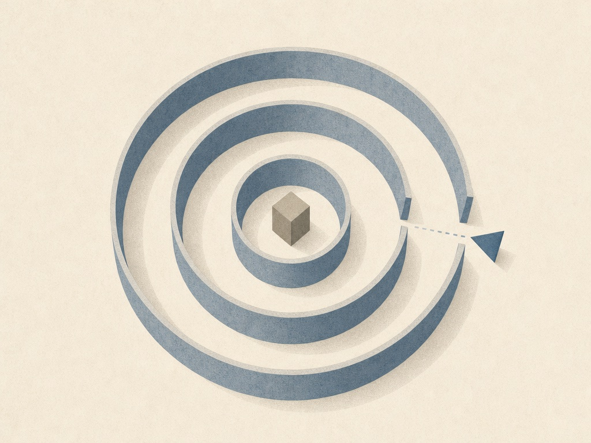

> 원문: <https://www.a16z.news/p/the-dream-of-the-1990s-is-alive-again>

---

1998년 5월, L0pht 소속 해커 일곱 명이 상원 위원회에서 인터넷을 30분 안에 무너뜨릴 수 있다고 증언했다. 2026년에 들으면 과장처럼 들리겠지만, 당시 사이버보안 상태를 아는 사람들은 이런 취약점이 존재한다는 사실에 아무도 놀라지 않았다.

90년대와 2000년대에 공격이든 방어든 어떤 형태로든 보안 일에 몸담았다면 그 리듬을 기억할 것이다. 누군가 모두가 의존하는 소프트웨어에서 치명적인 취약점을 찾는다. 하던 일을 내려놓고 어디에 노출됐는지 파악한다. 그리고 당시 초기 사이버보안 산업에 있었다면 고치려고 달려들고, EFNet IRC 채널에 있었다면 악용하려고 달려든다. 다음 주에는 같은 일이 또 벌어진다.

2002년 한 해에만 인터넷을 떠받치던 가장 중요한 소프트웨어들이 원격 취약점에 연달아 뚫렸다. Apache, OpenSSH, OpenSSL, BIND. 웹 서버, 보안 연결, DNS. 인터넷의 기반 부품을 아무거나 하나 고르면, 누군가 그것 때문에 아주 나쁜 한 주를 보내고 있었을 것이다.

최근 몇 달간 보안 팀들과 나눈 대화에서 이 느낌이 되살아나고 있다는 게 분명하다. 예전에는 보안 팀의 일정 전체를 긴급 대응으로 채워버리던 종류의 취약점이, 몇 년에 한 번 있는 특별한 사건이라기보다 2026년의 대부분을 보내는 방식처럼 느껴지기 시작했다.

Opus 4.5/4.6은 공격의 경제학이 급격히 바뀌기 시작한 지점이었다. 희귀한 전문성과 많은 시간을 요구하던 작업이 몇 자릿수 더 빠르고, 싸고, 반복하기 쉬워지고 있다. 그 결과가 지난 수십 년간 제대로 감사를 거쳤던, 적어도 우리가 그렇게 믿었던 핵심 소프트웨어 패키지에서 나타나고 있다.

보안 팀 사이에는 오래된 농담이 하나 있다. 제로데이가 모든 관심을 끌지만 실제로 대부분의 침해를 일으키는 건 550데이라는 농담이다. 그 농담은 놀랄 만큼 오래 유효했다. 그런데 불행하게도 우리는 시간 스펙트럼의 양쪽 끝, 제로데이와 550데이를 모두 걱정해야 하는 시기에 다시 들어섰다.

다행히 우리는 이런 시기를 겪어본 적이 있다. 첫 제로데이 대량 발생 시기의 경험을 오늘에 적용하고, 가장 AI 네이티브한 보안 프로그램을 운영하는 CISO들과 나눈 최근 대화를 더하면, 앞으로 몇 년이 어떤 모습일지에 대한 몇 가지 주제가 떠오른다.

### 1. 웜즈 2: 돌아왔다!

2000년대 초반에는 "인터넷 웜"이 물결쳤다. 웜은 스스로 번식하는 악성 프로그램으로, 알려진 취약점을 가진 호스트를 찾아 장악하고, 새로 감염된 호스트로 하여금 더 취약한 시스템을 찾아 스캔하게 해 자신을 복제했다. 초기 버전 중 일부는 감염 호스트들이 새로운 취약 시스템을 찾느라 만들어내는 트래픽이 너무 많아 네트워크 전체를 다운시키기도 했다. 2000년대 후반에는 마이크로소프트 생태계의 핵심 부분이 더 안전해지면서 원격으로 악용 가능한 취약점이 크게 줄었고, 이런 스타일의 공격도 대부분 사라졌다.

인터넷 웜이 돌아오는 것만큼 90년대와 2000년대 분위기를 되살리는 게 없다. AI가 취약점 발견과 익스플로잇 개발 시간을 크게 줄이고 있는데 패치 타임라인은 아직 따라잡지 못했기 때문에, 인터넷 웜이 돌아올 기회의 창이 열릴 것이다. 다만 SQLSlammer와 Sasser 등 2000년대 초반 웜의 목표가 단순한 자기 복제였던 것과 달리, 이번에는 상업적인 목적이 더 눈에 띈다. 공격자가 탈취한 자원으로 하는 행위의 선택지는 암호화폐 채굴에서 빠르게 추론용 API 키 탈취로 옮겨가고 있고, 랜섬웨어 같은 것도 있다.

### 2. Windows XP 패치 문제의 재림

2000년대 초반에는 인터넷에 직접 연결된 패치 안 된 Windows 머신이, 공격을 막는 데 필요한 업데이트를 내려받기도 전에 장악됐다. 당시에는 문제가 워낙 심각해서 SANS가 'Windows XP: Surviving the First Day'라는 가이드까지 내놨다.

AI 시대 버전의 이 문제는 운영체제에만 적용되는 게 아니고, 이미 소프트웨어 생태계 전반에 적용되고 있다. 지금까지 기업들이 대부분의 소프트웨어 패키지에 대한 자동 업데이트를 미뤄온 데는 두 가지 이유가 있었다. 첫째, 업데이트가 뭔가를 망가뜨릴 위험이 업데이트하지 않을 때의 보안 위험보다 컸다. AI가 공격을 기계 속도로 풀어주면서 이 계산은 바뀌고 있고, 기업들이 몇 자릿수 더 빠른 속도로 패치를 적용하는 모습이 늘 것이다. 둘째, 이 문제는 앞의 몇 문장이 암시하는 것보다 훨씬 어렵다. 기업 내부에 들어 있는 소프트웨어의 양은 어마어마하고, 그 상당 부분은 더 이상 활발히 유지보수되지 않는 경우가 많다. 그래서 기업이 몇 자릿수 더 빠르고 효과적으로 패치하도록 돕는 새 스타트업들이 이 분야에 등장하는 걸 지켜보는 일은 즐겁다.

### 3. 강화된 인프라 컴포넌트를 둘러싼 스타트업이 나온다

이런 보안 환경의 이전 버전에서는 고도로 강화된(hardened) 인프라 컴포넌트라는 아이디어를 중심으로 오픈소스 프로젝트와 스타트업이 여럿 생겨났다. 예컨대 OpenBSD는 정확성, 보안 감사, 안전한 기본값을 정체성으로 삼았고 한동안 안전한 운영체제의 금본위제로 꼽혔다. (필자는 2000년대 초반에 OpenBSD를 데스크톱 OS로 썼는데, 내가 고등학교에서 얼마나 인기가 없었는지는 이 사실 하나로 다 설명된다.)

핵심 인프라 조각을 가져와 기업용으로 고도로 강화된 버전을 제공한다는 것을 중심 약속으로 삼는 제품들의 새 세대가 나올 것으로 보인다. 이전 세대들은 상업적으로 고전했지만, 이번에는 보안 환경의 변화가 훨씬 더 큰 시장을 열어주는지 지켜볼 일이다.

큰 그림의 주제별 예측은 그럭저럭 좋다. 하지만 지금 이 상황을 직접 처리하고 있는 보안 팀이라면 어디서부터 시작해야 할까.

#### 1. 지금, 과감하게 자신들을 시험하라

컴플라이언스를 위한 연례 모의해킹 같은 게 아니다. 실제로 최근에 이야기한 보안 팀 대부분은 모의해킹 노력을 최대한 지속적으로 운영되도록 재편하고, 기존 모의해킹 서비스는 연례 컴플라이언스 행사로 재분류하고 있다.

우리가 지금 지내는 시대에서 보안 리더는, 공격자들이 이 시점에 실제로 성과를 내고 있는 최신 도구를 쓰는 범위 제한 없는 전면 레드팀 테스팅을 받아들여야 한다. 기존 방식의 취약점 관리, 스캐닝, 모의해킹 등은 요즘 매일 터지는 침해로 이어지는 문제들을 애초에 발견하지 못한다. 공격자들은 대신 Hinoki Security 같은 도구를 활용해 특화된 포스트트레이닝 보안 모델에 접근하고, 모델의 거절(refusal)에 걸리지 않으면서 현대적인 레드팀 테스팅을 수행한다.

외부 테스트에 더해 내부 테스트도 과감하게 할 시점이 있다면 바로 지금이다. 다가오는 제로데이 물결 때문에 외부 공격자가 환경 내부에 초기 거점을 확보하기가 점점 더 쉬워질 것이다.

#### 2. 심층 방어는 겹치는 탐지와 속도로 이동한다

"심층 방어(defense in depth)"는 보안 산업이 존재한 이래 계속 나온 만트라지만, 실무에서 무엇을 뜻하는지는 시간에 따라 바뀌었다. 업계가 처음 보안 통제를 도입하기 시작했을 때는 방화벽을 배치하고 그 뒤에 IDS를 함께 배치해 빠져나간 공격을 탐지하려는 정도였다. 지난 20여 년간 기업 환경이 계속 커지면서, 많은 CISO가 사적으로 털어놓는 현실은 이렇다. 통제 층 한두 개가 제대로 작동하지 않거나, 튜닝되지 않았거나, 상당수 경우 아예 실수로 꺼져 있었다는 사실을 침해가 터져서야 깨닫는 일이 잦다는 것이다. 그 결과 이 기간 동안 심층 방어의 실용적인 의미는, 한두 개가 의도대로 작동하지 않더라도 어느 하나는 제대로 작동해 사건을 막거나 탐지하거나 대응할 확률이 있도록 통제를 충분히 겹쳐 쌓는 것이 됐다. 짐작하겠지만 이 모든 것은 꽤 느리게 작동했다. 공격자가 더 빨랐지만 여전히 대략 같은 자릿수의 속도였기에 큰 불균형은 없었다.

이제 AI가 공격 역량의 모든 단계를 폭넓게 도우면서, 심층 방어의 새로운 목표로 이동하고 있다. 모든 통제 층이 완벽하게 작동하더라도 제로데이, 새로운 기법, 그리고 순수한 속도가 완벽하게 작동하는 통제 하나 이상을 우회할 가능성이 큰 세계다. 이 새로운 세계에서 보안 팀은 통제를 겹쳐 배치해 탐지 확률을 높이는 것에 더해, 이전에는 요구된 적이 없는 AI 네이티브 수준의 속도에 맞춰 탐지와 대응 역량을 최적화하는 마인드셋이 필요하다.

#### 3. AI 운영 환경을 위해 보안 스택을 재부팅하라

클라우드로의 전환이 방어자가 보안 스택을 바닥부터 다시 세워야 했던 마지막 순간이었다. 어느 면에서는 오늘보다 필요가 훨씬 더 명확했다. 그 전환기의 CISO는 많은 보안 통제를 물리 어플라이언스로 구매해왔다. 그런데 갑자기 꽂을 데이터센터 랙이 없어졌고, 그래서 완전히 소프트웨어인 클라우드 네이티브 보안 통제를 찾기 시작했다.

AI 시대는 기업의 프로세스와 기술 사용 거의 모든 부분을 바꿔놨고, 조직에서 가장 두드러진 보안 통제 상당수에도 같은 수준의 재부팅이 필요하다. 안티바이러스 시대의 1세대 악성코드에서 행위 기반 EDR 시대의 2세대로 갔듯이, 이제 악성코드와 엔드포인트 보안의 3세대, 즉 에이전틱 멀웨어(agentic malware) 시대에 들어섰다. 아이덴티티 쪽에서는 이제 인간의 행동을 인증하고 인가하는 데 그치지 않고, 에이전트가 기업 내부에서 어떻게 작동하는지에 대한 통제를 제공해야 한다. 오픈소스 소프트웨어 공급망 같은 다른 영역에서는, 에이전틱 코딩이 위험 여부와 상관없이 점점 더 많은 오픈소스 패키지를 끌어오면서 공격 수가 폭발적으로 늘었다.

물리 어플라이언스에서 클라우드 기반 아키텍처로 전환했던 것처럼, 이 영역들 전부 근본적으로 새로운 AI 네이티브 아키텍처를 요구한다. 그래서 이 시대를 위해 바닥부터 만들 수 있는 새로운 회사들이 이 문제들을 맡고 있다. 엔드포인트 네이티브 AI 보안을 하는 Neo, 에이전트를 위한 새로운 Okta 역할을 하는 Keycard, 급증한 오픈소스 공급망 공격으로부터 조직을 지키는 Socket 같은 회사들이다.

솔직하게 말하면, 공격이든 방어든 이야기하는 보안 리더 거의 전원이 앞으로 몇 년간 새로 공개되는 취약점의 홍수가 올 것으로 본다. 동시에 발견에서 작동하는 익스플로잇까지, 그리고 활동적인 공격 캠페인까지 걸리는 시간 간격은 계속 줄어들어 헤드라인에 오르는 침해가 더 잦아질 것이다.

전례 없는 상황처럼 들리지만, 실제로는 20여 년 전 보안 환경이 이랬을 때 배울 것이 많다. 그때와 마찬가지로 지금은, 스택 전체에 새로운 AI 네이티브 접근을 활용해 방어자의 보안 역량을 크게 앞으로 밀어낼 수 있는 기회를 준다. 새로운 회사, 새로운 아키텍처, 그리고 우리가 이미 의존하고 있는 소프트웨어에 대한 많은 작업이 필요하다. 하지만 반대편으로 나오면 이전에는 핏속 환상에 불과했던 방어 역량을 손에 넣게 된다. 그래서 사이버보안에서 뭔가를 만들기에 아마도 가장 특별한 시기다. Onward!

_이 글을 쓰는 데 도움을 준 Joel de la Garza에게 감사를 전한다._
