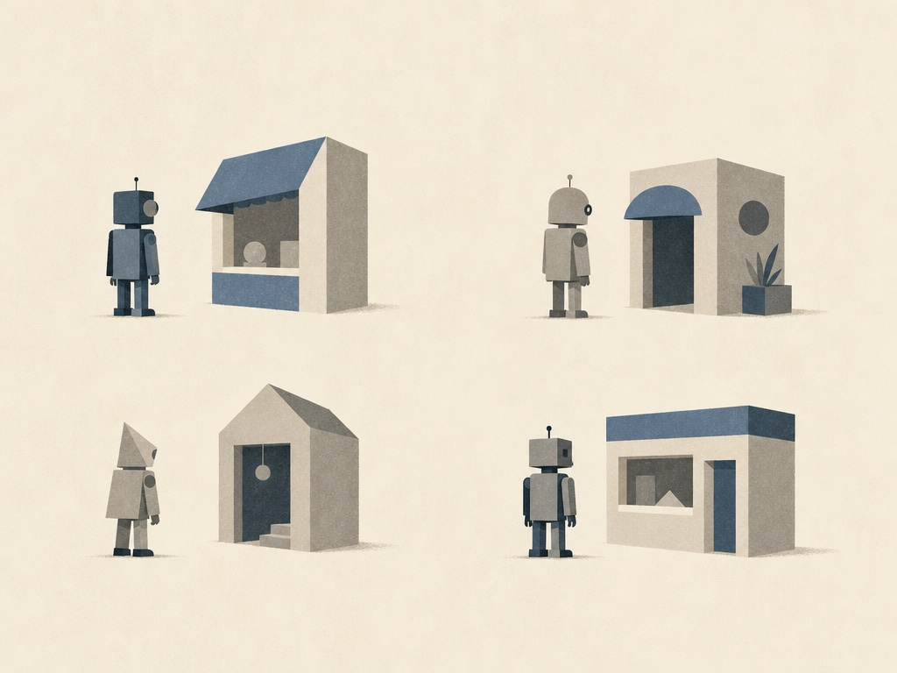

> 원문: <https://www.a16z.news/p/welcome-to-the-b2a-economy-how-agents>

---

B2A 경제를 다룬 [첫 글](https://www.a16z.news/p/welcome-to-the-b2a-economy)에서 우리는 에이전트가 앞으로 우리가 무엇을 사고, 어떤 앱을 쓰고, 어디에 돈과 토큰을 쓰는지에 점점 큰 영향을 줄 것이라고 주장했다. 거의 모든 비즈니스가 이 새로운 유통 채널을 활용하고 싶어 할 것이다. 그런데 에이전트에게는 어떻게 팔아야 할까.

우리는 고객에 NVIDIA, Google, Databricks, Cloudflare, Kalshi, Vercel, Snapchat, Exa, Clay 등이 있는 [The Prompting Company](http://promptingcompany.com/)와 함께 Grok Bot, Muse, Instinct, Dots 네 에이전트를 1,270개 프롬프트와 11,307회의 완주된 에이전트 실행에 걸쳐 테스트했다. 비교를 위해 ChatGPT, Gemini, Perplexity의 쇼핑 요청도 테스트했다.

테스트는 물건("15달러 미만 노이즈 캔슬링 헤드폰을 찾아줘")과 소프트웨어("이 영상 편집에는 Adobe와 Descript 중 무엇을 쓰는 게 좋을까")를 모두 다뤘다. 실험과 함께 YipitData의 소비자 지출 데이터를 결합해 Muse 등 소비자 에이전트가 매개한 구매가 실제로 어디서 일어나고 있는지 봤다. 에이전트 지출 기준 상위 50개 판매처 목록도 공개했으니 각자 결론을 내려볼 수 있다.

이 자료가 에이전트라는 고객의 모습을 그려주고, 그를 설득하는 다섯 가지 교훈을 남긴다.

## 1. 두드러지는 용도에 힘을 실어라

포괄적인 요청에는 에이전트들이 비슷한 기본 선택지를 공유하는 경우가 많다. Muse, Instinct, Grok Bot, Dots를 대상으로 한 테스트에서 한 에이전트가 고른 제품은 다른 에이전트 중 최소 하나도 고를 확률이 73%였다. 거의 4분의 1 사례에서는 네 에이전트 모두 같은 최상위 제품을 골랐다.

그렇다면 기본 선택지가 되려면 어떻게 해야 할까. 쉽지 않다. 연구 로그를 전부 공개하는 에이전트는 Muse가 유일한데, 그 로그는 후보군이 얼마나 좁은지를 보여준다. Muse는 거의 항상 자기 [메타 카탈로그](https://www.facebook.com/business/help/1275400645914358?id=725943027795860) 검색으로 시작하고 최대 50개 옵션을 끌어온다. 브라우저 사용 검색을 함께 돌리는 경우(항상 그렇지는 않다) 에이전트는 평균 세 개의 제품 페이지만 본다.

추천이 이렇게 겹치는 것을 보면 다른 에이전트들도 비슷하게 좁은 검색 집합을 쓸 가능성이 있다. 시간이 지나면 달라질 것이다. 에이전트가 실시간 메타데이터에 접근해 카테고리의 모든 제품을 실제로 훑을 수 있게 되기 때문이다. 그러나 지금은 에이전트가 보는 옵션 수가 상당히 낮다. 그리고 그 집합 안에서 꽤 일관된 변수, 즉 가격과 리뷰를 근거로 고른다.

에이전트의 검색 집합에 들어가고 최종적으로 선택되는 가장 좋은 방법은, 더 좁은 용도나 페르소나에서 제품이 뛰어나다는 것을 증명하는 것이다. 이는 기본 선택을 크게 뒤집을 수 있다. 두 헤어드라이어인 Shark FlexStyle과 Dyson Airwrap 중에 고르게 한 에이전트들은 91%의 사례에서 더 싼 Shark를 골랐다. 리뷰를 읽고 비슷한 성능에 더 낮은 가격이라고 결론 내렸기 때문이다.

그러나 요구가 조금만 복잡해지면 에이전트의 판단이 달라졌다. 모발이 가늘거나 컬러 시술 모발이라는 조건이 붙으면 Dyson이 51%의 실행에서 이겼다. 매일 써야 하는 제품이라는 조건이 붙으면 Dyson의 승률은 88%로 올랐다. 이런 구체적 조건은 무게, 최대 온도, 심지어 소리 같은 제품 특성을 에이전트가 찾게 만들었고, Dyson의 프리미엄 가격을 정당화하기 쉬워졌다.

소프트웨어 선택에서도 에이전트는 비슷한 논리를 따른다. 범용 그래픽 디자인 소프트웨어를 요청받으면 에이전트는 78%의 실행에서 Canva를 지명했고 Adobe는 한 번도 지명하지 않았다. 그러나 팀 템플릿이 언급되면 Adobe가 상위 목록에 오르는 빈도가 훨씬 높아졌다. 전문가 수준의 결과물이 필요하다고 하면 모든 실행에서 Adobe를 골랐다.

## 2. 사람 눈만이 아니라 에이전트 크롤러에 맞춰 제품을 최적화하라

에이전트는 검색에 접근하는 방식이 사람과 다를 뿐 아니라 전통적인 LLM과도 다르다. 제품을 찾으라 하면 LLM은 학습 데이터에 의존하고, 추가 옵션이나 정보 검증이 필요하면 웹 검색으로 돌아간다. LLM은 이용 가능한 제품이 아니라 좋은 옵션 몇 개를 드러내려 한다. 그 결과 리뷰 사이트, 언론, 포럼에 기대는 정도가 제품 페이지 자체보다 클 때도 있다.

에이전트는 반대로 사용자 메모리 확인에서 시작한다. 이는 에이전트가 사용자와 선호에 대해 쌓아둔 맥락이고, 최종 추천이 모든 조건을 맞추도록 하는 첫 단계다. 그다음 내부 커넥터와 카탈로그를 확인하고 외부 조사(주로 웹 검색)를 한다. The Prompting Company의 활동 로그에 따르면 Muse와 Dots는 자체 검색 시스템을 쓰고 Grok Bot과 Instinct는 Exa를 쓴다.

확인하는 출처의 비율은 카테고리마다 다르지만, 에이전트는 전통적 LLM보다 공식 또는 제3자 제품 페이지를 직접 방문할 가능성이 높다. 그래서 에이전트가 읽을 수 있는 웹사이트, 또는 에이전트가 접근할 수 있는 소프트웨어 제품이 중요하다. 에이전트가 제품이 무엇을 하는지, 얼마인지, 어떤 제한이 적용되는지 확인해야 최종 후보군에 넣을 수 있다.

소프트웨어에도 같은 규칙이 적용된다. 우리는 Dots에게 제품 사진으로 광고 열 장을 만들게 하고 이미지 생성 도구를 에이전트가 직접 고르게 했다. 에이전트는 [Midjourney](https://docs.midjourney.com/hc/en-us/articles/32013696484109-Community-Guidelines)를 확인했는데, 가이드라인에 일반 API가 없고 자동화 사용을 거의 항상 금지한다는 문서를 발견했다. 그러고는 [Ideogram](https://ideogram.ai/)으로 갔다. Ideogram은 제품 페이지에서 API와 공식 MCP 통합으로 이어지는 경로를 제공했다. [API 문서](https://developer.ideogram.ai/ideogram-api/api-overview)에 이미지를 생성하고 다운로드하는 코드까지 있어 에이전트의 선택은 쉬웠다.

에이전트 테스트에서 자기 웹사이트가 어떻게 나오는지는 [여기서](https://promptingcompany.com/retail-benchmarks) 확인할 수 있다.

## 3. 에이전트는 계산을 한다. 가치가 보이도록 하라

사람과 달리 에이전트는 냉정한 최적화 도구다. 배송비, 구독 약정 옵션, 반품·환불 정책, 보증까지 포함한 총비용을 계산한다.

그 근거로 1차 판매처, 3자 판매처, 중고 판매까지 포함해 어디서 사는 게 최선인지 판단한다. 같은 제품을 두 판매처가 같은 가격에 팔 때 에이전트는 86%의 테스트에서 반품 정책이 나은 쪽(무료 반품, 더 긴 반품 기간, 원래 결제 수단 환불)을 골랐다.

Quince는 에이전트에게 자기 가치를 명확히 알리는 소매점의 예다. Quince는 소비자 에이전트 지출 기준 상위 15개 소매점에 들지만 글로벌 상위 15개 소매점은 아니다. [50달러 캐시미어 스웨터](https://www.quince.com/women/cashmere/cashmere-crewneck-sweater)의 제품 페이지가 이유를 보여준다. 상단 가까이에 가격, 배송비(무료), 재고 상태, 리뷰(건수와 평점)가 있다. 가격은 전통 소매가와 직접 비교되고, 아래로 스크롤하면 특정 다른 브랜드와의 일대일 비교가 나온다.

소프트웨어도 에이전트를 위한 가격 표기로 이득을 본다. 에이전트 거래 수 9위, 기술 카테고리 1위는 도메인 등록 도구 Porkbun이다. Cloudflare(17위)와 GoDaddy(112위)가 월 등록 도메인 수에서 각각 2.6배, 4.8배로 앞서는데도 Porkbun이 이겼다. Muse와 Dots 모두 Porkbun의 투명한 가격과 락인이 없다는 점, 1년차 할인가가 나중에 뛰는 구조가 없다는 점을 선호했다.

다만 가격에는 한계점이 있다. 사람처럼 에이전트도 확실히 더 신뢰할 수 있는 판매자에게는 프리미엄을 지불하고, 제품 가격이 너무 좋아 믿기 어려우면 피한다.

한 실행에서 Grok Bot은 200달러짜리 Sonos 스피커 목록을 건너뛰고 공인 딜러의 250달러 옵션을 골랐다. 근거는 보증이었다. 실제로 싼 판매처와 더 비싼 신뢰할 수 있는 옵션을 겨루게 한 275회의 실제 상점 비교에서 에이전트는 72%의 경우 신뢰 쪽을 추천했다. 트래픽, 백링크, 브랜드가 여전히 중요한 지점이다.

가격 측면에서 10% 미만 할인은 에이전트를 전혀 움직이지 않았다. 10~50% 할인은 더 설득력이 있었지만, 에이전트가 더 싸고 덜 신뢰할 수 있는 옵션을 고른 비율도 24%에 그쳤다. 할인이 50%를 넘으면 에이전트는 피했다.

## 4. 에이전트마다 다른 고객처럼 대해라

사람처럼 에이전트마다 취향이 있고, 이는 어떤 제품을 보는지와 최종적으로 무엇을 고르는지에 모두 영향을 준다.

이 차이의 일부는 봇 차단에서 온다. 아마존 결제 테스트에서 Grok Bot은 모든 실행에서 장바구니에 도달했지만 Muse, Instinct, Dots는 모든 시도에서 차단됐다. 네 에이전트 중 대형 소매점 대신 브랜드 공식 사이트로만 사용자를 보내는 경향은 Instinct가 가장 컸다.

선호는 강할 수 있다. Grok Bot은 17.5%의 실행에서 아마존으로 연결했지만 다른 에이전트는 1.6%를 넘지 못했다. Muse는 답변의 26%에서 Walmart, 22%에서 Best Buy로 연결했다. 물론 Muse는 네 에이전트 중 유일하게, 더 넓은 검색에 나서기 전에 자기 Commerce Manager 제품에서 50개 옵션을 끌어오는 에이전트이기도 하다. 에이전트가 소매점과 거래를 맺으면서 이런 선호는 시간이 지날수록 강해질 것으로 본다. Muse와 Walmart는 [에이전트 간 통신 채널](https://x.com/juokaz/status/2124171797713363317)을 내놓는 중이고, ChatGPT는 최근 OpenAI 파트너십이 제품 추천에 영향을 주지 않는다는 [문구를 삭제했다](https://x.com/juokaz/status/2124194287432749332).

에이전트마다 다른 점 중 고려할 만한 것은 당신 제품을 어떻게 마케팅하는가다. 대면 회의용 AI 노트 솔루션을 요청했을 때 Grok Bot과 Instinct는 결국 거의 같은 추천 목록에 도달했고, 선택 이유(기존 기기에서 쓸 수 있음, 프라이버시, 편의성)까지 비슷했다. 그러나 Instinct는 옵션을 보여주는 보기 좋은 시각적 사이트를 만들었고, Grok Bot은 더 직설적인 답을 줬다. 심지어 노트 필기를 먼저 자기가 하고 이후 사용자를 위한 워크플로를 만들어 주겠다고 제안했다.

에이전트마다 신뢰하는 증거도 다르다. Muse는 리뷰를 거의 인용하지 않는다. 선택의 10%에서만 언급했고 다른 에이전트는 30~41%였다. Dots는 11.4%의 실행에서 전문 제품 테스트를 인용했는데 다른 에이전트는 3.7%를 넘지 않았다. 소프트웨어를 볼 때는 에이전트 입장의 "사용 편의성"이 1차 결정 요인이었다. Instinct는 평점을 그대로 받아들이지 않았다. 동점 판정 테스트에서 외부 리뷰를 확인했고 제시된 평점에 이의를 제기하는 일이 잦았다. "더 나은 리뷰"가 이긴 것은 26회 동점 판정 중 4회였다. Instinct에게는 반품이나 해지 조건이 다른 에이전트보다 훨씬 큰 요인이었다.

## 5. 에이전트가 이미 검색하고 거래하는 곳에 있어라

마음에 들든 아니든 에이전트는 검색을 애그리게이터(공급이 많고 가끔 할인이 있다)와 마켓플레이스(고유 재고가 많다)에서 시작하고 끝내는 경우가 많다. 에이전트는 검색을 마칠 시간이 제한되어 있고, 논리적으로 가장 빽빽한 옵션 집합을 한 번에 볼 수 있기를 원한다.

그래서 당신 제품이 이런 다른 플랫폼에서 어떻게 "보이는지"를 이해하는 일이 더 중요해진다. 에이전트 지출 상위 50개 판매처의 관측 지출 중 거의 3분의 1이 마켓플레이스와 애그리게이터로 갔다. 제3자 마켓플레이스를 운영하는 소매점을 포함하면 46%이고, 전통적인 다브랜드 소매점까지 포함하면 55%다.

이 수치는 여행이 지금까지 에이전트 지출에서 가장 큰 비중을 차지하고, 그 카테고리를 애그리게이터가 지배한다는 점에서 다소 왜곡되어 있다. YipitData 표본에서 지출 기준 상위 두 판매처는 Expedia와 Booking.com이었고, American Airlines와 United는 각각 4위와 6위였다.

애그리게이터는 많은 옵션과 가격, 예약 도구를 한곳에 모으므로 에이전트에게 매력적이다. 아래 워크스루에서 같은 호텔의 환불 가능 킹 룸은 [공식 사이트](https://www.zhotelssf.com/hotels/zelos/faq)에서는 476.20달러, [Expedia](https://www.expedia.com/San-Francisco-Hotels-Hotel-Zelos-San-Francisco.h225819.Hotel-Information)에서는 476달러였다. Expedia는 지금 결제할지 현지에서 결제할지 선택지를 줬고, 지금 결제 시 카드와 PayPal을 지원했다. 사용자가 공식 예약을 요구하지 않으면 에이전트의 선택은 명확하다.

지금은 에이전트가 자체 제품 카탈로그와 브라우저 사용에 크게 기대고, 외부 커넥터 사용은 낮다. 10월 22일부터 11월 8일 사이의 실행에서 Grok Bot은 5%의 실행에서 앱 연결을 제안했고 Instinct, Muse, Dots는 각각 1% 미만이었다.

그러나 이것은 빠르게 바뀌고 있다. OpenAI의 새 [Businesses in ChatGPT](https://openai.com/index/introducing-businesses-chatgpt/)는 검증된 비즈니스가 자기 정보를 갱신하고 가격과 재고가 담긴 제품 피드를 추가하게 해주며, 자격이 되는 미국 비즈니스는 고객 질문에 답하는 Business Agent를 게시할 수 있다. Meta는 기존 제품 카탈로그를 연결해 Muse 검색을 시작한다. 여러 에이전트(Muse, Grok Bot, Instinct)에서 [Shopify Catalog](https://www.shopify.com/news/fall-26-edition-merchant)는 Shop Pay로 살 수 있는 제품을 제공한다.

에이전트가 제품을 찾고 고른 뒤에는 결제가 마지막 관문이다. 우리 테스트에서 에이전트는 게스트 결제를 허용하는 상점에서 81%의 실행으로 결제 폼 끝까지 도달했다. 로그인 계정을 요구하는 상점에서는 모든 실행이 구매 과정 초반에 멈췄다. 사용자의 자격증명을 물어보다가도 있었지만, 다른 판매처로 옮겨가기도 했다.

장기적으로 신원 없는 쇼핑은 소비자나 판매자에게 이상적이지 않고, 신원·결제·사기 방지를 둘러싼 프로토콜이 형성되기 시작했다. Muse, Grok Bot, Instinct 모두 [Stripe의 Link 지갑](https://stripe.com/newsroom/news/stripe-helps-meta-muse-shop-with-link)을 쓴다. Muse에게 Link는 이를 받아들이는 100만 개 이상의 비즈니스에서 즉시 결제를 가능하게 하고, 그 밖의 곳에서는 일회용 가상 카드를 발행한다. 사용자는 채팅에서 구매를 승인하며 실제 카드 정보는 에이전트에게 주지 않는다. Muse는 [Shop Pay도 네이티브로](https://www.a16z.news/p/wallet-wars) 쓸 수 있다.

테스트가 끝난 뒤 OpenAI는 11월 13일 Dots용 [ChatGPT Wallet](https://openai.com/index/introducing-chatgpt-wallet/)을 출시했다. 초기에는 미국 Pro 사용자 대상이다. 에이전트가 고객의 실제 카드 정보 대신 토큰으로 기존 결제 흐름을 통해 지불하고, 사용자가 각 구매를 승인한다.

비즈니스가 에이전트에게 마케팅하고 판매하는 방법을 돕는 스타트업에게는 큰 기회가 있다. 이 분야에서 만들고 있다면 연락을 기다린다.

방법론: The Prompting Company가 2026년 10월 22일부터 11월 8일까지 1,270개 프롬프트로 11,307회의 완주된 개인 에이전트 테스트를 실행했고, ChatGPT, Gemini, Perplexity에서 2,619회의 쇼핑 요청 실행을 더했다. 표본은 실험마다 다르다.

YipitData의 별도 카드 패널 분석은 2026년 11월 11일까지의 에이전트 매개 구매를 다룬다. 추적은 Muse와 Instinct를 구분하지 않고 아마존은 제외한다. 판매처 순위와 금액은 제공된 표본에만 해당하며 총 판매처 매출이 아니다.
