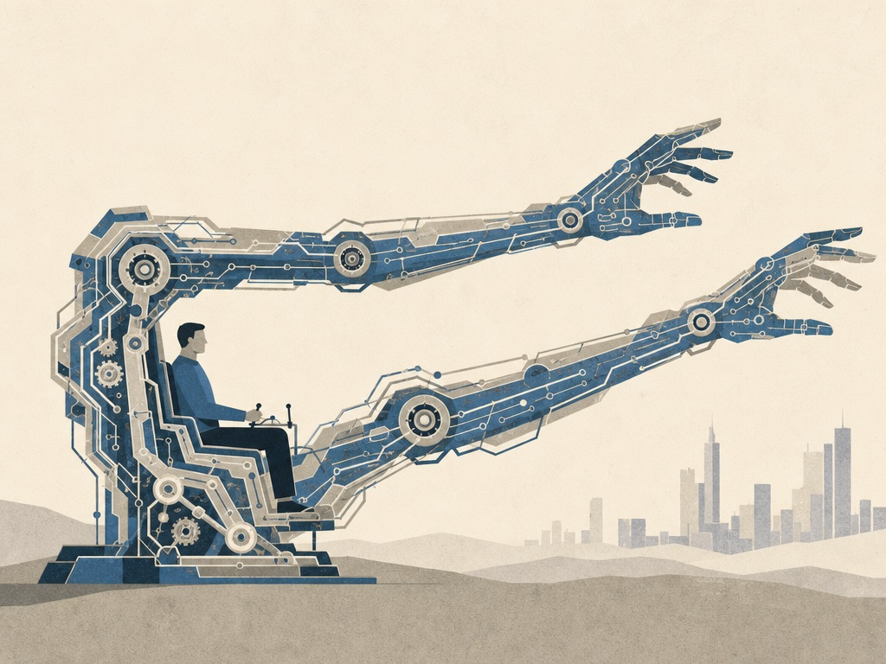

> 원문: <https://stratechery.com/2026/the-individual-exception/>

---

지난 목요일 이후로 내가 만든 것들:

- Sharp Tech 스튜디오의 카메라, 조명, 믹서와 그 밖의 장비 전부를 관리하는 Sharp Studio 서비스 앱을 만들었다. 스튜디오 PC의 Windows 앱, iPhone 앱, 웹 앱, Elgato Stream Deck에서 접근할 수 있다. 에피소드 녹음에 필요한 방 안의 모든 장비를 원격으로 완전히 제어한다.
- 물건을 분류하고 측정하는 일회용 iOS 앱을 여러 개 만들었고, 측정 리그(rig)를 설계해 3D 프린팅했다. 에이전트와 직접 상호작용하는 기기, 스튜디오용 전용 디스플레이 기기를 포함해 여러 전용 하드웨어 기기를 설계하고 부품도 구입했다.
- 내가 관리하는 여러 컴퓨터에 접속하는 iOS 앱을 완전한 기능을 갖추게 만들었다([Duo용으로 설계했지만 일반 iPhone에서도 동작하며, GitHub에 공개했다](https://github.com/Stratechery/duo-desktop)). 화면 공유, 터미널, KVM 스위치를 아우르고 Mac, Linux, Windows에서 작동한다. 솔직히 이야기하면 역대 최고의 화면 공유 클라이언트라고 생각한다. 벌써 매일 쓰고 있다.

이 과정에서 에이전트용 작은 하네스도 만들었다. 서브에이전트를 조율하는 것을 넘어, 부하 상황에 따라 내가 가진 여러 컴퓨터에 작업을 분배한다. iOS 개발은 Mac, GPU 관련 작업은 게이밍 PC, 나머지는 Linux 서버가 맡는다. 그 작업은 집안 모든 TV에서 돌아가는 커스텀 상태 보드, iOS 앱, Telegram 봇으로 추적된다.

이 모든 일은 몇 년 전만 해도 팀이 몇 주, 어쩌면 몇 달에 걸쳐 해야 했을 것이다. 나에게는 AI가 있다. 오직 한 명이면 충분하다.

### 임금이 디플레이션을 겪다

1950년대 시가총액 기준 최대 기업은 AT&T였다. 1959년 매출 75억 4,000만 달러, 시가총액 171억 달러, 직원 729,000명이었다. 인플레이션을 반영하면 매출 875억 달러, 시가총액 1,984억 달러다. 직원 수에는 인플레이션을 적용하지 않는다.

아니, 어쩌면 적용하는데 방향이 반대일지도 모른다. 세계에서 가장 가치 있는 회사들에서 눈에 띄는 것은 매출과 시가총액이 폭발적으로 늘어나는 동안 직원 수가 _디플레이션_을 겪었다는 점이다. 표의 금액은 모두 오늘 기준 인플레이션 조정치다:

| 연대 | 회사 | 연도 | 실질 매출 | 직원 수 | 실질 시가총액 |
| --- | --- | --- | --- | --- | --- |
| 1950년대 | AT&T | 1959 | $87.5B | 729,000 | $198.4B |
| 1960년대 | AT&T | 1969 | $147.8B | ~1,000,000 | $245.6B |
| 1970년대 | IBM | 1979 | $106.3B | 337,119 | $174.8B |
| 1980년대 | IBM | 1989 | $170.6B | 383,220 | $148.5B |
| 1990년대 | 제너럴 일렉트릭 | 1999 | $226.6B | 340,000 | $1.03T |
| 2000년대 | ExxonMobil | 2008 | $749.5B | 104,700 | $637.6B |
| 2010년대 | Apple | 2018 | $355.9B | 132,000 | $1.00T |
| 2020년대 | Apple | 2026 | $478.8B | 167,000 | $5.07T |

AI 시대를 연 두 회사, Nvidia와 Anthropic을 보면 디플레이션은 더 극단적이다:

| 연대 | 회사 | 연도 | 실질 매출 | 직원 수 | 실질 시가총액 |
| --- | --- | --- | --- | --- | --- |
| 2020년대 | Nvidia | 2026 | $361.8B | 42,000 | $3.99T |
| 2020년대 | Anthropic | 2026 | $35.3B | 5,300 | $1.17T |

이것이 직원 1인당 매출과 1인당 시가총액의 놀라운 상승으로 이어진다. 그래프는 로그 스케일이라는 점에 유의하라:

그런데도 Nvidia의 1인당 시가총액을 9,500만 달러로 잡은 이 차트는, 시장이 Nvidia의 어느 한 직원에게 매긴 가치에는 한참 못 미친다:

이 차트를 만드는 것을 도와준 ChatGPT가 이렇게 짚어주었다:

> 젠슨 황이 CEO로 복귀한 뒤 Nvidia는 시가총액이 거의 1조 달러 늘었다. 그 증가분만으로도 2008년 ExxonMobil의 인플레이션 조정 시가총액 전체(6,380억 달러)를 웃돈다.

오직 한 명이면 충분하다.

### 황의 오디세이

Nvidia의 전직이자 현직 CEO 젠슨 황의 두 주간 항해를 초현실적이라고 부르는 것도 부족한 말이다. 다만 앞선 사례가 없었다고 주장할 수는 없다. 정확히 세 번째 추수감사절 전이었다. 샘 앨트먼도 정확히 같은 주말에 OpenAI CEO에서 쫓겨났다가 복귀했다(막스 페르스타펜의 라스베이거스 그랑프리 두 번째 우승도 여기에 적어둔다).

그래도 나는 이번 사건이 같은 방식으로 끝나리라 생각하지 않았고, [Sharp Tech에서 그렇게 말했다](https://sharptech.fm/member/episode/jensens-not-coming-back-adventures-in-agentic-commerce-q-a-on-united-gta-vi-i-phone-duo). 앨트먼은 다소 서툰 내부 쿠데타로 쫓겨나 비상장사 투자자와 직원들의 압박으로 복귀했지만, 황은 강력한 세력이 언론을 동원하고 느슨하게 위장한 비리 시비를 걸어 Nvidia 이사회에 선택의 여지를 남기지 않는, 훨씬 체계적인 캠페인의 표적이었던 것으로 보였다. 물론 황은 적들에게 탄약을 아낌없이 줬다. 지난 몇 주 나는 "사람을 먼저 데려오라. 그러면 죄를 보여주겠다(Show me the man and I'll show you the crime)"는 말을 인용해 왔지만, 최소한 성적 기호와 관련해서는 황이 비판자들에게 사실상 "어느 죄를 말하는가"라고 되물었다는 점도 짚어둘 만하다.

동시에 황의 외도, 부하 직원과의 관계까지 포함해서, 아무도 신경 쓰지 않은 것처럼 보였다. 진짜 죄로 보이는 것은 황의 대중국 칩 판매에 대한 확고한 지지, 수출 통제 규칙을 최소한만 지키겠다는 태도, 그리고 가장 열렬한 비판자들의 주장대로 실제 밀수에 대한 방관이었다.

나는 적어도 오늘은 이 혐의들을 따져 보려는 것이 아니다. 그 대부분은 지난주 글 [Obituaries](https://stratechery.com/2026/obituaries/)에서 다뤘다(오늘 글의 다른 제목 후보는 _Resurrections_였다). 더 넓게 보면 이 글은 규범적 분석을 위한 글도 아니다. 황의 대중국 거래는 선거에서 [반AI 물결](https://stratechery.com/2026/ai-on-the-ballot/)의 힘을 얻은 민주당 의회가 조사할 것이고, 그의 개인적 도덕적 실패는 다른 거의 모든 경영자였다면 조기 퇴진이 불가피하다는 데 의문의 여지가 없었을 것이다.

내가 주목하는 것은 황이 명백히 어떤 다른 경영자도 아니라는 점, 그리고 그의 복귀가 기술이 비즈니스를 바꾸는 방식의 정점(apotheosis)에 있다는 점이다. AI가 정보기술의 정점인 것처럼. 오직 한 명이면 충분하다.

### 관리주의의 종말

1941년 전직 트로츠키스트 제임스 번햄은 [The Managerial Revolution](https://en.wikipedia.org/wiki/The_Managerial_Revolution)을 썼다. 산업 사회의 복잡성이 커질수록, 대규모 규모의 경제와 기술적 복잡성, 정부와의 뒤엉킴 때문에 생산수단의 소유자와 실제로 사회를 통제하는 관리 계급이 점점 갈라질 것이라는 주장이었다. 이 관점에서 소련 공산주의, 독일 파시즘, 미국 뉴딜주의는 모두 같은 히드라의 머리들이었다. 개인주의와 기업가정신에서 코퍼리티즘과 관료제로의 같은 구조적 전환을 다른 이념이 각각 정당화한 것일 뿐이었다.

이후 85년을 보면 번햄이 일리가 없었다고 말하기 어렵다. 그리고 지난 10일 동안, 관리 국가, 워싱턴 D.C.식으로 말하면 '더 블롭(the blob)', 반대 진영식으로 말하면 '딥 스테이트'가 번햄 테제의 단연 최대 도전자를 죽인 것처럼 보였다. 황은 Nvidia가 단일 개인, 즉 황 자신이 컴퓨팅의 미래 비전을 실행하기 위한 수단으로 설계됐다는 점을 분명히 밝혀 왔다. 다음은 그의 책 [The Nvidia Way](https://wwnorton.com/books/the-nvidia-way)에 관한 [Tae Kim과의 Stratechery 인터뷰](https://stratechery.com/2024/an-interview-with-tae-kim-about-jensen-huang-and-the-nvidia-way/)에서 가져온 발췌다. 길지만 중요하다고 생각한다:

> **이 애플 비유가 맞다면, 젠슨이 언젠가 떠난 뒤의 Nvidia에 대해 더 낙관적인가요, 덜 낙관적인가요? 젠슨이 말해온 또 다른 비유인 "나(I)가 아니라 우리(We)"도 있죠. 그것도 상당히 애플스러운데, 누가 뭘 했는지 말하지 않는 것으로 유명하죠. 그 결과 스티브 잡스가 모든 공을 가져갔던 것처럼 이제는 "젠슨 황이 모든 공을 가져간다"는 이야기가 있고, 그러면 오히려 "사실 그럴 만하다"는 논리를 만들어 주기도 합니다. 그래도 애플은 적어도 재정적으로 스티브 잡스 이후 시대에 잘 나가고 있죠. 그런데 Nvidia 직원들이 회사에 안 맞을 때 떠나는 곳을 꼽으라고 하면 애플을 말하던데, 15년 전이었다면 다르게 느꼈을지도 모릅니다. 앞으로 어떻게 보십니까?**
>
> **TK:** 재정적으로는 동의한다. 하지만 한발 물러서서 보자. 애플이 혁신의 측면에서 무엇을 만들었는가? 모든 면에서 너무 뒤처져 있고, 스티브 잡스가 기반을 놓고 만든 플랫폼 위에서 달리고 있을 뿐 새로운 것이 없다. 애플 카는 사실상 무산됐고 AI에서는 존재감이 없다. 애플 아이폰이 놀라운 플랫폼이고 팀 쿡이 그것을 잘 이끌어 수천억 달러를 벌어들이는 건 맞다. 하지만 실제 기술 혁신의 관점에서 애플이 정말 혁신했다고 말하기는 어렵다고 본다.
>
> 같은 맥락에서 Nvidia를 보자. 젠슨이 내일 사라지고 은퇴한다고 치자. 젠슨이 Nvidia를 사랑하기 때문에 일어나지 않을 일이지만, 일어났다고 치자. 나는 모르겠다. 젠슨은 회사에 너무 깊이 스며 있다. Nvidia가 하는 일을 할 수 있는 이유 중 하나는 그가 회사 안 모든 일의 맥박을 쥐고 있기 때문이다.
>
> **그는 Nvidia를 자신의 형태로 빚었다. Nvidia는 그에게 외골격(exoskeleton) 같은 것이다.**
>
> **TK:** 정확히 그 비유다. 그는 Nvidia를 포뮬러 원 레이싱 드라이버처럼 운전할 수 있게 만들었다고 말한다. 실제로 이렇게 말한다. "나는 내가 완벽하게 운전하고, 관리하고, 조종할 수 있도록 Nvidia를 만들었다." 그렇다면 젠슨이 없다면, 하루에 상위 등급 이메일 100통을 읽고, 회사 안의 모든 AI 논의 메일링 리스트를 살피고, 최고 엔지니어들과 AI 논문을 주고받는 다른 CEO를 볼 수 있을까? 나는 모르겠다. Nvidia의 최고 인물들을 모두 만나봤다. 모두 인상적이지만 젠슨급은 아니다.
>
> **이것이 기능 중심 조직 이야기로 돌아가는 부분이다. 각 분야의 절대 최고 인재들을 모아 놓으면, 모든 일에 관여하고 모든 것을 파악하는 중심에 있는 사람이 모든 기회에 최적의 자원을 보낼 수 있다. 그런데 그 정의상 조직 안에 다른 제너럴리스트가 있을 자리는 없어지죠?**
>
> **이것은 애플에서도 있던 일이다. 다만 15년 전, 스티브 잡스가 있던 시절이라 조금 다른 세계였을 수 있다. 하지만 "여기는 제너럴리스트를 위한 자리가 아니다"라는 단호한 태도가 있었다. "여기 오는 건 전문가가 되기 위해서다. 여기 취직하면 다른 직무로 옮길 일은 없다고 각오해라. 우리는 당신이 하는 일에서 최고가 되길 원하고, 사업부를 넘나드는 다양한 경험에는 관심이 없다." 이것은 모든 것이 궁극의 제너럴리스트, 모든 것을 보고 이해하는 단 하나의 노드로 흘러들어갈 때 통하는 방식이고, 놀랍도록 효과적이다. 하지만 승계 계획에는 좋지 않다. 꽤 어렵게 만든다.**

그런데도 Nvidia가 황에 의존한다는 이유로, 이사회와 권력자들은 Nvidia의 명목상 소유주인 주주들의 선호와 정반대로 황이 떠나야 한다고 결정했다. 내가 말했듯 나는 그들이 성공했다고 생각했다. 기술이 줄어드는 수의 직원으로 과대한 매출과 가치평가를 내는 것을 점점 가능하게 만들었을지라도, 결국 어떤 개인도 대체 가능한 것으로 판정될 것이라고. 특히 조직된 언론 캠페인과 국가안보 기구의 반대 앞에서는.

하지만 내가 틀렸다. 그리고 결국 이번 주말에 벌어진 일이 잘못됐다고 생각하더라도, 대통령 도널드 트럼프가 [Nvidia 이사회 회의에 전화를 걸어](https://www.semafor.com/article/11/23/2026/huang-reinstatement-came-at-trumps-behest) 황의 복귀를 촉구한 일까지 포함해서, 이 순간은 황이 명백히 예외로 인정받았다는 점(그럴 만한 이유가 없지 않은)에서, 그리고 미래의 전조라는 점에서 독특해 보인다. 오직 한 명이면 충분하다.

### 이분법적 분포

세계는 분명 더 복잡해지고 있다. 그 복잡성을 다루는 도구들은 단지 좋아지는 것에 그치지 않고, 오히려 복잡성 위에서 번창한다. 나는 AI를 가르칠 때 가장 먼저 하는 조언 중 하나가 '말을 더 하라'는 것이다(그렇다, 타이핑보다 말하기가 낫다). AI에게 정보를 과하게 줘서 압도할 수는 없다. AI는 상상을 초월하는 규모의 정보를 다룬다. 프롬프트 하나로 만들어낼 수 있는 하찮은 토큰들은 프론티어 LLM이라는 정보의 바다에서 단지 분자들일 뿐인데, 그럼에도 놀랍게도 그 분자들만으로 원하는 거의 모든 일을 해낼 수 있다.

AI의 강세 시나리오(bull case)는, 시야를 넓혀 보면 사회에 대해 꽤 끔찍한 시나리오다. 이 관점에서 1조 달러의 설비투자는 없어지는 일자리의 수로 정당화된다. 인간이 해야 했던 일이 점점 기계로 옮겨 갈수록, 잘 사는 경제의 가장 중요한 요인인 수요가 어디서 올 것인가라는 질문이 남는다. 약세 시나리오(bear case)는 AI 지지자들이 코딩과 수학 같은 검증 가능한 영역의 일반화 가능성을 크게 과대평가했으며, AI는 인간이 하는 모든 일, 그중 측정할 수 없는 일의 상당 부분을 해내지 못할 것이라는 것이다.

단기적으로는 나도 약세 쪽에 상당한 공감을 보인다. 하지만 단기적으로만이다. 장기에 대한 내 테제는 훨씬 더 많은 회사가 AT&T나 GE보다 Nvidia처럼 될 것이라는 것이다. 관리자 계층 대신, 소수의 사람들, 어쩌면 개인 한 명이 기존보다 못해 보이는 파괴적 방식으로 훨씬 큰 시장을 노리며 섹터마다 아래에서부터 치고 올라오는 급진적으로 새로운 조직 구조가 등장한다. 그리고 시간이 지나며 기술이 계속 좋아지고, 결정적으로, 경제가 이 놀라운 능력을 중심으로 재편되면서 기존 기업들은 경쟁에서 밀려 궁극적으로 몰락한다. AI가 그만큼 혁명적이기 때문에 기존 기업들은 적응하기 어렵다. 단기에는 이것이 AI의 실패로 보이지만, 장기적으로 그들의 몰락은 불가피하다.

2024년 글 [MKBHD's For Everything](https://stratechery.com/2024/mkbhds-for-everything/)에서 나는 인터넷이 개인이 강력한 미디어 주체가 되는 것을 가능하게 했다고 서술하며 이렇게 결론지었다:

> 브라운리의 두 번째로 인기 있는 영상은 겨우 두 달 된 영상이다. 애플 비전 프로 개요 영상이다. 픽사의 영화가 우리의 안내서라면, AI가 점점 더 많은 일자리를 위협하는 시점에 메타가 퀘스트를 개발하고 애플이 비전 프로를 내놓은 것은 우연이 아니다. 이것이 픽사의 월-E가 그린 세계다:
>
> 
>
> 재미있는 건, 이 사진을 찾아보기 전까지는 영화 속 인간들이 모든 물질적 필요를 해결해주는 AI에 무기력하게 안긴 채 헤드셋을 쓰고 있다고 확신했다는 점이다. 픽사는 우리가 우주 항행 크루즈선을 만드는 능력을 과대평가하고 소비자 가전의 끊임없는 발전을 과소평가한 모양이다.
>
> 하지만 내 추측은 픽사가 틀렸다는 것이다. 2016년 모바일 월드 콩그레스에서 찍힌 마크 저커버그의 이 유명한 사진이 진실에 더 가깝다.
>
> 
>
> 월-E는 모든 인간이 똑같이 배의 AI인 AUTO에게 기쁘게 종속될 것이라고 가정함으로써 틀렸다. 실제로 인류는 이분법적으로 나뉠 것이다. 대다수는 비전 프로를 쓰고 스트리밍을 보고 틱톡을 보며 만족하고, AI의 도움을 받은 점점 더 주권적인 개인들이 배를 조종한다.
>
> 과장처럼 들릴 수 있다. 그래서 미디어를 먼저 보는 것이 유용하다. 브라운리는 HP 노트북으로 미디어 센터 리모컨 리뷰를 시작한 개인 한 명일 뿐인데, 실제로 회사와 제품 전체의 운명을 쥐고 있다. 내 내기는 AI가 브라운리를 대체한다는 것이 아니라, AI가 브라운리를 미디어만이 아니라 모든 것의 권위자로 만든다는 것이다.

다시 말하지만 좋다거나 나쁘다는 이야기가 아니라, 그렇게 되었고 될 것이라는 이야기다. 황의 경우에는 이런 예외주의가 상상할 수 있는 최고의 판돈으로 이미 진행 중이다. 황이 당신이나 나와 다른 기준, 확실히 훨씬 낮은 기준을 적용받고 있는가? 틀림없다. 중국 혐의는 제쳐두고 누구와 잤는지만 보아도, 그의 복귀가 모든 사람이 (회사)법 앞에서 평등하게 대우받아야 한다는 정신의 위반인가? 분명히 그렇다. 그런데도 투자자들은 환호하고, 황의 가장 강경한 적들조차 Nvidia의 장기 전망, 그리고 미국의 전망이 그 예외 덕에 어떤 측면에서는 더 밝다는 것을 인정해야 한다. AI는 이제 한 명이면 충분하다는 것을 의미한다. AI의 등장에서 가장 중요한 인물로 꼽히는 그 사람은 이미 그 자리에 있다.
