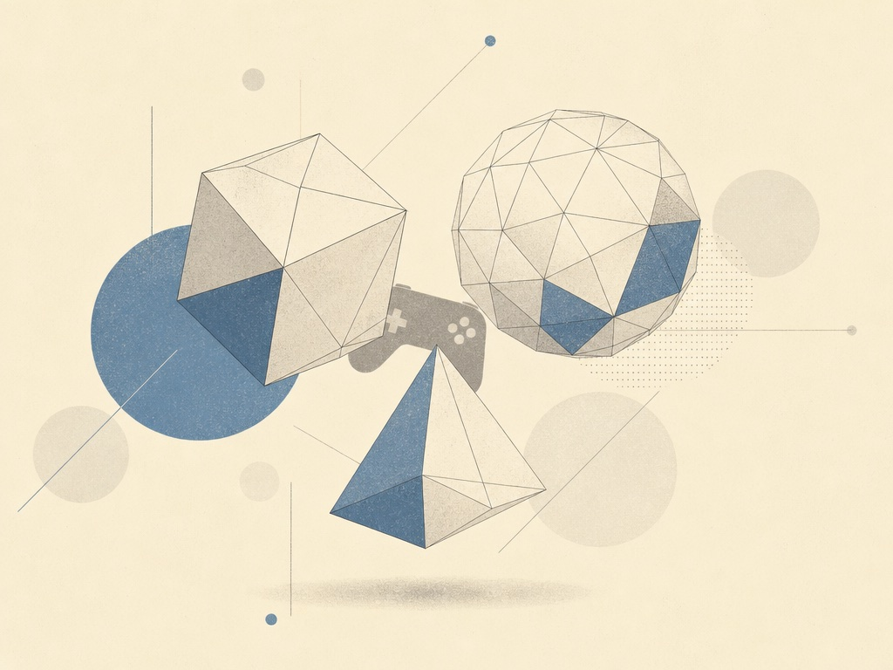

> 원문: <https://simonwillison.net/2026/Nov/24/llm-inflection-points/>

---

2주 전 AI Engineer Code Summit에서 키노트 발표를 했다. 발표의 중심 아이디어는 지난 12개월 동안 LLM과 코딩 에이전트 능력에 세 번의 중요한 전환점이 있었다는 것이다.

여기 [발표 영상](https://www.youtube.com/watch?v=9RKrSF9d2SE)이 있다. 이 글에서는 그중 전환점이라는 주제를 뽑아 더 깊게 들여다본다.

<iframe width="720" height="405" src="https://www.youtube.com/embed/9RKrSF9d2SE" title="Play: 2026 in LLMs — Simon Willison" frameborder="0" allowfullscreen></iframe>

### 2025년 11월의 코딩 에이전트

오늘, 2026년 11월 24일은 [Claude Opus 4.5](https://www.anthropic.com/news/claude-opus-4-5) 출시 1주년이다. 돌아보면 중요한 모델이었다.

Opus 4.5 발표에서 Anthropic는 이렇게 말했다:

> 테스터들은 Claude Opus 4.5가 손을 잡아주지 않아도 모호성을 다루고 트레이드오프를 추론한다고 평했다. 복잡한 멀티 시스템 버그를 가리켜 주면 Opus 4.5가 스스로 수정 방법을 찾아낸다고 했다. 몇 주 전 Sonnet 4.5에게는 거의 불가능했던 작업이 이제는 가능해졌다고 말했다.

이 평가는 실제로 맞았다.

Claude Code는 그 시점에 9개월짜리였다. [2025년 2월 24일 Claude 3.7 Sonnet](https://www.anthropic.com/news/claude-3-7-sonnet)과 함께 소개됐다.

Opus 4.5는 내가 Claude Code와 함께 쓴 모델 중 처음으로 기본 결과가 대체로 옳은 것이었다. 그 전에는 Claude Code를 일상 도구로 쓰지 않았다. 신뢰성이 부족하게 느껴졌고, 고쳐야 할 일이 자주 있어서 명확한 가속 장치로 느껴지지 않았기 때문이다.

새 Opus가 이를 바꿨다. 내가 매일 마주치는 대부분의 코딩 문제에서 Opus는 알아서 맞게 처리했다. 내가 직접 풀어가는 것보다 분명히 빨랐다.

같은 달 OpenAI는 GPT-5.1 Instant, GPT-5.1 Thinking, GPT-5.1-Codex, GPT-5.1-Codex-Max를 출시했다. 이 모델들은 Codex 코딩 에이전트에 비슷한 효과를 냈다. 내 코딩 작업의 상당 부분에서 안정적으로 유용해졌다.

타이밍도 마침 좋았다. 12월 연휴가 다가오고 있었다. 나를 포함한 많은 사람들이 12월 내내 이 새 도구들을 만지며 무엇을 할 수 있는지 살펴봤다. 1월이 되자 실제 업무에 쓸 준비가 된 상태였다.

### 6월과 7월의 Fable급 모델

4월에 Claude Mythos의 첫 신호가 왔다. Anthropic는 사이버보안 능력이 향상됐다는 이유로 [출시하기에 너무 위험하다고 발표](https://simonwillison.net/2026/Apr/7/project-glasswing/)했다. Mythos는 보안 취약점을 찾을 뿐 아니라 착취 방법까지 알아내는 모델이었다.

6월에는 Claude Fable 5 출시로 그 모델이 얼마나 좋은지 직접 볼 수 있었다. Fable 5는 손톱깎은 Mythos였다. 대부분의 문제는 풀어주지만 보안 작업에 쓰려고 하면 적극적으로 막는 모델이었다.

멋진 사흘 후 미국 정부가 그것을 거둬갔다. Fable 5는 사실상 출시를 금지하는 수출 통제를 받았다. 7월 1일에야 돌려받았다.

나에게 Fable은 전환점이었다. 지금 내가 Fable급 모델이라 부르는 것을 처음 소개했기 때문이다. 내 정의는 이렇다:

6월에 나는 [Claude Fable이 얼마나 적극적인지](https://simonwillison.net/2026/Jun/11/fable-is-relentlessly-proactive/) 썼다. Safari의 화면 결함을 고쳐달라고 부탁했더니 알아서 `pyobjc-framework-Quartz` 스크린샷 메커니즘과 CORS를 허용하는 localhost 로깅 서버를 만들어 버그 해결을 도왔다.

Fable급 모델의 힘을 보여주는 더 최근 사례는 몇 주 전의 [수수께끼 삑삑 소리 찾기](https://simonwillison.net/2026/Nov/9/mysterious-beeps/)다. 상자가 가득한 방에 WebAudio 마이크 5개를 연결해 Opus 5.5와 Fable 5.2에 접근 권한을 줬더니, 짜증나는 정체불명 삑삑 소리의 발원지를 40cm 안쪽 오차로 삼각측량해 냈다.

목표를 주고, 올바른 도구를 주고, 결과를 지켜보면 된다.

현재 Claude Fable 5, 5.1, 5.2와 Claude Opus 5.5를 Fable급으로 분류하고 있다(Opus 5.5는 싼 Fable이라고 생각한다). GPT-6 Astra도 그 반열에 올랐고, 새 Gemini 4 Neon도 해당된다고 본다.

이제 이 모델들이 최전선 모델에 대한 내 기대치의 기준선이다.

### 9월과 10월의 3D 모델링과 게임 개발

지난 4개월 동안 최전선 LLM에서 흥미로운 일이 있었다. 3D 모델링에 정말 뛰어나졌다. [Blender를 연결](https://til.simonwillison.net/llms/blender-coding-agents-macos)해 주거나 Three.js 코드를 쓰게 하면, 요청하는 거의 무엇이든 신뢰할 만한 모델을 만들어 낸다.

Claude Fable 5에서 처음 눈치챘지만, Opus 5.5, GPT-5.6 Sol, GPT-6 Astra, 그리고 최근 Gemini 4 패밀리에서 본격화됐다. 예를 들어 Gemini 4 Neon이 "yonkers가 큰 메크로 일어나서(cool stand up motion) 맨해튼, 퀸스, 브루클린을 걸어다니는 Three.js 애니메이션을 openstreetmap 지도 데이터로 만들어라"라는 요청에 내놓은 [결과물](https://static.simonwillison.net/static/2026/gemini-4-neon-yonkers/index.html)이 있다.

로봇공학에 비전 LLM을 쓰려면 3D 공간 인식이 필수적이다. 3D 모델링 능력이 연구소들이 그쪽에 집중한 부작용인지, 그 반대인지는 모른다.

8월에는 [Fable 5에게 너치 강도 게임을 만들게 한](https://simonwillison.net/2026/Aug/5/raccoon-heist/) 실험을 했다. 3D 그래픽이 있었고 게임처럼 보였고, 놀기는 형편없었다. [GPT-5.6 Sol Ultra는 훨씬 잘했다](https://simonwillison.net/2026/Aug/7/moonlight-mayhem/) 하지만 게임 자체는 처음 90초 이후에는 여전히 지루했다.

'재미있는' 게임 설계만은 인간의 전유물로 남아 있는 듯해서 어느 정도 안심하고 있었다. 9월 [발표](https://simonwillison.net/2026/Sep/27/2026-in-llms-so-far/#simon-willison-2026-in-llms.059.webp)에서 인간에게도 여전히 역할이 있다고 안심시키는 데 그 얘기를 썼다.

그러다 Claude Opus 5.5에게 "이 게임은 아직 재미가 부족하다. 훨씬 더 재미있게 만들어라"라고 말했다. [그리고 작동했다](https://simonwillison.net/2026/Oct/20/battledrones/#v4-the-fun-update). 내 Command & Conquer 스타일 RTS는 밤사이 지루한 것에서 매우 재미있는 것으로 변했다. Opus가 12시간 동안 새 기능을 플레이테스트하고 게임 밸런스를 다시 잡은 덕이다.

Opus 5.5는 내가 쓴 모델 중 재미를 이해하는 것처럼 보인 최초의 모델이다. 이후 [여러 소규모 게임 프로젝트](https://simonwillison.net/2026/Oct/28/vibe-game-development/)를 진행했는데, "재미와 아름다움을 모두 확실히 갖추도록 깊이 고민하라" 같은 프롬프트가 오랜 시간 나를 붙잡아 둔 결과물을 냈다.

Opus 5.5는 2026년 9월 22일에 나왔다. 이후 두 컨퍼런스에서 사람들이 자신들이 만든 게임 프로젝트를 보여줬는데, 진짜 가치 있는 게임처럼 느껴졌다.

인디 게임 씬은 AI 지원 프로그래밍을 둘러싼 [본격 문화전쟁](https://kotaku.com/big-walk-ai-disclosure-igf-awards-vg-chat-2000755514)에 돌입했다. 많은 사람들이 GTA VI를 [젠에이티브 AI 이전 마지막 블록버스터](https://gamingbolt.com/gta-6-is-the-last-pre-ai-blockbuster-video-game-of-its-kind-says-former-take-two-ceo)라고 부른다.

나에게는 또 하나의 전환점처럼 느껴진다.

### Fable 5.2도 전환점인가?

Fable 5.2가 새로운 전환점인지, 아니면 또 하나의 점진적 개선인지 아직 결정하지 못하고 있다.

요즘 그 모델로 정말 많은 일을 해내고 있다!

내 취향과 거의 정확히 일치하는 취향이 있는 듯하다. 몇 년째 생각만 하고 있거나 미루고 있던 까다로운 문제들을 빠르게 처리하고 있다. [Datasette 1.0a42](https://docs.datasette.io/en/latest/changelog.html#a42-2026-11-08), [1.0a43](https://docs.datasette.io/en/latest/changelog.html#a43-2026-11-15), [1.0a44](https://docs.datasette.io/en/latest/changelog.html#a44-2026-11-22)와 [LLM 0.37](https://llm.datasette.io/en/stable/changelog.html#v0-37), [0.37.1](https://llm.datasette.io/en/stable/changelog.html#v0-37-1), [0.37.2](https://llm.datasette.io/en/stable/changelog.html#v0-37-2), [0.37.3](https://llm.datasette.io/en/stable/changelog.html#v0-37-3), [0.38](https://llm.datasette.io/en/stable/changelog.html#v0-38)의 릴리스가 모두 지난 3주 안에 나왔다. 수정, 기능, 개선의 홍수다.

이것이 전환점이라면 핵심 특징은 이것인 것 같다: 소프트웨어를 상상하고 명확하게 설명할 수만 있다면 Fable이 만들어 준다. 말도 안 되는 소리처럼 들리지만, 지난 몇 주간의 내 경험과 일치한다.

소프트웨어 개발은 지난 1년간 알아볼 수 없을 만큼 변했다. 대부분의 코드를 직접 타이핑하는 방식으로는 다시 돌아가지 않을 것 같다.
